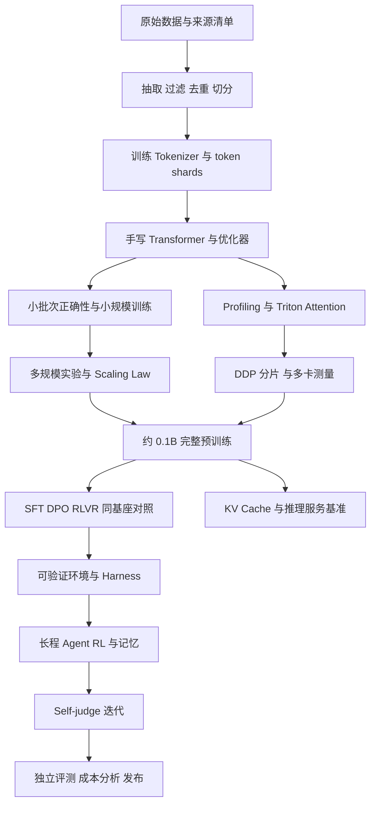

# 01 · 导读与工程

[阅读说明](../README.md) · [完整手册](../大模型全链路知识手册.md) · [下一册：数据与分词](02_数据与分词.md)

> 从原始语料、Tokenizer、约 0.1B Transformer，到 Triton、多卡系统、Scaling Law、SFT／DPO／RLVR、可验证环境、长程 Agent 与 self-judge 闭环。
>
> 编写日期：2026-10-11。
>
> 本文是一份教学与实验手册。模型配置、训练预算、任务设计和验收门槛中标为“教学建议”的内容，是为这条路线设计的方案；论文结论与官方接口附来源。代码分为可独立运行的参考实现、依赖 GPU 的教学实现、需要自行补齐项目接口的伪代码，章节中分别说明。

<a id="contents"></a>

## 目录

- [0. 目标、路线与交付物](#chapter-0)
- [1. 先修知识与统一符号](#chapter-1)
- [2. 工程环境、目录与可复现记录](#chapter-2)
- [3. 从 raw dump 到训练数据](02_数据与分词.md#chapter-3)
- [4. 从零实现 Byte-level BPE Tokenizer](02_数据与分词.md#chapter-4)
- [5. 从零实现约 0.1B Transformer](03_模型与预训练.md#chapter-5)
- [6. 预训练目标、优化器与训练循环](03_模型与预训练.md#chapter-6)
- [7. 算力、显存与训练预算核算](04_资源推理与测量.md#chapter-7)
- [8. 采样、KV Cache 与推理服务](04_资源推理与测量.md#chapter-8)
- [9. 性能测量与优化方法](04_资源推理与测量.md#chapter-9)
- [10. 手写 Triton Attention 内核](05_Triton与多卡.md#chapter-10)
- [11. 多卡训练与多卡推理](05_Triton与多卡.md#chapter-11)
- [12. 拟合 Scaling Law 并外推](06_Scaling与评测.md#chapter-12)
- [13. 评测与可信实验设计](06_Scaling与评测.md#chapter-13)
- [14. SFT：学习示范与交互协议](07_SFT与DPO.md#chapter-14)
- [15. DPO：从偏好对学习](07_SFT与DPO.md#chapter-15)
- [16. RLVR：从可验证结果学习](08_RLVR与对照.md#chapter-16)
- [17. 同一基座的 SFT／DPO／RLVR 对照](08_RLVR与对照.md#chapter-17)
- [18. 可验证环境与奖励设计](09_环境与Harness.md#chapter-18)
- [19. Harness：把模型接入行动循环](09_环境与Harness.md#chapter-19)
- [20. 长程 Agent 的训练与信用分配](10_长程Agent与SelfJudge.md#chapter-20)
- [21. Self-judge 与自我改进闭环](10_长程Agent与SelfJudge.md#chapter-21)
- [22. 发布、服务、观测与回滚](11_发布实战与排错.md#chapter-22)
- [23. 全链路实战安排与验收](11_发布实战与排错.md#chapter-23)
- [24. 排错索引与常见误解](11_发布实战与排错.md#chapter-24)
- [附录 A. 实验记录与报告模板](12_模板公式与参考.md#appendix-a)
- [附录 B. 公式速查与术语表](12_模板公式与参考.md#appendix-b)
- [附录 C. 参考资料与证据边界](12_模板公式与参考.md#appendix-c)

---

<a id="chapter-0"></a>
## 0. 目标、路线与交付物

### 0.1 最终要掌握什么

这条路线训练的是完整的判断能力：能够解释一个模型为什么学得动、为什么跑得慢、为什么评测变好、为什么奖励上涨却任务失败。最后应能把“模型、数据、系统、优化目标、环境、评测”放到同一套实验记录中，定位增益来自哪里。

需求中的每一项对应一个可检查的产物：

| 需求 | 必须完成的产物 | 验收依据 |
| --- | --- | --- |
| 从零写 Tokenizer | 训练器、编码器、解码器、词表与 merge 文件 | Unicode round-trip、特殊 token、吞吐、压缩率 |
| 从零写 Transformer | 自定义线性层、Embedding、RMSNorm、RoPE、Attention、SwiGLU、LM | 形状、梯度、因果性、参数量、过拟合小批次 |
| 端到端训练约 0.1B | 自有预训练 checkpoint 与完整日志 | 数据谱系、验证 loss、恢复训练、生成样例 |
| Triton attention kernel | tiled forward、online softmax、backward、Autograd 接口 | 输出／梯度误差、速度、峰值显存 |
| 多卡训练与推理收益 | 单卡、2 卡、4 卡的实验报告 | 固定工作量、全局 token/s、延迟、成本、扩展效率 |
| 从 raw dump 洗语料 | 原始清单、抽取、过滤、去重、切分、token shards | 每阶段保留率、抽检、污染检测、数据消融 |
| Scaling Law | 多规模实验、拟合、留出验证与外推区间 | 外推误差、残差、bootstrap、预算约束 |
| 同基座 SFT／DPO／RLVR | 共享初始 checkpoint 的对照分支 | 相同测试集、明确数据与总计算成本 |
| 可验证环境与 harness | task、tools、state、verifier、trace、runner | oracle 能解、空操作失败、重放一致、假通过审计 |
| 长程 Agent | 多轮训练轨迹与长程测试 | 多步成功、异常恢复、记忆消融、训练／推理一致 |
| self-judge loop | actor／judge 迭代与外部锚点评测 | 判官校准、假阳性、客观任务增益、停止标准 |

### 0.2 主线与扩展线

**主线固定一个自己训练的约 0.1B 基座。** 本手册的默认模型有 97,536,768 个独立可训练参数，属于约 0.1B。所有核心后训练实验从同一个冻结的预训练 checkpoint 出发，保持 Tokenizer 和架构一致。

小模型可以完成格式学习、短算术、受控工具选择和简单多步流程，但一般不具备大模型的开放域知识与复杂代码能力。主线先在可生成、可验证、可调难度的任务中验证学习过程。扩展线允许使用 1.5B～8B 等更大开源模型探索复杂 Agent 任务；扩展线内部重新固定同一基座，独立报告结果，不能把它的成绩算作自训 0.1B 的成绩。[R07](12_模板公式与参考.md#r07)、[R08](12_模板公式与参考.md#r08)

### 0.3 推荐的依赖顺序



先把一条最小链路跑通，再扩大数据和系统规模。最小链路是：一小份原始文本 → 512～2K 词表 → 1M～5M 模型 → 几百训练步 → 自回归采样 → 一个整数算术 verifier。它能暴露接口问题，不能替代后续 0.1B 实验。

### 0.4 三种知识要分开记录

1. **恒等式与接口事实**：例如矩阵乘法 FLOPs、DPO loss、当前框架要求。用推导或官方资料核验。
2. **经验规律**：例如更大 batch 的最佳学习率、某个数据过滤器的收益。必须限定模型、数据、预算。
3. **教学设定**：例如本手册的词表 16K、12 层、2B token 目标。它们是起点，不是普适最优值。

Stanford CS336 的基础、系统、规模、数据、后训练五部分提供了这条路线的系统参照。[R01](12_模板公式与参考.md#r01)～[R06](12_模板公式与参考.md#r06) 自学时要核对仓库年份和 commit：课程首页与单个作业 README 可能来自不同年份，禁止跨版本拼接适配器、测试和超参数。

<a id="chapter-1"></a>
## 1. 先修知识与统一符号

### 1.1 最少需要的数学

| 知识 | 在本路线中的用途 | 建议练习 |
| --- | --- | --- |
| 矩阵乘法与转置 | QKV、输出投影、FFN、梯度 | 手算 `(B,T,d) @ (d,h)` 的输出形状 |
| 链式法则 | softmax、交叉熵、Attention backward | 推导 `dS=P*(dP-row_sum(P*dP))` |
| 对数与指数 | log-prob、logsumexp、缩放律 | 解释为何不能先 softmax 再直接 log |
| 概率分布与期望 | 采样、RL、KL | 比较 greedy、temperature、top-p |
| 方差与置信区间 | 实验重复、bootstrap、组优势 | 计算二值奖励 `[1,0,0,0]` 的均值／标准差 |
| 最优化 | AdamW、学习率调度、曲线拟合 | 区分参数更新与权重衰减 |
| 算法复杂度 | BPE、去重、Attention | 区分计算复杂度和 HBM 读写量 |

### 1.2 张量符号

| 符号 | 含义 | 本手册默认值或单位 |
| --- | --- | --- |
| `B` | 当前设备 micro-batch 的序列数 | 以实际显存确定 |
| `T` | 一条序列的 token 长度 | 主预训练 1024 |
| `V` | 总词表大小，含特殊 token | 16,384 |
| `d` | hidden dimension | 768 |
| `L` | Transformer 层数 | 12 |
| `h` | Query head 数 | 12 |
| `d_h` | 每头维度 `d/h` | 64 |
| `d_ff` | SwiGLU 中间维度 | 2048 |
| `N` | 独立参数数；缩放律中口径要固定 | 97,536,768 |
| `D` | 实际消费的训练 token 数 | 与独特 token 数另列 |
| `C` | 训练计算量 | FLOPs |
| `W` | data-parallel world size | 1、2、4 |
| `A` | 梯度累积 micro-step 数 | 按全局 batch 计算 |
| `G` | 每个 RL prompt 的 rollout 数 | 建议从 4 或 8 开始 |
| `x,y` | prompt 与 response | response 含终止 token 时明确说明 |

模型张量主约定为 `hidden: [B,T,d]`、`Q/K/V: [B,h,T,d_h]`、`logits: [B,T,V]`。本文 attention mask 中 **True 表示允许关注**。这不等于所有库的 mask 约定；接入外部算子时必须检查。

### 1.3 稳定的 logsumexp

对向量 `z`：

$$
\operatorname{LSE}(z)=m+\log\sum_i e^{z_i-m},\quad m=\max_i z_i.
$$

这让最大指数为 1，避免大正数溢出。全为 `-inf` 的行需要特殊处理；不能计算 `-inf-(-inf)`。在因果语言模型中每个有效 query 至少允许关注自己，因此有效行不应全被 mask。

### 1.4 梯度与 Autograd 的边界

“从零实现”可以使用 PyTorch 张量运算、`nn.Parameter`、模块注册和 Autograd。关键是自己写出算法，不能直接用 `nn.Linear`、内置 Attention、现成 Tokenizer 或完整 Trainer 替代学习目标。进入性能对照时应加入成熟库作为参考基线。

手写 Triton kernel 不会自动获得 PyTorch 梯度。训练需要 `torch.autograd.Function` 的 backward 或显式注册的梯度规则；只有 forward 的快 kernel 不能直接替换训练 Attention。

<a id="chapter-2"></a>
## 2. 工程环境、目录与可复现记录

### 2.1 环境选择

正文 shell 示例统一使用 **Linux／WSL2 Bash**，Python 算法示例跨平台。多卡 NCCL、常见 vLLM 部署和 Triton 教学实验优先在 Linux CUDA 环境完成。Windows 端可以编写与调试纯 Python、CPU 模型、数据逻辑；选择 Triton Windows 移植时需要单独核对支持矩阵，不能默认等同 Linux。[R19](12_模板公式与参考.md#r19)～[R22](12_模板公式与参考.md#r22)

WSL2 中把高频读写的数据放到 Linux 文件系统内，避免训练时持续跨 `/mnt/...` 读取大量小文件。租用 Linux 机器时，先传代码和小样本，完成 smoke test，再传大数据。

建议分三个锁定环境，减少依赖互相冲突：

| 环境 | 工作 | 主要依赖 |
| --- | --- | --- |
| `data` | WARC、抽取、过滤、去重、BPE | Python、NumPy、regex、WARC 解析器、正文抽取器 |
| `train` | scratch 模型、Triton、DDP | PyTorch、匹配 CUDA 的 Triton、NumPy |
| `rollout` | 推理服务、Agent rollout | vLLM 或自写生成器、环境服务、任务依赖 |

先选与显卡驱动兼容的 PyTorch wheel，再选择被该组合支持的 Triton／推理引擎版本。不要把某篇旧作业中的 `flash-attn` 版本直接安装到另一套 PyTorch 中。

```bash
# 环境准备示意：PyTorch 安装命令需按官方支持矩阵选择。
python -m venv .venv
source .venv/bin/activate
python -m pip install numpy scipy regex pytest
python -m pip freeze > requirements.lock.txt
nvidia-smi
```

`requirements.lock.txt` 只锁 Python 包，还要记录驱动、CUDA runtime、GPU 型号、系统镜像、编译器和仓库 commit。

### 2.2 建议的实验仓库

下面是需要建设的项目结构，不表示本文附带了这个完整仓库：

```text
lm_lab/
├── configs/              # 模型、数据、训练、评测、后训练配置
├── src/
│   ├── tokenizer/        # BPE train / encode / decode / serialize
│   ├── data/             # raw -> clean -> split -> token shards
│   ├── model/            # scratch modules / attention / KV cache
│   ├── kernels/          # Triton forward / backward
│   ├── optim/            # AdamW / schedules
│   ├── distributed/      # DDP / sharding / collective benchmarks
│   ├── posttrain/        # SFT / DPO / RLVR
│   ├── envs/             # tasks / tools / verifiers
│   ├── harness/          # runner / context / memory / replay
│   └── eval/             # metrics / bootstrap / reports
├── tests/                # 算法正确性与关键协议测试
├── scripts/              # 每个实验的入口
├── manifests/            # 数据、模型、环境版本与 hash
├── artifacts/            # Tokenizer / checkpoints / traces / reports
└── runs/                 # 每次运行独立目录
```

### 2.3 先定义模块合同

| 模块 | 输入 | 输出 | 必须固定的合同 |
| --- | --- | --- | --- |
| 文本抽取 | 原始响应、headers、来源 | `Document` | 编码策略、正文规则、失败理由 |
| BPE | UTF-8 字符串 | token IDs | special IDs、merge 顺序、预分词规则 |
| 数据采样 | shards、seed、消费游标 | `input_ids, labels, loss_mask` | 切分、shuffle、跨文档策略 |
| LM | token IDs、positions、attention mask | logits | mask 语义、RoPE 排列、输出 dtype |
| Trainer | batch、模型、optimizer | checkpoint、日志 | 归一化、累积、token 计数 |
| Rollout | prompt、policy version、sampling | response、logprobs、trace | 真实上下文、终止原因、采样分布 |
| Verifier | task、最终产物、受信状态 | reward、diagnostics | 超时、解析失败、缺失测试均明确 |
| Harness | task、tools、模型接口、预算 | episode trace | 行动协议、上下文处理、停止条件 |

全链路最常见的错误来自合同不一致，而不是矩阵公式本身：训练使用一套 chat template，rollout 使用另一套；采样含 EOS，log-prob mask 排除了 EOS；工具输出被误当成模型输出参加 RL loss。

### 2.4 运行清单

每个 `run_id` 至少保存：

```json
{
  "run_id": "pretrain_097m_seed0_example",
  "git_commit": "填写真实 commit",
  "config_sha256": "填写真实 hash",
  "tokenizer_sha256": "填写真实 hash",
  "dataset_manifest_sha256": "填写真实 hash",
  "initial_checkpoint_sha256": null,
  "seed": 0,
  "precision": "fp32 weights + bf16 autocast",
  "world_size": 1,
  "hardware": "填写 GPU 型号、互联、CPU、内存、磁盘",
  "tokens_seen": 0,
  "unique_tokens_estimate": 0,
  "status": "planned"
}
```

seed 需要覆盖 Python、NumPy、PyTorch CPU、各 GPU 以及数据采样器。初始权重应跨 rank 一致；数据 seed 通常按 rank 划分。严格确定性可能降低性能，而且部分 CUDA 运算仍有约束；报告可复现程度和误差范围。

### 2.5 三道正确性关卡

1. **CPU 小张量**：验证算法、边界、梯度，能逐项检查。
2. **单 GPU 小模型**：验证 dtype、Autograd、显存、异步计时、恢复训练。
3. **多 GPU 小模型**：验证采样互斥、通信、全局归一化、rank 行为，再放大。

每次只引入一个主要变化。一个同时更换数据、Tokenizer、优化器、kernel 和学习率的实验，即使变快变好，也无法解释原因。
