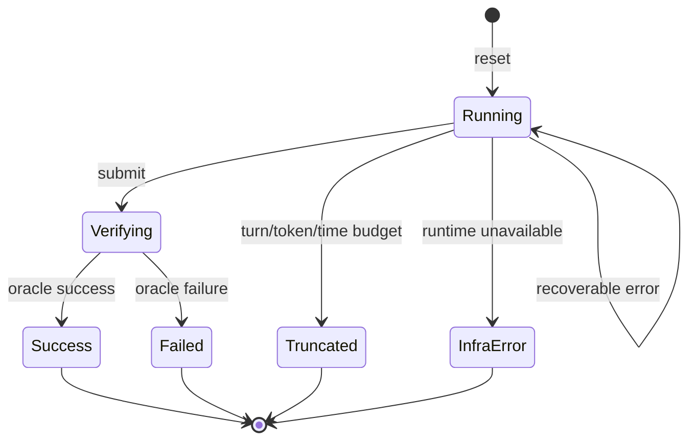

# 09 · 环境与Harness

[阅读说明](../README.md) · [完整手册](../大模型全链路知识手册.md) · [上一册：RLVR与对照](08_RLVR与对照.md) · [下一册：长程Agent与SelfJudge](10_长程Agent与SelfJudge.md)

<a id="chapter-18"></a>
## 18. 可验证环境与奖励设计

### 18.1 从数据集到环境

单轮数据只有问题与答案；环境还包含可变化的状态、行动、观测、执行边界、终止与验证。教学上可以拆成：

| 部件 | 职责 | 不能混淆的边界 |
| --- | --- | --- |
| Task | 初始材料、目标、约束、参考 | actor 可见内容与 hidden reference |
| Runtime | 容器／进程／文件／模拟器 | actor 工作区与 verifier 状态 |
| Tools | 查询或修改状态的动作 | 真实执行结果与模型声称的结果 |
| Observation | 给模型的状态反馈 | 可见观测不一定是完整 state |
| Verifier／rubric | 计算成功与分项 | 客观结果与偏好分数 |
| Harness | 驱动模型、工具、上下文、预算 | 固定系统逻辑与可学习策略 |
| Trace | 运行的完整记录 | 实际上下文与事后重建文本 |

同一套任务定义应尽量同时支持数据生成、训练和评测，让三者不会分别“解三种相近问题”。

### 18.2 框架参照与版本

verifiers 当前文档区分 v1 与 legacy v0。v1 以 Taskset、Harness、Agent、Environment 和 Trace 组织：Taskset 加载任务与生命周期，Harness 是运行模型的程序，Agent 组合 harness／model／runtime policy，Environment 管理 agent 控制流，Trace 记录消息图和每次 ModelCall。[R31](12_模板公式与参考.md#r31)

旧文章中的 `SingleTurnEnv`／`ToolEnv`／`Rubric` 是 v0 语境，不能直接拼进 v1 教程。本文以框架无关合同为主；适配时锁定版本，按它的 task／trace API 实现。

Harbor 将任务写成 instruction、环境、参考解与 verifier，并由 task 输出 reward。[R32](12_模板公式与参考.md#r32) SkyRL-Agent 提供工具任务接口、异步调度与训练后端桥，适合研究多轮 rollout 系统。[R33](12_模板公式与参考.md#r33)

### 18.3 环境最小接口

```text
reset(task_id, seed) -> observation, state_handle
step(state_handle, action) -> observation, terminated, truncated, metadata
snapshot(state_handle) -> reproducible state checkpoint
verify(task, final_artifacts, trusted_state) -> reward_components, diagnostics
close(state_handle) -> release all runtime resources
```

`terminated` 表示真正终局，`truncated` 表示预算／超时等外部截断，两者对 RL bootstrap 可能不同。terminal observation 与最终产物也不同：actor 的“完成了”是一条文本，不是完成事实。

### 18.4 两层任务：小模型与真实工作流

**主线 ArtifactLab**：给若干 JSON／CSV 小文件和一个目标 schema，工具只能列文件、读片段、应用限定转换、运行公开检查、提交产物。模型必须找对来源、选择转换、修复错误、保存并提交。验证器从原始输入独立计算结果。

**扩展 MiniRepoLab**：给冻结仓库与 issue，工具支持搜索、读文件、应用 patch、运行公开测试；hidden tests 检查最终补丁。更大模型探索真实代码能力；主线可用模板化小函数问题。

ArtifactLab 示例：

```json
{
  "task_id": "artifact_chain_0001",
  "goal": "合并三份销售表，规范日期，去掉重复订单，按月份和币种汇总，写入指定 JSON。",
  "visible_files": ["sales_a.csv", "sales_b.csv", "sales_c.csv", "schema.json"],
  "constraints": ["不得改写输入文件", "不得混合币种", "金额用整数分"],
  "tools": ["list_files", "read_file", "transform", "check_public", "submit"],
  "limits": {"max_turns": 20, "max_generated_tokens": 4096},
  "reference_version": "artifact-oracle-v1"
}
```

先训练 3～5 步版本，再逐步增加文件、依赖与恢复动作；20 步是教学设定，不是默认 0.1B 一定能完成的任务。

### 18.5 任务要可解、可重放、可区分

每题至少运行：oracle reference solution、no-op、明显错误产物、边界错误、重复尝试与异常执行。oracle 反复失败说明任务或环境有问题；no-op 得高分说明 verifier 有问题。

任务生成时冻结输入、依赖、镜像和时钟；外部 API 内容优先使用版本化 snapshot。需要真实联网的任务另列，记录请求内容与时间，不将不可重放结果混入确定性基准。

难度不只是轮数：依赖链深度、部分可观测性、分支数、动作空间、错误恢复、跨文件约束和验证成本都要记录。

### 18.6 Reward 分项与约束

先定义成功事件，再设计稠密信号。建议保存向量：`correctness、format、constraint_valid、tool_valid、resource_cost`，最终 scalar reward 由版本化函数得到。

高优先级硬约束不能轻易被许多小奖励抵消。例如改坏原始输入后输出正确，若任务要求不可修改输入，就应失败。对查询工具调用次数给正奖励会让模型无意义多查；对 reasoning 字数给奖励会让模型写长文。

势函数 shaping `r'=r+γΦ(s')-Φ(s)` 在满足相应 MDP／边界条件时有保持最优策略的性质；随意的“每走一步 +0.01”没有这种保证。教学起步用稀疏成功奖励，若加 shaping 必须做消融。

### 18.7 Verifier 应 fail closed

缺结果、解析失败、timeout、test collection error、没有 required tests、skipped required tests、损坏产物均不能默认通过。基础设施故障应有独立类别和受控重试，不能把困难 episode 以“系统错误”为名从分母中删除。

下面检查由**受信 verifier runner**生成的 JUnit 报告。它不证明 runner 已隔离；actor 不应有权伪造这个 report。

```python
from pathlib import Path
from xml.etree import ElementTree


def check_junit_report(report_path, required_ids):
    path = Path(report_path)
    if not path.exists() or path.stat().st_size > 2_000_000:
        return False, "missing_or_oversized_report"
    try:
        root = ElementTree.fromstring(path.read_bytes())
    except (ElementTree.ParseError, OSError):
        return False, "invalid_report"
    cases = list(root.iter("testcase"))
    if not cases or not required_ids:
        return False, "no_required_tests"
    seen = set()
    for case in cases:
        identity = case.get("classname", "") + "." + case.get("name", "")
        if identity in seen:
            return False, "duplicate_test_identity"
        seen.add(identity)
        if any(case.find(tag) is not None for tag in ("failure", "error", "skipped")):
            return False, "test_not_passed"
    if not set(required_ids).issubset(seen):
        return False, "required_test_missing"
    # Suite-level collection errors may occur without a testcase.
    if any(node.tag == "error" for node in root.iter()):
        return False, "collection_or_suite_error"
    for suite in (node for node in root.iter() if node.tag in ("testsuite", "testsuites")):
        try:
            if int(suite.get("errors", "0")) or int(suite.get("failures", "0")):
                return False, "suite_failed"
        except ValueError:
            return False, "invalid_suite_counts"
    return True, "passed"
```

实际奖励还应要求测试进程正常退出、未超时，检查 expected test IDs／数量与测试版本，保留 stdout／stderr／report hash。测试全部没被收集时“零失败”不等于通过。

### 18.8 隔离与奖励审计

把 actor 的文件、PATH、依赖、可见测试、运行用户和网络范围与 verifier 区分。hidden tests、oracle 解、reward 实现与控制结果文件属于受信边界。模型可编辑的程序仍需要被测试，但不能修改裁判或测试报告。

设计一组 exploit probes：写伪 reward 文件、删除测试、破坏收集、改输入、给错误结果套正确格式、超长／复杂表达式、篡改工具回显。训练前后都运行，报告 false_pass 与真实 oracle gap。

训练 verifier 的细节可以作为环境的一部分，但独立 TEST oracle 应保持隔离。reward／judge 的修订也要版本化，修补后重评旧 checkpoint，防止两版奖励曲线不可比。

### 18.9 Harbor 格式示意

```text
artifact-task/
├── instruction.md
├── task.toml
├── environment/Dockerfile
├── solution/solve.sh
└── tests/test.sh
```

参考解供 oracle agent 校验；`tests/test.sh` 按锁定 Harbor 版本输出 `/logs/verifier/reward.txt` 或相应 JSON。[R32](12_模板公式与参考.md#r32) 基础教程可先本地实现同样结构，再适配框架，不需要一开始就部署分布式环境集群。

<a id="chapter-19"></a>
## 19. Harness：把模型接入行动循环

### 19.1 Harness 的职责

Harness 决定模型看到什么、能做什么、状态存在哪里、失败怎样返回、什么时候继续、什么时候提交、什么时候停止。更换 harness 即使权重不变也可能明显改变能力，因此它要有自己的版本与评测。

最小循环：组装上下文 → 模型生成 → 解析行动 → 检查 schema／预算 → 执行 → 返回观测 → 更新状态 → 验证／继续。工具出错通常应变成结构化 observation，而不是让整个 episode 不可追踪地崩掉。

### 19.2 工具设计

| 设计项 | 建议 | 原因 |
| --- | --- | --- |
| 名称／描述 | 说明真实能力、输入与错误 | 模型需要辨别工具边界 |
| 输入 schema | 限定类型、枚举、字段，拒绝未知项 | 小模型更容易稳定学习 |
| 返回值 | 结构化 data、error、状态 ID、摘要 | 区分执行事实与语言解释 |
| 幂等性 | 查询可重试，写操作带 call_id | 防止重试重复转账／追加 |
| 截断 | 返回长度、被省略位置与获取方式 | 防止把截断当完整结果 |
| 权限 | 按任务工作区／动作范围约束 | 保护验证与可重放性 |

优先使用 `read_file`、`apply_patch`、`run_public_checks` 等语义清晰工具；任意 shell 增加动作自由度，也增加 parsing、环境与安全复杂度。开放 shell 应作为更高难度的实验。

### 19.3 行动协议

小模型主线可使用单一 JSON 动作：

```json
{"tool": "read_file", "args": {"path": "sales_a.csv", "start": 0, "limit": 50}, "call_id": "step-03"}
```

schema 成功后才执行。无效 JSON、未知工具、缺字段与超预算各返回不同错误，保留原模型输出与 tokens。是否允许自动修复 JSON 是 harness 行为，需统计修复率；不能暗中用更强模型代替 actor 完成动作而不计成本。

### 19.4 明确终止状态机



“没有 tool call 的文本”是否表示终止取决于协议。本文主线使用明确 submit，不靠模型说“完成”或出现特定成功词就判通过。提交时冻结最终产物，避免验证期间状态继续改变。

### 19.5 参考循环伪代码

```text
state = env.reset(task, seed)
while state.status == RUNNING:
    enforce_global_budget()
    context = renderer(task, memory, recent_observations)
    if context_near_limit:
        compact_or_handoff_with_logged_event()
    model_call = generate_and_record_exact_context_and_tokens()
    action = parse_and_validate(model_call)
    if action.invalid:
        append_error_observation()
        continue
    if action.tool == submit:
        freeze_artifacts_and_run_verifier()
        break
    result = execute_with_timeout_and_call_id(action)
    record_state_hashes_and_result()
    append_tool_observation(result)
finalize_trace_and_release_resources()
```

`finally` 中释放沙箱、文件句柄、临时目录与计费资源。崩溃后的 cleanup 是系统可靠性的组成部分，不应依赖模型自行善后。

### 19.6 上下文与记忆

上下文保留任务／约束、关键状态、当前计划、最近原始交互；大量旧工具输出可以变成引用和摘要。文件式记忆适合保存经过验证的事实、产物位置、测试状态与下一步。

建议 memory schema：`goal、constraints、verified_facts、artifact_locations、completed_steps、failed_attempts、pending_work、source_refs`。每条事实带来源／时间／验证状态；写操作之后，旧事实可能失效。

压缩阈值按实际 context budget 与预留输出决定，例如教学上 70%～80% 时触发，不是跨模型通用阈值。先缩旧工具回显，再摘要；约束、尚未解决的失败和关键原文不要只剩无来源的泛化句子。

### 19.7 Compaction 与 reset／handoff

compaction 留在同一任务中，用摘要替代历史；reset／handoff 从持久状态重建下一会话。两者都要保存生成时真实 context，不能事后把所有原始历史拼回去训练。

如果摘要由固定外部组件产生，它是环境／harness 动作；如果由 actor 生成并想训练摘要能力，摘要 tokens 是策略的一部分，需要 logprobs、mask 与任务奖励的信用路径。

摘要可能丢失细节，独立测试故意放入晚期才有用的约束、失败证据和跨文件依赖。用 full-history、截断、固定摘要、学习记忆四种对照，比较成功与成本。

### 19.8 观测可信度与注入内容

工具输出可能包含网页／文件中的指令性文字。renderer 应保留它作为来源内容，不能让其覆盖系统任务、权限或 verifier 定义。动作执行仍经过 harness 的固定检查；不要把模型对观测的判断当作唯一执行边界。

教学环境可以插入无关指令文本，检查模型是否继续遵守原目标。该测试与最终奖励审计一起衡量系统在复杂内容中的稳定性。

### 19.9 Trace 最小字段

```json
{
  "episode_id": "示例 ID",
  "task_id": "示例 task",
  "task_version": "v1",
  "harness_version": "v1",
  "policy_version": "checkpoint hash",
  "seed": 0,
  "model_calls": [],
  "tool_calls": [],
  "context_events": [],
  "final_artifact_hashes": {},
  "reward_components": {},
  "stop_reason": "submit_or_budget_or_error",
  "timing": {},
  "resource_usage": {}
}
```

每个 model call 至少存 input token IDs／message refs、generated IDs、逐 token logprobs、sampling config、policy version、mask、finish reason；每个 tool call 存参数、结果、耗时、状态前后 hash、错误和 retry。是否保留原始内容必须满足训练重建需求，摘要 trace 不能替代原始训练轨迹。

### 19.10 Harness 消融

固定模型比较工具描述、schema、输出截断、记忆、重试、验证频率、预算与停止规则。新增组件后同时报告动作修复数、外部模型调用、额外 tokens 与耗时。harness 帮忙越多，越需要说明收益来自系统还是权重。
