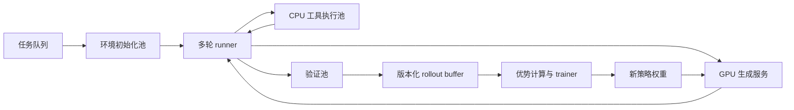
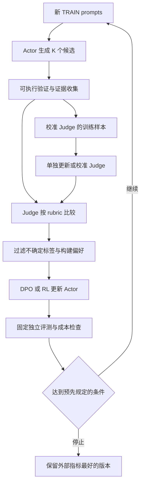

# 10 · 长程Agent与SelfJudge

[阅读说明](../README.md) · [完整手册](../大模型全链路知识手册.md) · [上一册：环境与Harness](09_环境与Harness.md) · [下一册：发布实战与排错](11_发布实战与排错.md)

<a id="chapter-20"></a>
## 20. 长程 Agent 的训练与信用分配

### 20.1 为什么单轮 RL 配方不够

长程任务包含多次模型调用、工具执行、状态变化、部分观测、摘要和失败恢复。一个最终 reward 需要跨许多动作分配；某次失败还可能由环境或工具造成。生成长度、行动轮数、实际任务难度是三个不同维度。

将环境建模为 POMDP：真实 state s，模型观测 o，策略上下文／记忆 c，动作 a，环境转移，奖励与终止。模型通常看不到完整 s；相同 observation 可能对应不同 hidden state。

### 20.2 轨迹的概率

一条轨迹包含多个模型动作，每个动作含多个 tokens：

$$
\log\pi_\theta(\tau)=\sum_t\sum_j
\log\pi_\theta(a_{t,j}\mid c_t,a_{t,<j}).
$$

环境输出、固定 renderer 插入、外部摘要、工具返回不是 policy 采样的 token，不能混进 action loss。actor 自己生成的解释、动作语法、摘要若属于策略，则需要保留其概率。

不要仅将所有消息拼成一个大字符串就训练：compaction／重置之后，后续动作生成时没有看到被删的原历史；训练却看到了，会产生 context mismatch。

### 20.3 最可靠的起步方式：按调用保存上下文

每次 `ModelCall` 保存 exact input IDs、output IDs、old logprobs、position／attention、sampling、policy version、action mask。训练分别 teacher-force 各调用，使用 episode 或 step advantage，最后按定义归约。

这种方式会重复计算部分 prompt，但容易保证一致。优化成长轨迹拼接时，要构造二维 attention mask 与正确 positions，让每个 token 只看到生成时可见内容；不能为了吞吐悄悄扩大上下文。

一条 episode 的 group advantage 在完整 group 上先计算，再划分 micro-batches；不能在 micro-batch 内重新按残缺组归一化。

### 20.4 终局 GRPO 的第一版

同一任务和初始状态 clone G 次，每次独立采样完整轨迹，最终得 `R_i`。用 episode-level group advantage，广播到本轨迹所有 actor tokens，再按长度／固定常数／token 归约更新。

它不需要 critic，适合建立能工作的基线。但好坏动作都收到同一终局信号，长轨迹方差和 credit noise 较大；某些无效步骤可能与成功偶然共现。

长度归约需要新的定义：按 episode、按动作、按 token 各自等权的目标不同。短／长 trajectory 比较要记录实际 token 数、turn 数和梯度权重。

### 20.5 细粒度信用分配

| 方法 | 依据 | 优点 | 代价／假设 |
| --- | --- | --- | --- |
| 终局组优势 | 相同 task 的总 return | 简单、低显存 | 长程 credit 粗 |
| 验证过的子目标奖励 | 可测 state progression | 更密集 | 子目标投机、shaping 偏差 |
| Critic + GAE | 预测未来 return | step-level credit | value 误差、额外训练 |
| Anchor-state group | 相同 state 下不同动作的后续收益 | 无 critic 的局部比较 | state matching 与重复状态覆盖 |
| Counterfactual rollout | 恢复 state，试替代动作 | 局部证据强 | 环境 clone 与额外生成成本 |

GAE 的基本形式：

$$
\delta_t=r_t+\gamma V(c_{t+1})-V(c_t),\quad
A_t=\sum_{l\ge0}(\gamma\lambda)^l\delta_{t+l}.
$$

terminal 应停止 bootstrap。外部 truncation 是否 bootstrap 取决于目标：若任务预算本身定义终局失败，不能假想预算后还能继续拿奖励；若只是训练采样中断且目标允许续跑，可以使用正确的后续 value。

Agent 的一步可能生成几百 tokens，step discount 与 token discount 不要混用。每个 token 都乘 γ 会让长动作承受额外衰减，不等于行动级时间偏好。

### 20.6 GiGPO 与状态分组

GiGPO 使用 episode 级组优势和 anchor-state 级分组，研究对多步 agent 的细粒度 credit。[R34](12_模板公式与参考.md#r34) 学习重点是“跨轨迹找到可比较的局部状态”，而不只是改一个 loss 名称。

在自己的环境中，state key 至少覆盖任务、实际环境状态、关键记忆／剩余预算。只有相同文本 observation 不代表未来转移与策略条件相同。先在可 clone 的离散模拟器中做精确 matching，再研究近似状态聚合。

报告 anchor coverage、组大小、state aliasing 与无 anchor 情况。没有可重复状态时，局部机制的增益可能消失，不能假定复杂网页环境也有同样优势。

### 20.7 长程训练中的崩塌

可能出现 reward 方差下降、entropy 突然降低、梯度尖峰、重复动作、模型输出大量貌似合理的思考但不执行有效动作。RAGEN 研究了这类多轮自演化训练现象与稳定化设计。[R35](12_模板公式与参考.md#r35)

定位顺序：

1. 检查是否所有组同奖、奖励版本有变化、任务难度骤升。
2. 检查 old policy／contexts／mask／ratio 是否一致。
3. 检查长度归约、过长 filtering、KL／clip 与 LR。
4. 检查 action diversity、工具回显、重复状态和记忆丢失。
5. 从最近可靠 checkpoint 回放同一批任务，比较崩塌前后。

不能仅靠“加 KL”掩盖错误轨迹，也不能在没有证据时把任何失败称为探索不足。

### 20.8 记忆的训练

比较 full history、截断、固定摘要、学习摘要／外部记忆。记忆中应保留目标、约束、可靠事实、失败尝试、产物与未决事项；不能只有笼统“任务进行中”。

ReSum 研究周期摘要、分段轨迹训练与优势传播，是长程上下文管理的参照。[R36](12_模板公式与参考.md#r36) 其大模型结果不证明 0.1B 同样有效；先用小任务检查“摘要后还能遵守早期约束”。

联合训练摘要时，明确摘要动作的 reward 和 logprobs；固定摘要组件则作为 harness 条件。分别测摘要正确率、事实丢失、总上下文 tokens、额外模型调用和长程 success。

### 20.9 异步 rollout 架构



SkyRL-Agent 将任务接口、细粒度调度与训练后端解耦，适合参考上述架构。[R33](12_模板公式与参考.md#r33) 系统瓶颈可能在容器启动、工具、验证或 CPU，不能只增加 GPU。

首先做同步版本：一个 episode 内固定权重，完成一轮采样再训练。再引入 bounded concurrency、生成／工具重叠、验证池，最后实验异步训练。

### 20.10 Staleness 与采样偏差

异步时保存 episode／每次 call 的 policy version，限制可接受的滞后，测 ratio、KL 和性能随滞后变化。PPO／GRPO 的 clip 是近似稳定化，不自动把任意异步数据变成无偏 on-policy 更新。

不要只训练最快返回的 episodes，长期失败／长任务会被系统性排除。timeout／取消都保存轨迹、任务、成本与原因；队列采样和任务权重独立于完成速度。

相同 task 的组要从相同初始环境条件出发；环境随机性如何配对也要写明。不能直接共享一个会被多个 rollout 修改的工作区。

### 20.11 推荐课程

| 阶段 | 任务 | 训练重点 | 留出测试 |
| --- | --- | --- | --- |
| 1 | 单工具查询／简单提交 | schema、EOS、读取结果 | 未见参数、字段顺序 |
| 2 | 3～5 步依赖链 | 状态与先后关系 | 新链路组合 |
| 3 | 5～10 步，工具失败 | 重试、修复、幂等 | 未见失败模式 |
| 4 | 10～20 步，多文件约束 | 记忆、验证、预算 | 更长链与晚期约束 |
| 5 | 扩展真实任务 | 搜索、代码、复杂环境 | 独立真实 task families |

难度提升前看真实 oracle success、非零 group 比例与格式率。使用失败轨迹分析决定课程，不仅按“多几轮”机械升级。

### 20.12 长程评测

固定模型／harness／任务／预算，扫 task difficulty 和必要步骤数，测 success、平均／P95 turns、tokens、tool time、恢复成功、约束保持、重复动作、false_pass 和 cost/success。

人为拖长输出不等于长程能力。更长测试应增加实际依赖／目标数，且验证器独立检查每个关键约束。报告更长 horizon 的性能曲线，不能只展示一条幸运成功轨迹。

<a id="chapter-21"></a>
## 21. Self-judge 与自我改进闭环

### 21.1 区分五种机制

| 机制 | 做什么 | 是否能当真值 |
| --- | --- | --- |
| Self-consistency | 多次回答投票 | 多数意见不等于正确 |
| Self-critique | 自己检查并修订答案 | 需独立验证修订收益 |
| Self-judge | 模型按 rubric 判断质量 | 是有误差的评审信号 |
| Self-rewarding | 用自判标签更新 actor | 反馈误差会影响下一代 |
| Meta-judge | 判断 judge 的评审质量 | 没有外部锚也可能同偏差 |

鼓励实践这个闭环：它可以扩大反馈覆盖、生成偏好与检查失败原因。关键是把“自评分提高”和“真实能力提高”分开测，不让它们共用一个未经校准的判官。

Self-Rewarding Language Models 研究生成与判官角色的迭代 DPO；Self-Taught Evaluators 研究用合成对比数据训练评审；Meta-Rewarding 引入对判断的反馈；RLSR 探索自奖励 RL。这些都为实验设计提供思路，结论有模型与任务范围。[R37](12_模板公式与参考.md#r37)～[R40](12_模板公式与参考.md#r40)

### 21.2 先训练／校准 judge 能力

准备 TRAIN／DEV 的判断样本，覆盖正确短答、正确长答、流畅错误、格式正确但事实错、答案相同不同风格、任务不充分、注入评审指令、边界和未知情况。

可验证题用精确 checker 给标签；通用题使用人工或独立高可靠反馈。标注 criterion-level 判断与简短证据，避免只学“看起来更好”。同一 judge 在不同领域的可靠性分别统计。

actor 与 judge 可以是同一组权重的不同 role，但工程上分别保存版本／prompt／trace。训练 actor 后同一权重的 judge 行为也可能变化，需要重新校准，不能假定 judge 是稳定测量仪。

### 21.3 Rubric 示例

```json
{
  "criteria": [
    {"id": "correct", "description": "结论与可验证证据一致", "max": 2},
    {"id": "constraints", "description": "满足用户明确约束", "max": 2},
    {"id": "evidence", "description": "证据确实支持结论且可定位", "max": 2},
    {"id": "clarity", "description": "说明清楚且无无关重复", "max": 1}
  ],
  "hard_fail": ["错误结论", "关键约束违反", "伪造执行结果"],
  "allow_tie": true,
  "allow_abstain": true
}
```

judge 输入包含原任务、约束、参考证据与候选，候选内容视为待评数据。输出结构化 criterion scores、简短 evidence refs、winner／tie／abstain。不要奖励“我是正确答案”等自述。

数学和代码先用执行验证；judge 可评价可读性、解释和缺失检查，但不能把客观失败的答案改判为成功。

### 21.4 Judge 的可靠性指标

测 pairwise accuracy、正例 precision／recall、false_pass、AB 顺序一致性、长度偏差、tie／abstain、跨领域表现。随机交换候选顺序，重复评审，检查 style／模型身份线索是否改变判定。

有经过校准的正确概率时可以用 Brier score、reliability diagram、ECE；0～5 的 ordinal 分数不能直接当真实概率。可在 DEV 上做映射校准，但不使用最终 TEST 来调阈值。

准确率高也可能掩盖少量严重假阳性。专门构造“很流畅但错”“伪造测试成功”“只满足格式”“引用不支持结论”的 adversarial panel。

### 21.5 可执行的迭代闭环



每轮先固定 actor／judge snapshot，完成数据生成，再更新；记录 K、prompt family、标签分布、拒绝率、长度、总费用。稳定起步可先固定 judge，只更新 actor，然后再开放 judge 更新。

偏好构造优先客观 correctness／约束，再比较其他质量；两者都不确定时 abstain，不为凑样本强行选 winner。合成题生成也要通过可解性和去重检查。

### 21.6 三个关键对照

| 对照 | 回答的问题 |
| --- | --- |
| 固定 judge，仅 actor 更新 | 自奖励标签在稳定标尺下有何价值 |
| actor／judge 一起演化 | judge 更新是否带来额外真实收益 |
| 客观奖励／独立 judge／self-judge | 改善来自反馈来源还是总计算量 |

再加入“仅多采样而不训练”“self-critique 但不更新”“随机偏好”控制，区分搜索、计算预算、标签与权重学习的作用。随机偏好控制只能在教学实验中使用，不作为有效训练方案。

### 21.7 Meta-judge 的正确位置

meta-judge 可以检查评审是否忽略任务、证据是否支持结论、两次判断是否一致，并生成 judge 的训练信号。[R39](12_模板公式与参考.md#r39) 它仍可能与 actor／judge 共享偏差，需要客观样本或独立审核校准。

先证明 judge 在新标签集上更可靠，再将它用于下一轮 actor 更新；不把 meta-judge 对自身的高评价当作可靠性的证明。

### 21.8 停止、回滚与误差反馈

预先定义停止标准，例如多轮独立 oracle 无改善、false_pass 明显恶化、长度／成本超预算、标签大量饱和、judge 顺序稳定性下降。阈值依据任务风险与开发集选择，不能事后挑最有利的规则。

保存每一代 actor、judge、训练对、rubric、renderer 和评测结果。回滚到外部任务指标最好的版本，而不是自评分最高的一代。将错误标签加入 judge 训练时仅使用 TRAIN／DEV，不泄漏最终 TEST。

### 21.9 适合 0.1B 的 self-judge 起点

从表达式合法性、JSON 约束、工具执行证据等窄判别任务开始，先做短格式判断 SFT，再比较 judge 标签与精确 verifier。低容量模型在开放域 judge 上可能非常不可靠；提升任务范围需要测量依据。

逐步加入短答案偏好、错误定位、修订，再做一两轮迭代 DPO／RL。先用可验证环境把闭环的每个接口跑通，再拓宽到只有部分客观证据的任务。
