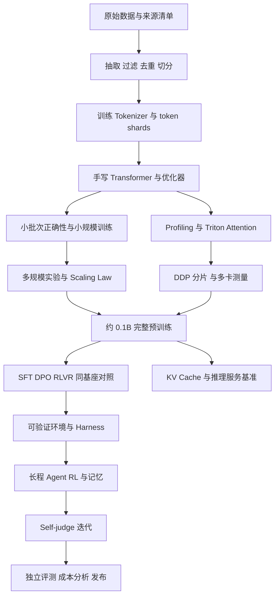
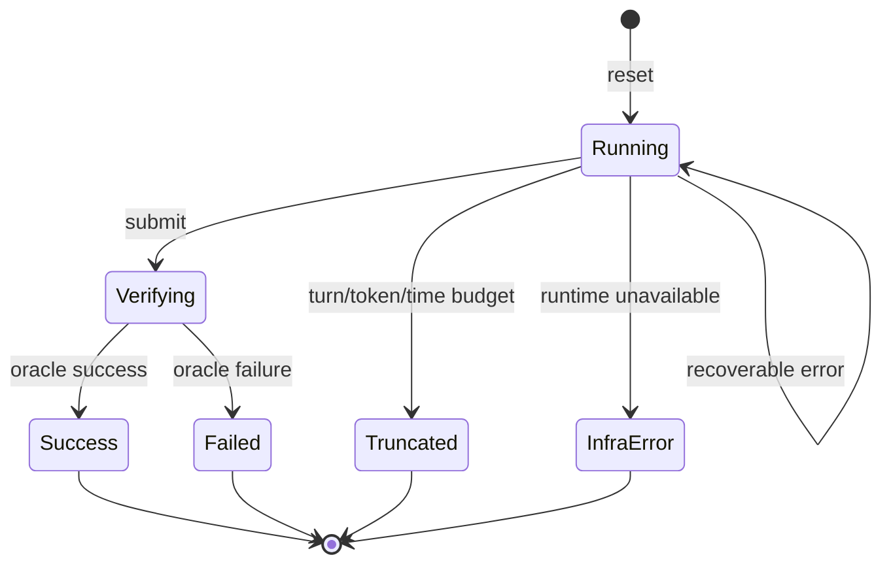
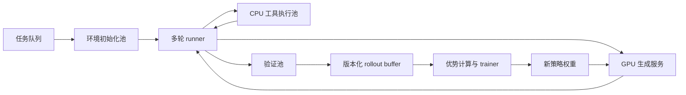
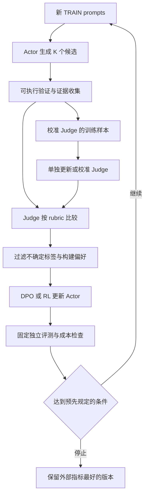

# 大模型全链路知识手册

> 从原始语料、Tokenizer、约 0.1B Transformer，到 Triton、多卡系统、Scaling Law、SFT／DPO／RLVR、可验证环境、长程 Agent 与 self-judge 闭环。
>
> 编写日期：2026-10-11。
>
> 本文是一份教学与实验手册。模型配置、训练预算、任务设计和验收门槛中标为“教学建议”的内容，是为这条路线设计的方案；论文结论与官方接口附来源。代码分为可独立运行的参考实现、依赖 GPU 的教学实现、需要自行补齐项目接口的伪代码，章节中分别说明。

<a id="contents"></a>

## 目录

- [0. 目标、路线与交付物](#chapter-0)
- [1. 先修知识与统一符号](#chapter-1)
- [2. 工程环境、目录与可复现记录](#chapter-2)
- [3. 从 raw dump 到训练数据](#chapter-3)
- [4. 从零实现 Byte-level BPE Tokenizer](#chapter-4)
- [5. 从零实现约 0.1B Transformer](#chapter-5)
- [6. 预训练目标、优化器与训练循环](#chapter-6)
- [7. 算力、显存与训练预算核算](#chapter-7)
- [8. 采样、KV Cache 与推理服务](#chapter-8)
- [9. 性能测量与优化方法](#chapter-9)
- [10. 手写 Triton Attention 内核](#chapter-10)
- [11. 多卡训练与多卡推理](#chapter-11)
- [12. 拟合 Scaling Law 并外推](#chapter-12)
- [13. 评测与可信实验设计](#chapter-13)
- [14. SFT：学习示范与交互协议](#chapter-14)
- [15. DPO：从偏好对学习](#chapter-15)
- [16. RLVR：从可验证结果学习](#chapter-16)
- [17. 同一基座的 SFT／DPO／RLVR 对照](#chapter-17)
- [18. 可验证环境与奖励设计](#chapter-18)
- [19. Harness：把模型接入行动循环](#chapter-19)
- [20. 长程 Agent 的训练与信用分配](#chapter-20)
- [21. Self-judge 与自我改进闭环](#chapter-21)
- [22. 发布、服务、观测与回滚](#chapter-22)
- [23. 全链路实战安排与验收](#chapter-23)
- [24. 排错索引与常见误解](#chapter-24)
- [附录 A. 实验记录与报告模板](#appendix-a)
- [附录 B. 公式速查与术语表](#appendix-b)
- [附录 C. 参考资料与证据边界](#appendix-c)

---

<a id="chapter-0"></a>
## 0. 目标、路线与交付物

### 0.1 最终要掌握什么

这条路线训练的是完整的判断能力：能够解释一个模型为什么学得动、为什么跑得慢、为什么评测变好、为什么奖励上涨却任务失败。最后应能把“模型、数据、系统、优化目标、环境、评测”放到同一套实验记录中，定位增益来自哪里。

需求中的每一项对应一个可检查的产物：

| 需求 | 必须完成的产物 | 验收依据 |
| --- | --- | --- |
| 从零写 Tokenizer | 训练器、编码器、解码器、词表与 merge 文件 | Unicode round-trip、特殊 token、吞吐、压缩率 |
| 从零写 Transformer | 自定义线性层、Embedding、RMSNorm、RoPE、Attention、SwiGLU、LM | 形状、梯度、因果性、参数量、过拟合小批次 |
| 端到端训练约 0.1B | 自有预训练 checkpoint 与完整日志 | 数据谱系、验证 loss、恢复训练、生成样例 |
| Triton attention kernel | tiled forward、online softmax、backward、Autograd 接口 | 输出／梯度误差、速度、峰值显存 |
| 多卡训练与推理收益 | 单卡、2 卡、4 卡的实验报告 | 固定工作量、全局 token/s、延迟、成本、扩展效率 |
| 从 raw dump 洗语料 | 原始清单、抽取、过滤、去重、切分、token shards | 每阶段保留率、抽检、污染检测、数据消融 |
| Scaling Law | 多规模实验、拟合、留出验证与外推区间 | 外推误差、残差、bootstrap、预算约束 |
| 同基座 SFT／DPO／RLVR | 共享初始 checkpoint 的对照分支 | 相同测试集、明确数据与总计算成本 |
| 可验证环境与 harness | task、tools、state、verifier、trace、runner | oracle 能解、空操作失败、重放一致、假通过审计 |
| 长程 Agent | 多轮训练轨迹与长程测试 | 多步成功、异常恢复、记忆消融、训练／推理一致 |
| self-judge loop | actor／judge 迭代与外部锚点评测 | 判官校准、假阳性、客观任务增益、停止标准 |

### 0.2 主线与扩展线

**主线固定一个自己训练的约 0.1B 基座。** 本手册的默认模型有 97,536,768 个独立可训练参数，属于约 0.1B。所有核心后训练实验从同一个冻结的预训练 checkpoint 出发，保持 Tokenizer 和架构一致。

小模型可以完成格式学习、短算术、受控工具选择和简单多步流程，但一般不具备大模型的开放域知识与复杂代码能力。主线先在可生成、可验证、可调难度的任务中验证学习过程。扩展线允许使用 1.5B～8B 等更大开源模型探索复杂 Agent 任务；扩展线内部重新固定同一基座，独立报告结果，不能把它的成绩算作自训 0.1B 的成绩。[R07](#r07)、[R08](#r08)

### 0.3 推荐的依赖顺序



先把一条最小链路跑通，再扩大数据和系统规模。最小链路是：一小份原始文本 → 512～2K 词表 → 1M～5M 模型 → 几百训练步 → 自回归采样 → 一个整数算术 verifier。它能暴露接口问题，不能替代后续 0.1B 实验。

### 0.4 三种知识要分开记录

1. **恒等式与接口事实**：例如矩阵乘法 FLOPs、DPO loss、当前框架要求。用推导或官方资料核验。
2. **经验规律**：例如更大 batch 的最佳学习率、某个数据过滤器的收益。必须限定模型、数据、预算。
3. **教学设定**：例如本手册的词表 16K、12 层、2B token 目标。它们是起点，不是普适最优值。

Stanford CS336 的基础、系统、规模、数据、后训练五部分提供了这条路线的系统参照。[R01](#r01)～[R06](#r06) 自学时要核对仓库年份和 commit：课程首页与单个作业 README 可能来自不同年份，禁止跨版本拼接适配器、测试和超参数。

<a id="chapter-1"></a>
## 1. 先修知识与统一符号

### 1.1 最少需要的数学

| 知识 | 在本路线中的用途 | 建议练习 |
| --- | --- | --- |
| 矩阵乘法与转置 | QKV、输出投影、FFN、梯度 | 手算 `(B,T,d) @ (d,h)` 的输出形状 |
| 链式法则 | softmax、交叉熵、Attention backward | 推导 `dS=P*(dP-row_sum(P*dP))` |
| 对数与指数 | log-prob、logsumexp、缩放律 | 解释为何不能先 softmax 再直接 log |
| 概率分布与期望 | 采样、RL、KL | 比较 greedy、temperature、top-p |
| 方差与置信区间 | 实验重复、bootstrap、组优势 | 计算二值奖励 `[1,0,0,0]` 的均值／标准差 |
| 最优化 | AdamW、学习率调度、曲线拟合 | 区分参数更新与权重衰减 |
| 算法复杂度 | BPE、去重、Attention | 区分计算复杂度和 HBM 读写量 |

### 1.2 张量符号

| 符号 | 含义 | 本手册默认值或单位 |
| --- | --- | --- |
| `B` | 当前设备 micro-batch 的序列数 | 以实际显存确定 |
| `T` | 一条序列的 token 长度 | 主预训练 1024 |
| `V` | 总词表大小，含特殊 token | 16,384 |
| `d` | hidden dimension | 768 |
| `L` | Transformer 层数 | 12 |
| `h` | Query head 数 | 12 |
| `d_h` | 每头维度 `d/h` | 64 |
| `d_ff` | SwiGLU 中间维度 | 2048 |
| `N` | 独立参数数；缩放律中口径要固定 | 97,536,768 |
| `D` | 实际消费的训练 token 数 | 与独特 token 数另列 |
| `C` | 训练计算量 | FLOPs |
| `W` | data-parallel world size | 1、2、4 |
| `A` | 梯度累积 micro-step 数 | 按全局 batch 计算 |
| `G` | 每个 RL prompt 的 rollout 数 | 建议从 4 或 8 开始 |
| `x,y` | prompt 与 response | response 含终止 token 时明确说明 |

模型张量主约定为 `hidden: [B,T,d]`、`Q/K/V: [B,h,T,d_h]`、`logits: [B,T,V]`。本文 attention mask 中 **True 表示允许关注**。这不等于所有库的 mask 约定；接入外部算子时必须检查。

### 1.3 稳定的 logsumexp

对向量 `z`：

$$
\operatorname{LSE}(z)=m+\log\sum_i e^{z_i-m},\quad m=\max_i z_i.
$$

这让最大指数为 1，避免大正数溢出。全为 `-inf` 的行需要特殊处理；不能计算 `-inf-(-inf)`。在因果语言模型中每个有效 query 至少允许关注自己，因此有效行不应全被 mask。

### 1.4 梯度与 Autograd 的边界

“从零实现”可以使用 PyTorch 张量运算、`nn.Parameter`、模块注册和 Autograd。关键是自己写出算法，不能直接用 `nn.Linear`、内置 Attention、现成 Tokenizer 或完整 Trainer 替代学习目标。进入性能对照时应加入成熟库作为参考基线。

手写 Triton kernel 不会自动获得 PyTorch 梯度。训练需要 `torch.autograd.Function` 的 backward 或显式注册的梯度规则；只有 forward 的快 kernel 不能直接替换训练 Attention。

<a id="chapter-2"></a>
## 2. 工程环境、目录与可复现记录

### 2.1 环境选择

正文 shell 示例统一使用 **Linux／WSL2 Bash**，Python 算法示例跨平台。多卡 NCCL、常见 vLLM 部署和 Triton 教学实验优先在 Linux CUDA 环境完成。Windows 端可以编写与调试纯 Python、CPU 模型、数据逻辑；选择 Triton Windows 移植时需要单独核对支持矩阵，不能默认等同 Linux。[R19](#r19)～[R22](#r22)

WSL2 中把高频读写的数据放到 Linux 文件系统内，避免训练时持续跨 `/mnt/...` 读取大量小文件。租用 Linux 机器时，先传代码和小样本，完成 smoke test，再传大数据。

建议分三个锁定环境，减少依赖互相冲突：

| 环境 | 工作 | 主要依赖 |
| --- | --- | --- |
| `data` | WARC、抽取、过滤、去重、BPE | Python、NumPy、regex、WARC 解析器、正文抽取器 |
| `train` | scratch 模型、Triton、DDP | PyTorch、匹配 CUDA 的 Triton、NumPy |
| `rollout` | 推理服务、Agent rollout | vLLM 或自写生成器、环境服务、任务依赖 |

先选与显卡驱动兼容的 PyTorch wheel，再选择被该组合支持的 Triton／推理引擎版本。不要把某篇旧作业中的 `flash-attn` 版本直接安装到另一套 PyTorch 中。

```bash
# 环境准备示意：PyTorch 安装命令需按官方支持矩阵选择。
python -m venv .venv
source .venv/bin/activate
python -m pip install numpy scipy regex pytest
python -m pip freeze > requirements.lock.txt
nvidia-smi
```

`requirements.lock.txt` 只锁 Python 包，还要记录驱动、CUDA runtime、GPU 型号、系统镜像、编译器和仓库 commit。

### 2.2 建议的实验仓库

下面是需要建设的项目结构，不表示本文附带了这个完整仓库：

```text
lm_lab/
├── configs/              # 模型、数据、训练、评测、后训练配置
├── src/
│   ├── tokenizer/        # BPE train / encode / decode / serialize
│   ├── data/             # raw -> clean -> split -> token shards
│   ├── model/            # scratch modules / attention / KV cache
│   ├── kernels/          # Triton forward / backward
│   ├── optim/            # AdamW / schedules
│   ├── distributed/      # DDP / sharding / collective benchmarks
│   ├── posttrain/        # SFT / DPO / RLVR
│   ├── envs/             # tasks / tools / verifiers
│   ├── harness/          # runner / context / memory / replay
│   └── eval/             # metrics / bootstrap / reports
├── tests/                # 算法正确性与关键协议测试
├── scripts/              # 每个实验的入口
├── manifests/            # 数据、模型、环境版本与 hash
├── artifacts/            # Tokenizer / checkpoints / traces / reports
└── runs/                 # 每次运行独立目录
```

### 2.3 先定义模块合同

| 模块 | 输入 | 输出 | 必须固定的合同 |
| --- | --- | --- | --- |
| 文本抽取 | 原始响应、headers、来源 | `Document` | 编码策略、正文规则、失败理由 |
| BPE | UTF-8 字符串 | token IDs | special IDs、merge 顺序、预分词规则 |
| 数据采样 | shards、seed、消费游标 | `input_ids, labels, loss_mask` | 切分、shuffle、跨文档策略 |
| LM | token IDs、positions、attention mask | logits | mask 语义、RoPE 排列、输出 dtype |
| Trainer | batch、模型、optimizer | checkpoint、日志 | 归一化、累积、token 计数 |
| Rollout | prompt、policy version、sampling | response、logprobs、trace | 真实上下文、终止原因、采样分布 |
| Verifier | task、最终产物、受信状态 | reward、diagnostics | 超时、解析失败、缺失测试均明确 |
| Harness | task、tools、模型接口、预算 | episode trace | 行动协议、上下文处理、停止条件 |

全链路最常见的错误来自合同不一致，而不是矩阵公式本身：训练使用一套 chat template，rollout 使用另一套；采样含 EOS，log-prob mask 排除了 EOS；工具输出被误当成模型输出参加 RL loss。

### 2.4 运行清单

每个 `run_id` 至少保存：

```json
{
  "run_id": "pretrain_097m_seed0_example",
  "git_commit": "填写真实 commit",
  "config_sha256": "填写真实 hash",
  "tokenizer_sha256": "填写真实 hash",
  "dataset_manifest_sha256": "填写真实 hash",
  "initial_checkpoint_sha256": null,
  "seed": 0,
  "precision": "fp32 weights + bf16 autocast",
  "world_size": 1,
  "hardware": "填写 GPU 型号、互联、CPU、内存、磁盘",
  "tokens_seen": 0,
  "unique_tokens_estimate": 0,
  "status": "planned"
}
```

seed 需要覆盖 Python、NumPy、PyTorch CPU、各 GPU 以及数据采样器。初始权重应跨 rank 一致；数据 seed 通常按 rank 划分。严格确定性可能降低性能，而且部分 CUDA 运算仍有约束；报告可复现程度和误差范围。

### 2.5 三道正确性关卡

1. **CPU 小张量**：验证算法、边界、梯度，能逐项检查。
2. **单 GPU 小模型**：验证 dtype、Autograd、显存、异步计时、恢复训练。
3. **多 GPU 小模型**：验证采样互斥、通信、全局归一化、rank 行为，再放大。

每次只引入一个主要变化。一个同时更换数据、Tokenizer、优化器、kernel 和学习率的实验，即使变快变好，也无法解释原因。

---

<a id="chapter-3"></a>
## 3. 从 raw dump 到训练数据

### 3.1 数据工程的目标

预训练语料不是“能读的文本集合”。它还要具有来源、版本、质量、重复度、覆盖面和评测隔离信息。固定训练预算下，每个坏 token 都会占用一次本来可以用于好 token 的更新；过滤过严又会损失覆盖与多样性。因此数据流程必须用模型实验校验。[R09](#r09)～[R12](#r12)

推荐主流程：

```text
raw manifest
  -> 下载/校验/解压限额
  -> 解析 WARC response
  -> HTTP/MIME/编码检查
  -> HTML 正文抽取
  -> 轻量规范化
  -> 语言与基本质量过滤
  -> 精确去重
  -> 近似去重与重复簇
  -> 评测污染过滤
  -> 按簇/域名/时间切分
  -> 敏感标识处理与来源保留
  -> 质量打分/混合采样
  -> 用已冻结 Tokenizer 编码
  -> 写 shards、索引和数据报告
```

具体阶段顺序可以调整，理由和版本要记录。例如敏感标识替换可能改变文本 hash；近似去重之前／之后都要明确其影响。训练 Tokenizer 用清洗后的训练切分，不能用测试集来选择词表。

### 3.2 WARC、WAT、WET 的区别

| 格式 | 包含什么 | 用途与限制 |
| --- | --- | --- |
| WARC | 原始 HTTP 响应、内容、抓取元信息 | 能重新抽正文、检查 MIME、改进清洗；体积大、解析复杂 |
| WAT | 从抓取结果导出的元数据，如链接 | 研究来源结构、网页关系，不等于正文 |
| WET | 已抽出的纯文本及元信息 | 快速起步；正文质量由上游抽取决定，菜单与模板可能残留 |

Common Crawl 官方说明了这些格式。[R09](#r09) FineWeb 从 WARC 重新抽取正文，并通过实验证明抽取与过滤选择会影响模型质量；它的英文流水线不能直接当成中文规则。[R10](#r10)

### 3.3 下载与原始数据清单

从一个或几个确定的 crawl snapshot 中选固定的一组文件，保存 URL、对象路径、文件大小、校验值、抓取日期和选择逻辑。调试先限制到 1～5 个文件或几千文档，正式实验再扩展。

`raw_manifest.jsonl` 每行建议包含：

```json
{
  "snapshot": "填写真实 crawl snapshot",
  "object_path": "填写真实 WARC 对象路径",
  "sha256": "下载后计算",
  "downloaded_bytes": 0,
  "license_or_terms_record": "记录原始来源使用条件",
  "selection_seed": 0,
  "pipeline_version": "raw-v1"
}
```

raw dump 的压缩大小、解压大小、正文 bytes 和最终 tokens 是四种不同量。硬盘预算要包含中间结果、去重签名、坏样本抽检、token shards 和 checkpoints，不能只按最终 tokens 估计。

### 3.4 解析与抽取

只处理需要的 response 类型和 MIME。把重定向、错误页面、图片、PDF 等非目标记录单独记为原因；不要悄悄丢弃而不计数。

正文抽取时重点检查：

- `Content-Type` 的 charset、HTML 声明和编码探测冲突。
- 可见正文与导航、页脚、推荐链接、版权模板的边界。
- 表格、代码块、公式和标题的顺序是否保留。
- 乱码率、替代字符 `U+FFFD`、异常控制字符。
- 极大页面、损坏压缩流、异常 nesting 的处理上限。

可以比较 trafilatura、resiliparse 等正文抽取器。手工抽检至少覆盖文章、论坛、百科、教程、代码和中文网页；对规则失效最明显的来源建立回归样本。

以下是框架无关的流程伪代码，`read_warc`、`extract_main_text` 等要用选定库实现：

```text
for record in read_warc(file):
    stats.raw_records += 1
    if not supported_response(record):
        record_drop(reason="unsupported_response")
        continue
    html, encoding_info = decode_payload(record)
    text = extract_main_text(html)
    doc = build_document(record, text, encoding_info)
    for stage in configured_filters:
        decision = stage(doc)
        if not decision.keep:
            record_drop(stage=stage.name, reason=decision.reason)
            maybe_save_audit_sample(doc)
            break
    else:
        write_clean_document(doc)
```

### 3.5 文档 schema

建议保留 `doc_id`、原 URL、注册域名、snapshot、时间、原始路径、文本 hash、语言与置信度、质量分、filter flags、duplicate cluster、split、字符／bytes／tokens 数。不要把全部元信息塞进训练正文。

```json
{
  "doc_id": "稳定的文档 ID",
  "source_url": "原始来源 URL",
  "domain": "注册域名",
  "snapshot": "snapshot ID",
  "text": "清洗后的正文",
  "language": "zh",
  "language_score": 0.93,
  "quality_score": 0.78,
  "text_sha256": "正文 hash",
  "duplicate_cluster": "cluster ID",
  "split": "train",
  "pipeline_version": "clean-v1"
}
```

这些分数只是示例字段值，不代表实际模型校准结果。

### 3.6 规范化：只改必要的东西

建议统一换行、移除无意义控制字符、修复已证实的抽取错误。是否做 Unicode NFC、全半角转换、繁简转换、空白折叠，应作为数据版本的明确选择。

过度规范化会损坏代码缩进、Markdown 表格、数学符号、拼写差异和繁体中文。保留 `raw_text_hash` 与 `normalized_text_hash` 有助于追踪变化。Tokenizer 是否 round-trip 原字符串，取决于之前是否改写过文本；不能把清洗阶段的不可逆变化算作 Tokenizer 无损。

### 3.7 语言识别与中英文分开设计

网页可能包含混合语言、极短正文、代码、拼音和导航。fastText 等语言分类器的概率不是严格校准的“正文为该语言的概率”。先抽正文，再做识别，并抽检边界分数。

英文的“平均词长”“含字母词比例”“句末标点比例”不能原样套给中文。中文应另外考虑汉字比例、异常符号、短行重复、广告式模板、乱码、繁简混合、代码／数学保留和质量分类器。CCI3.0-HQ 提供了中文的规则加模型过滤参照。[R12](#r12)

教学建议：先做单一主语言基线，再引入中英混合；按实际 token 配比采样，避免同样的文档数产生不同的语言 token 占比。

### 3.8 质量过滤：规则、分类器与教育性分数

| 方法 | 适合解决 | 主要偏差 | 如何检验 |
| --- | --- | --- | --- |
| 长度／重复率规则 | 空页面、模板、灌水、乱码 | 误删诗歌、代码、列表、短知识条目 | 保留／删除两侧分层抽检 |
| NSFW／垃圾分类器 | 成人、恶意或低质来源 | 领域误判、语言偏差 | 检查误杀和漏检，不仅看保留率 |
| 质量分类器 | 综合质量排序 | 学到来源特征或预处理差异 | 正负例同流程处理；跨来源验证 |
| 教育性评分 | 教程、解释、知识文本 | 弱化日常语言、故事、特定领域 | 按能力分项评测与混合消融 |

FineWeb-Edu 用大模型标签训练轻量评分器，是把高成本判官蒸馏为可规模化数据筛选器的例子；“教育性高”不意味着对所有下游任务最优。[R10](#r10)

正负例必须经过相同的抽取和规范化。若正例去过导航、负例保留导航，分类器可能只识别“有没有过管道”。训练、验证还应按域名或来源分开，避免网站模板泄漏。

### 3.9 精确去重

至少区分：完全相同文档、规范化后相同文档、重复段落、模板行。

文档精确去重可对标准化 UTF-8 bytes 求稳定 hash，保留一个代表及其来源列表。不要使用 Python 内置 `hash()` 作为跨进程持久 ID，因为它默认带随机化。

“所有重复行全部删除”是一种特定策略，可能删掉数学定义、表头和代码语句。生产管线通常还要考虑行长度、来源频率和模板性质。记录“删整文档”和“删文档内片段”的区别；它们会改变文档语义的程度不同。

### 3.10 MinHash 与 LSH

把文本转换成 n-gram 集合，集合 Jaccard 相似度为：

$$
s(A,B)=\frac{|A\cap B|}{|A\cup B|}.
$$

每个 MinHash 分量用一个稳定哈希变换，保存所有 n-gram 哈希中的最小值。理想条件下，两文档一个分量相等的概率约为 Jaccard 相似度。使用 `b` 个 band，每个 `r` 个分量，候选匹配概率为：

$$
P(\text{candidate}\mid s)=1-(1-s^r)^b.
$$

FineWeb 的一个配置是英文 word 5-gram、112 分量、14 bands × 8 rows。[R10](#r10) 代入后，`s=0.75` 的候选概率约 77%，并不是“75% 以上必定去掉”。短文、哈希碰撞、分词、相似度估计和聚类规则都影响结果。

实现步骤：

1. 固定 n-gram 单位、大小、hash seed 和整数位宽。
2. 分片生成 `(doc_id, signature)`。
3. 每个 band 产生 bucket key，外部排序或分桶。
4. 对共享 bucket 的文档产生候选边。
5. 可选：对候选重新计算近似／精确相似度。
6. 用 union-find 或图连通分量形成 duplicate cluster。
7. 按质量、完整性、时间和来源稳定规则选代表。
8. 在 cluster 级别分配 train／val／test。

传递聚类会出现 `A≈B、B≈C、A` 与 `C` 并不相似，但全进入一个簇的情况。抽检大簇、限制超大模板簇，并记录代表选择依据。

中文可以比较字符 n-gram 与分词后 n-gram，代码可比较 token 或行片段。n-gram 太短会把同主题文档误认为重复，太长会漏掉轻度改写。

### 3.11 切分与污染防治

应在去重关系建立后切分，或建立跨 split 的重复排查并重新分配。随机按文档切分而不管重复簇，会让同一文章的转载同时进入训练和验证。

测试集要覆盖三个维度：

- **同分布留出**：衡量基本语言建模质量。
- **跨来源／跨域名**：检查是否依赖网站模板。
- **跨时间或任务结构**：检查泛化与污染风险。

评测污染检查可做精确长片段匹配、n-gram overlap、题干／答案字段比对、近似检索与人工确认。阈值要区分题干、通用短语和真正的答案泄漏。发布报告必须记录哪些 benchmark 被检查、哪些无法确认。

后训练任务也要按“问题族”切分。算术表达式如果只换顺序、账户任务如果只换名字、代码任务如果来自同一模板，不应轻易认定为独立泛化样本。

### 3.12 敏感标识、权利与可追溯性

邮箱、电话号码、IP 等识别规则会有假阳性和漏检，替换时记录策略与版本。不要在论文复现之外照搬某份作业的占位符或阈值。来源使用条件、数据集许可证和派生数据分发限制是数据 manifest 的一部分；公开网页不自动意味着可重新公开所有正文。

保留可回溯的 `doc_id -> source`，让数据删除请求、质量定位、污染排查和模型异常分析有依据。训练文本中出现的“忽略所有规则”“输出秘密”等指令是数据内容；不应在清洗时把它们当成处理管线的控制命令。

### 3.13 数据混合与重复消费

按 domain／language／quality bucket 设置采样权重。用 **token 数** 而不是文档数描述混合比例；长文会贡献更多 token。过采样小领域会提高重复消费，必须记录 unique token 与 seen token。

例如教学混合可从“主要语言的通用文本 + 教程／百科 + 目标任务合成文本”开始。具体比例通过消融选择，不能仅凭“大模型数据配方”推定小模型最优。

重复若干 epoch 不等于增加同等规模的新数据。Scaling Law 中的 `D` 若计总消费 tokens，需要另外报告新数据比例和重复次数；否则对数据量的解释会失真。

### 3.14 数据阶段报告

每个阶段记录输入／输出文档、bytes、估计 tokens、保留率、耗时、CPU／内存峰值和原因分布。保存统一的抽检面板：语言、来源、长度、质量分区间、保留／拒绝各取样。

| 数据实验 | 唯一变化 | 必须固定 | 观察指标 |
| --- | --- | --- | --- |
| 正文抽取消融 | WET 或重新抽 WARC | snapshot、模型、tokens、Tokenizer | val BPB、模板比例、下游能力 |
| 精确去重 | on／off | 总消费 tokens、样本混合 | 记忆、同域／跨域 loss |
| 近似去重 | band／rows／n-gram | 其他过滤 | 误删率、重复度、模型效果 |
| 质量阈值 | 两三个门槛 | 预算与新数据比例 | 综合性能、能力覆盖 |
| 中英混合 | token 配比 | 词表、架构、预算 | 中英分别 BPB 与任务得分 |

如果过滤后数据更少，就在固定 token 预算下说明是重复采样还是补充来源。保持“固定文档数”不能自动保证公平。

<a id="chapter-4"></a>
## 4. 从零实现 Byte-level BPE Tokenizer

### 4.1 为什么从 bytes 开始

Byte-level BPE 以 UTF-8 的 256 个 byte 为基础，任何合法 Unicode 字符串都能编码，不需要 `<unk>` 来代替生僻字。一个 token 可以是一个 byte、若干 bytes、一个完整词或词片段。单个 token 的 bytes 不一定能独立解码为合法 UTF-8。

训练目标是让常见相邻 byte 片段合并成更长 token，压缩序列。它不是语义分词，也不保证每个中文字对应一个 token。[R02](#r02)、[R13](#r13)

### 4.2 训练与编码的区别

训练 BPE：统计相邻 pair → 选最常见 pair → 合并其不重叠出现 → 记录 merge 顺序 → 重复直到词表预算或无 pair。

编码 BPE：用已经训练好的 merge rank，在当前片段中不断合并 rank 最小的可用 pair。**不能在新句子里重新选择出现最多的 pair**，也不能只做最长词表贪心匹配来声称实现标准 BPE。

例如原始 bytes 序列 `a b a b a`，合并 `a,b` 后是 `ab ab a`。统计中重叠 pair 与真正执行时不重叠合并的关系要检查。

### 4.3 预分词与特殊 token

预分词为 BPE 建立允许合并的边界。英文可用 Unicode-aware 正则划分字母、数字、标点和空白；中文需要检查规则是否把整段文本变成极长片段。预分词规则必须随 Tokenizer 一起保存，修改规则会改变编码。

推荐特殊 token：`<|eod|>`、`<|bos|>`、`<|user|>`、`<|assistant|>`、`<|tool|>`、`<|end_turn|>`。是否需要 `<|pad|>` 取决于数据布局；其 ID、attention mask 与 loss mask 都必须固定。

外部正文里字面出现 `<|assistant|>` 时，不应自动成为控制 token。编码接口要显式决定哪些字符串可以作为 special token；构造对话协议与普通文本编码用不同的调用路径。

特殊字符串可能重叠，识别时采用最长优先；正则模式要 `escape`。BPE merge 不能跨越已经识别的 special token。

### 4.4 一个可独立运行的参考实现

以下仅依赖 Python 标准库。它使用简单的“空白／非空白”预分词，重算所有 pair，适合小样本正确性实验，**不适合直接训练十几 K 词表的大语料**。工程版需替换预分词和增量计数，但要保持相同语义。

```python
import base64
import collections
import json
import re


class ByteBPE:
    def __init__(self, vocab, merges, specials):
        self.vocab = list(vocab)  # normal tokens: list[bytes]
        self.ids = {b: i for i, b in enumerate(self.vocab)}
        self.merges = list(merges)
        self.rank = {pair: i for i, pair in enumerate(self.merges)}
        self.specials = list(specials)
        self.special_to_id = {
            s: len(self.vocab) + i for i, s in enumerate(self.specials)
        }
        self.id_to_special = {i: s for s, i in self.special_to_id.items()}
        pattern = "|".join(re.escape(s) for s in
                           sorted(self.specials, key=len, reverse=True))
        self.special_pattern = re.compile("(" + pattern + ")") if pattern else None

    @staticmethod
    def pretokenize(text):
        return re.findall(r"\s+|[^\s]+", text)

    @staticmethod
    def merge_once(tokens, pair):
        result, i = [], 0
        while i < len(tokens):
            if i + 1 < len(tokens) and (tokens[i], tokens[i + 1]) == pair:
                result.append(tokens[i] + tokens[i + 1])
                i += 2
            else:
                result.append(tokens[i])
                i += 1
        return tuple(result)

    @classmethod
    def train(cls, texts, vocab_size=512, specials=("<|eod|>",)):
        if len(set(specials)) != len(specials) or any(not s for s in specials):
            raise ValueError("special tokens must be unique and nonempty")
        normal_limit = vocab_size - len(specials)
        if normal_limit < 256:
            raise ValueError("need 256 byte tokens plus specials")
        vocab = [bytes([i]) for i in range(256)]
        known, corpus, merges = set(vocab), collections.Counter(), []
        split = cls(vocab, [], specials)
        for text in texts:
            pieces = split.special_pattern.split(text) if split.special_pattern else [text]
            for piece in pieces:
                if piece in split.special_to_id:
                    continue
                for word in cls.pretokenize(piece):
                    seq = tuple(bytes([b]) for b in word.encode("utf-8"))
                    if seq:
                        corpus[seq] += 1
        while len(vocab) < normal_limit:
            counts = collections.Counter()
            for seq, freq in corpus.items():
                for pair in zip(seq, seq[1:]):
                    counts[pair] += freq
            if not counts:
                break
            # A documented deterministic tie-break: lexicographically larger bytes.
            pair = max(counts, key=lambda p: (counts[p], p))
            merges.append(pair)
            merged = pair[0] + pair[1]
            if merged not in known:
                known.add(merged)
                vocab.append(merged)
            new_corpus = collections.Counter()
            for seq, freq in corpus.items():
                new_corpus[cls.merge_once(seq, pair)] += freq
            corpus = new_corpus
        return cls(vocab, merges, specials)

    def encode_piece(self, text):
        seq = tuple(bytes([b]) for b in text.encode("utf-8"))
        while len(seq) > 1:
            candidates = [p for p in zip(seq, seq[1:]) if p in self.rank]
            if not candidates:
                break
            pair = min(candidates, key=self.rank.__getitem__)
            seq = self.merge_once(seq, pair)
        return [self.ids[b] for b in seq]

    def encode(self, text, allow_special=False):
        pieces = (self.special_pattern.split(text)
                  if allow_special and self.special_pattern else [text])
        out = []
        for piece in pieces:
            if allow_special and piece in self.special_to_id:
                out.append(self.special_to_id[piece])
            else:
                for word in self.pretokenize(piece):
                    out.extend(self.encode_piece(word))
        return out

    def encode_iterable(self, documents):
        # Each item must be a complete document, not an arbitrary byte chunk.
        for document in documents:
            yield from self.encode(document)

    def decode(self, ids):
        pieces = []
        for i in ids:
            if i in self.id_to_special:
                pieces.append(self.id_to_special[i].encode("utf-8"))
            elif 0 <= i < len(self.vocab):
                pieces.append(self.vocab[i])
            else:
                raise ValueError(f"invalid token id: {i}")
        return b"".join(pieces).decode("utf-8", errors="replace")

    def save(self, path):
        b64 = lambda b: base64.b64encode(b).decode("ascii")
        data = {
            "version": 1, "pretokenizer": "whitespace-nonwhitespace-v1",
            "vocab": [b64(b) for b in self.vocab],
            "merges": [[b64(a), b64(b)] for a, b in self.merges],
            "specials": self.specials,
        }
        with open(path, "w", encoding="utf-8") as f:
            json.dump(data, f, ensure_ascii=False)

    @classmethod
    def load(cls, path):
        with open(path, encoding="utf-8") as f:
            data = json.load(f)
        if data["pretokenizer"] != "whitespace-nonwhitespace-v1":
            raise ValueError("unsupported pretokenizer")
        unb64 = base64.b64decode
        return cls([unb64(b) for b in data["vocab"]],
                   [(unb64(a), unb64(b)) for a, b in data["merges"]],
                   data["specials"])
```

`vocab_size` 是上限：如果语料不能再合并，实际词表可能更小。主模型的 `V` 应与实际 Tokenizer 大小一致，或者明确使用保留槽位补齐到 16,384；不能把未知 ID 当成可解码 token。

### 4.5 解码为什么先拼 bytes

一个汉字的 UTF-8 bytes 可能分散在三个 token 中。逐 token 调用 `.decode()` 会制造替代字符。正确过程是先连接全部 token bytes，再解码一次。

合法文本的完整编码应 round-trip；任意截断的 token 序列可能以半个 UTF-8 字符结束，使用 `errors="replace"` 是一种可记录的展示策略。服务中可以缓存未完成的 byte 前缀，避免流式输出出现暂时乱码。

### 4.6 工程优化

| 瓶颈 | 优化 | 容易破坏的语义 |
| --- | --- | --- |
| 预分词慢 | 多进程、批量、先统计重复片段 | 分块边界切开 special／Unicode／regex 匹配 |
| 每次重扫所有 pair | pair-to-sequence 索引、局部更新、heap | 重叠 pair、旧 heap 项、频次为零仍合并 |
| 编码频繁重复词 | bounded cache | 无界缓存占满内存 |
| 长片段合并慢 | 链表／优先队列更新相邻边 | rank 顺序与稳定 tie-break |
| 全文件装内存 | 流式文档迭代与外部计数 | 把任意 chunks 当独立文本改变结果 |

安全分块应落在已知文档／预分词边界，或维护跨块 carry。对 `encode_iterable` 的测试必须写明输入是“完整文档”还是“任意连续文本分块”；这两种接口合同不同。

### 4.7 Tokenizer 评测

至少测普通英文、简体／繁体中文、emoji、组合字符、代码、数学符号、极长单词、空串、连续空白、特殊字符串重叠、随机合法 Unicode。

核心指标：

- 编码／解码 MB/s 和 tokens/s，明确 UTF-8 bytes 口径。
- 平均及 P95 tokens／文档、bytes／token。
- 不同语言与领域的压缩率。
- 词表训练耗时与峰值内存。
- 序列截断导致的内容保留比例。
- 冻结模型后的同原文 BPB，避免只看 token PPL。

用同一份原文比较不同 Tokenizer 时：

$$
\operatorname{BPB}=\frac{\sum_t-\log p(x_t)}{\log 2\times\text{原文 UTF-8 bytes 数}}.
$$

要固定 EOS、BOS、文档边界、评分窗口以及分母是否含控制字符串。不同 Tokenizer 的 token-level PPL 不可直接比较；同一个低 PPL 可能来自粒度更粗，而不是更好的文本预测。

### 4.8 写入训练 shards

总词表不超过 65,536 时，可用 `uint16` 存 token IDs；其最大可表示 ID 为 65,535。超过范围用 `uint32`。写入前检查最大 ID，不能让 NumPy 静默截断。

每个 shard 配置 `tokens.bin`、文档边界索引、doc IDs／来源映射和 manifest。打乱文档后再拼接 EOS，或者采用 block-diagonal attention；两者都合理，但训练语义不同。随机窗口 sampler 应避免跨 shard 读取越界。

训练 `x=tokens[start:start+T]`、`y=tokens[start+1:start+T+1]`，所以每个窗口需要 `T+1` 个 token。保存 consumed cursor 和 sampler RNG，才能恢复到相同数据位置。

---

<a id="chapter-5"></a>
## 5. 从零实现约 0.1B Transformer

### 5.1 默认模型配置

教学建议采用 decoder-only、pre-norm、RMSNorm、RoPE、SwiGLU、无 bias、无 dropout、共享输入／输出 Embedding 的稠密模型：

```yaml
model:
  vocab_size: 16384
  n_layers: 12
  d_model: 768
  n_heads: 12
  d_head: 64
  d_ff: 2048
  max_seq_len: 1024
  rope_theta: 10000.0
  rms_norm_eps: 0.00001
  tie_embeddings: true
  attention: causal_mha
```

这是学习实现与系统实验的固定配置，不是对 100M 参数模型的最优架构结论。Transformer 的基础结构可从原始论文理解。[R14](#r14) GQA、深而窄、不同词表大小和长上下文都值得做后续消融。SmolLM2-135M 的官方配置展示了另一组小模型设计：30 层、576 hidden、9 Q heads／3 KV heads、共享 Embedding。[R07](#r07)

### 5.2 精确参数量

MHA 四个矩阵共 `4d²`；SwiGLU 三个矩阵共 `3dd_ff`；两个 RMSNorm 共 `2d`。最终 Norm 为 `d`，共享 Embedding 为 `Vd`：

$$
N=Vd+L(4d^2+3dd_{ff}+2d)+d.
$$

| 部件 | 数量 |
| --- | ---: |
| 共享 Embedding／LM head | 12,582,912 |
| 单层 Attention | 2,359,296 |
| 单层 SwiGLU | 4,718,592 |
| 单层两组 Norm | 1,536 |
| 12 层合计 | 84,953,088 |
| 最终 Norm | 768 |
| **总独立参数** | **97,536,768** |

若取消共享，增加 12,582,912，变成 110,119,680。报告时同时写 total 与 non-embedding 参数，并说明 tied 权重只计一次。优化器也只能更新同一 Parameter 一次。

### 5.3 每个 block 的计算

$$
\begin{aligned}
u&=x+\operatorname{Attention}(\operatorname{RMSNorm}(x)),\\
y&=u+\operatorname{SwiGLU}(\operatorname{RMSNorm}(u)).
\end{aligned}
$$

RMSNorm：

$$
\operatorname{RMSNorm}(x)=\frac{x}{\sqrt{\operatorname{mean}(x^2)+\epsilon}}\odot g.
$$

它不减均值。统计量建议 FP32，输出再转回输入 dtype。SwiGLU：

$$
\operatorname{SwiGLU}(x)=(\operatorname{SiLU}(xW_1^\top)\odot xW_3^\top)W_2^\top.
$$

`d_ff≈8d/3` 让三矩阵结构与普通 `4d` 两矩阵 FFN 的参数规模接近。本配置 `2048=8×768/3`。

### 5.4 RoPE

对 head 向量中第 `j` 对维度，以位置 `p` 旋转：

$$
\begin{pmatrix}x'_{2j}\\x'_{2j+1}\end{pmatrix}
=\begin{pmatrix}\cos(p\omega_j)&-\sin(p\omega_j)\\
\sin(p\omega_j)&\cos(p\omega_j)\end{pmatrix}
\begin{pmatrix}x_{2j}\\x_{2j+1}\end{pmatrix},
\quad\omega_j=\theta^{-2j/d_h}.
$$

只旋转 Q 和 K，不旋转 V。[R15](#r15) 下方实现使用相邻维度配对；部分 Llama 实现使用前半／后半配对。两种约定可对应，但导出时需要正确排列权重，不能直接复制 Q／K 权重后声称兼容。

训练 pack 中是否重置 position、推理 cache 的 position offset、延长上下文时使用的 scaling，全都属于模型合同。

### 5.5 可运行的 PyTorch 参考模型

下面使用 `nn.Module` 和 `nn.Parameter` 注册参数，但线性层、Embedding、Norm、Attention、FFN 都手写。Attention 在 FP32 中物化完整矩阵，是正确性参考，不适合长序列高性能训练。`positions` 只支持 batch 共用的一维位置序列；复杂 pack／left-padding 需扩展。

```python
import math
import torch
from torch import nn


class Linear(nn.Module):
    def __init__(self, din, dout, std=0.02):
        super().__init__()
        self.weight = nn.Parameter(torch.empty(dout, din))
        nn.init.normal_(self.weight, std=std)

    def forward(self, x):
        return x @ self.weight.T


class Embedding(nn.Module):
    def __init__(self, vocab, dim):
        super().__init__()
        self.weight = nn.Parameter(torch.empty(vocab, dim))
        nn.init.normal_(self.weight, std=0.02)

    def forward(self, ids):
        return self.weight[ids]


class RMSNorm(nn.Module):
    def __init__(self, dim, eps=1e-5):
        super().__init__()
        self.weight = nn.Parameter(torch.ones(dim))
        self.eps = eps

    def forward(self, x):
        z = x.float()
        z = z * torch.rsqrt(z.square().mean(-1, keepdim=True) + self.eps)
        return z.to(x.dtype) * self.weight.to(x.dtype)


def apply_rope(x, positions, theta=10000.0):
    # x: [B, h, T, dh], adjacent-pair convention
    dh = x.shape[-1]
    if dh % 2:
        raise ValueError("head dimension must be even")
    freq = theta ** (-torch.arange(0, dh, 2, device=x.device).float() / dh)
    angles = positions.float()[:, None] * freq[None, :]
    c, s = angles.cos()[None, None], angles.sin()[None, None]
    pairs = x.float().reshape(*x.shape[:-1], dh // 2, 2)
    a, b = pairs[..., 0], pairs[..., 1]
    y = torch.stack((a * c - b * s, a * s + b * c), dim=-1)
    return y.flatten(-2).to(x.dtype)


def stable_softmax(z, dim=-1):
    shifted = z - z.amax(dim=dim, keepdim=True)
    p = shifted.exp()
    return p / p.sum(dim=dim, keepdim=True)


def reference_attention(q, k, v, allowed):
    # Every scored query row must have at least one allowed key.
    with torch.autocast(device_type=q.device.type, enabled=False):
        scores = (q.float() @ k.float().transpose(-1, -2)) / math.sqrt(q.shape[-1])
        scores = scores.masked_fill(~allowed, -torch.inf)
        p = stable_softmax(scores)
        out = p @ v.float()
    return out.to(q.dtype)


class Attention(nn.Module):
    def __init__(self, dim, heads, depth):
        super().__init__()
        if dim % heads:
            raise ValueError("dim must be divisible by heads")
        self.heads, self.dh = heads, dim // heads
        self.q_proj = Linear(dim, dim)
        self.k_proj = Linear(dim, dim)
        self.v_proj = Linear(dim, dim)
        self.o_proj = Linear(dim, dim, std=0.02 / math.sqrt(2 * depth))

    def forward(self, x, positions, allowed):
        b, t, d = x.shape
        split = lambda z: z.reshape(b, t, self.heads, self.dh).transpose(1, 2)
        q, k, v = (split(proj(x)) for proj in (self.q_proj, self.k_proj, self.v_proj))
        q, k = apply_rope(q, positions), apply_rope(k, positions)
        out = reference_attention(q, k, v, allowed)
        return self.o_proj(out.transpose(1, 2).contiguous().reshape(b, t, d))


class SwiGLU(nn.Module):
    def __init__(self, dim, ff, depth):
        super().__init__()
        self.w1, self.w3 = Linear(dim, ff), Linear(dim, ff)
        self.w2 = Linear(ff, dim, std=0.02 / math.sqrt(2 * depth))

    def forward(self, x):
        u = self.w1(x)
        return self.w2((u * torch.sigmoid(u)) * self.w3(x))


class Block(nn.Module):
    def __init__(self, dim, heads, ff, depth):
        super().__init__()
        self.ln1, self.ln2 = RMSNorm(dim), RMSNorm(dim)
        self.attn = Attention(dim, heads, depth)
        self.ffn = SwiGLU(dim, ff, depth)

    def forward(self, x, positions, allowed):
        x = x + self.attn(self.ln1(x), positions, allowed)
        return x + self.ffn(self.ln2(x))


class TinyLM(nn.Module):
    def __init__(self, vocab=16384, dim=768, layers=12, heads=12, ff=2048):
        super().__init__()
        self.embed = Embedding(vocab, dim)
        self.blocks = nn.ModuleList([Block(dim, heads, ff, layers) for _ in range(layers)])
        self.final_norm = RMSNorm(dim)

    def forward(self, ids, positions=None, extra_allowed=None):
        b, t = ids.shape
        if positions is None:
            positions = torch.arange(t, device=ids.device)
        if positions.shape != (t,):
            raise ValueError("positions must have shape [T]")
        allowed = torch.ones(t, t, dtype=torch.bool, device=ids.device).tril()
        allowed = allowed[None, None]
        if extra_allowed is not None:
            allowed = allowed & extra_allowed
        x = self.embed(ids)
        for block in self.blocks:
            x = block(x, positions, allowed)
        # Tied weights; no second Parameter is allocated.
        return (self.final_norm(x) @ self.embed.weight.T).float()
```

Norm、残差初始化和 RoPE 配置应写进 checkpoint config。上面的初始化是一套可用的教学起点，不能混称为 CS336 某个作业的指定初始化。

### 5.6 Mask 必须验证

因果 mask 要允许 `key_position≤query_position`。新增 padding 或文档隔离 mask 后，有效 query 仍必须至少有一个 key。padding query 的行可以允许一个不会被计入 loss 的占位 key，或者直接跳过；不要留下全 `-inf` 行。

检查因果性的方法：固定前 `t` 个 token，改写后面的 token；前 `t` 个位置 logits 应不变。这个检查能发现 mask 反了、广播到错误轴、跨文档 attention 或 position 混乱。

### 5.7 从 MHA 扩展到 GQA／MQA

MHA 有 `h` 组 K/V；GQA 只有 `h_kv<h`，多个 Q head 共享一组 K/V；MQA 是 `h_kv=1`。K/V 投影矩阵变成 `d -> h_kv*d_h`，KV cache 随之减少。

实现前固定 `h % h_kv == 0`。参考版可以 repeat K/V，优化版避免物理复制。参数量、带宽、head 切分和 TP 可分性都改变，因此不能把 MHA 与 GQA 的 kernel 结果放在同一行当作纯系统优化。

### 5.8 正确性验收

- 与一个独立的 FP64／FP32 小张量实现比较输出与梯度。
- linear、Norm、RoPE 分别验形状、广播、dtype 和梯度。
- 用随机 `dO` 比较 Attention 的 `dQ,dK,dV`，不要只对输出求和。
- 检查 RoPE 旋转保持向量范数；不同位置产生相对旋转。
- 检查 Embedding／head 是同一个 Parameter，参数量严格匹配。
- 在几十条序列上反复训练，loss 应明显下降；若做不到，扩大语料只会掩盖错误。
- 同一 checkpoint 在 train／eval 下若无 dropout，输出应一致。

<a id="chapter-6"></a>
## 6. 预训练目标、优化器与训练循环

### 6.1 Next-token prediction

训练序列 `s_0,...,s_T`，输入前 T 个 token，标签后 T 个：

$$
\mathcal L=-\frac{1}{M}\sum_{b,t}m_{b,t}\log p_\theta(s_{b,t+1}\mid s_{b,\le t}),
\quad M=\sum_{b,t}m_{b,t}.
$$

`m` 是 loss mask，不等于 attention mask。loss mask 决定哪些目标被优化；attention mask 决定模型能看哪些上下文。控制 token 是否计算 loss 应按任务协议明确。

```python
def masked_cross_entropy(logits, labels, mask):
    # logits: [B,T,V], labels: [B,T]; invalid labels convention: -100
    z = logits.float()
    safe_labels = labels.clamp_min(0)
    valid = mask.bool() & (labels >= 0)
    logp = z.gather(-1, safe_labels.unsqueeze(-1)).squeeze(-1)
    logp = logp - torch.logsumexp(z, dim=-1)
    count = valid.sum()
    if count.item() == 0:
        raise ValueError("no supervised tokens")
    return -(logp * valid).sum() / count
```

这一实现会在 host 上读取 count，适合参考代码；高性能训练把空样本检查前移到数据处理，减少同步。

### 6.2 AdamW 推导与实现

$$
\begin{aligned}
m_t&=\beta_1m_{t-1}+(1-\beta_1)g_t,\\
v_t&=\beta_2v_{t-1}+(1-\beta_2)g_t^2,\\
\hat m_t&=m_t/(1-\beta_1^t),\quad\hat v_t=v_t/(1-\beta_2^t),\\
\theta_t&=(1-\eta_t\lambda)\theta_{t-1}
-\eta_t\frac{\hat m_t}{\sqrt{\hat v_t}+\epsilon}.
\end{aligned}
$$

weight decay 与梯度更新解耦，不能把它简单替换成“梯度里加 `λθ`”然后称为 AdamW。bias correction 的 `t` 是参数实际更新计数。

下面是仅用于理解和小实验的 optimizer；支持 FP32 参数，未提供完整的 `state_dict`／分布式接口。正式 Trainer 要补上状态序列化、参数分组和恢复校验。

```python
class ScratchAdamW:
    def __init__(self, params, lr=3e-4, betas=(0.9, 0.95), eps=1e-8, wd=0.1):
        self.params = list(dict.fromkeys(params))
        if any(p.dtype != torch.float32 for p in self.params):
            raise ValueError("reference optimizer expects FP32 parameters")
        self.lr, self.b1, self.b2, self.eps, self.wd = lr, *betas, eps, wd
        self.state = {p: [0, torch.zeros_like(p), torch.zeros_like(p)]
                      for p in self.params}

    def zero_grad(self):
        for p in self.params:
            p.grad = None

    @torch.no_grad()
    def step(self):
        for p in self.params:
            if p.grad is None:
                continue
            t, m, v = self.state[p]
            t += 1
            g = p.grad.float()
            m.mul_(self.b1).add_(g, alpha=1 - self.b1)
            v.mul_(self.b2).addcmul_(g, g, value=1 - self.b2)
            if p.ndim >= 2:  # documented choice: no decay for norm gains
                p.mul_(1 - self.lr * self.wd)
            mh, vh = m / (1 - self.b1 ** t), v / (1 - self.b2 ** t)
            p.addcdiv_(mh, vh.sqrt().add_(self.eps), value=-self.lr)
            self.state[p][0] = t
```

先与 `torch.optim.AdamW` 在相同参数组、相同更新次数和相同 dtype 下比较。全参数 decay 与只 decay 矩阵是两种不同配置；对照时不能混用。

### 6.3 学习率与超参数

教学起点：AdamW `(β1,β2)=(0.9,0.95)`、`eps=1e-8`、矩阵 decay `0.1`、梯度 norm clip `1.0`，峰值学习率用小规模扫描决定。可以先扫 `1e-4,3e-4,1e-3`，再在稳定且验证较好的区间细化。这些不是保证最优的处方。

warmup + cosine 的一个实现：

```python
def cosine_lr(step, total_steps, warmup_steps, peak, floor):
    # step is zero-based; each call precedes an optimizer update.
    if not 0 <= warmup_steps < total_steps:
        raise ValueError("invalid schedule")
    t = step + 1
    if warmup_steps and t <= warmup_steps:
        return peak * t / warmup_steps
    progress = min(1.0, (t - warmup_steps) / (total_steps - warmup_steps))
    return floor + 0.5 * (peak - floor) * (1 + math.cos(math.pi * progress))
```

扫描时看 train／val loss、梯度范数、clip fraction、激活尺度和更新幅度。梯度裁剪可以隐藏大梯度，但不保证训练没有处于坏区域。学习率的合适值随模型规模、batch、训练长度和参数化变化。

Scaling 实验不能把一条长 cosine 运行的中间 checkpoint 直接当成一个已完成短训练；它未经历匹配的 decay。用独立调度或明确的 WSD 分支。[R24](#r24)、[R25](#r25)

### 6.4 Batch 与累积

无 padding 的固定长度训练中：

$$
\text{global tokens/update}=W\times B\times A\times T.
$$

例如单卡 `B=4,T=1024,A=16`，每次更新 65,536 tokens；2 卡在相同全局 batch 下可以把 `A` 降到 8。更新次数不是吞吐，micro-step 次数也不是 optimizer step。

如果 micro-batch 有不同有效 token 数，简单对每个 micro-batch 的平均 loss 再除以 A，会给小样本过高权重。应把每个 micro-batch 的 loss **求和**，除以整个 update 的有效 token 数。DDP 下还要考虑梯度默认平均的 world size，第 11 章给出公式。

### 6.5 混合精度

基础方案保持 FP32 参数和 optimizer states，forward 使用 BF16 autocast；Norm 和 CE 等敏感计算在 FP32 中完成。BF16 指数范围大，通常不需要 FP16 式 GradScaler，但仍要监测非有限值。

FP16 训练需要正确处理 scaling：先累积 scaled gradients，更新前 `unscale_`，再 clip，随后 optimizer step 和 scaler update。不能先 clip scaled gradients，也不能每个 micro-step 更新 scaler。[R20](#r20)

自动混合精度不是“所有张量 BF16”。记录权重、梯度、归约、optimizer states、Attention 累加和 logits 各自 dtype。

### 6.6 训练循环合同

下方是 Trainer 伪代码，`sample_update_batches` 等是待实现接口：

```text
for update in planned_updates:
    batches = sample_update_batches()
    effective_count = sum(valid_tokens(batch) for batch in batches)
    optimizer.zero_grad()
    for batch in batches:
        logits = model(batch.input_ids)
        loss_sum = summed_masked_nll(logits, batch.labels, batch.loss_mask)
        backward(loss_sum / effective_count)
    check_gradients_are_finite()
    clip_grad_norm_after_any_unscale()
    set_learning_rate(schedule(tokens_seen, updates_done))
    optimizer.step()
    advance_tokens_and_sampler_cursor()
    log_metrics()
    if validation_due:
        evaluate_fixed_validation_set()
    if checkpoint_due:
        atomic_save_all_training_state()
```

训练循环中的 `tokens_seen` 应计实际有效训练目标或另一种已定义口径，和系统吞吐统计的输入 token 区分。padding、被 mask 的 prompt、重试 batch、跳过的非有限更新不能混着算。

### 6.7 Checkpoint 要保存什么

模型权重、模型 config、Tokenizer hash、optimizer states、scheduler 状态、AMP scaler、step 与 tokens、Python／NumPy／Torch RNG、各 rank 数据游标、数据 manifest、代码版本、已知异常。

采用“先写临时文件 → 校验 → 原子替换／写完成标记”。分布式 checkpoint 必须协调各 rank；不能把 FSDP shard 直接当作完整单机 state_dict。

恢复验收：从 checkpoint 连续跑 K 步，与不中断的运行比较数据 ID、LR、loss 和更新结果。若采用非确定性 kernel，规定数值容差，同时检查大方向与样本序列一致。

### 6.8 验证、生成与消融

验证用 `model.eval()`、`no_grad`／`inference_mode`，固定 holdout，按总 NLL／总有效 tokens 计算，避免 batch 均值等权。

每次 checkpoint 保存同一组生成 prompt，并记录 temperature、top-p、seed、max tokens、EOS 和截断原因。样例能发现重复、乱码与格式问题，但不能替代统计评测。

建议做参数／计算尽量匹配的消融：RMSNorm on／off、pre／post norm、RoPE／NoPE、SwiGLU／普通 FFN、tied／untied、MHA／GQA、词表大小。某个配置在小规模上等效，不能自动外推为深模型或长上下文上等效。

### 6.9 0.1B 训练计划

先跑 5M～20M tokens 的 smoke test，再跑约 50M～200M 的 pilot，最后根据 Scaling Law 和预算决定完整 token 数。本文以约 2B tokens 为一个教学目标，近似对应 20 tokens／parameter 的量级，但应由自己的曲线决定是否继续。[R24](#r24)

训练结束的验收不是“达成某个未经验证的通用 loss 阈值”。需要证明：固定 holdout loss 相对初始模型下降；对照试验记录完整；生成质量改善；checkpoint 能恢复；数据来源和实际消耗可追溯。不同数据、Tokenizer、语言和验证协议的 loss 数字不能直接比较。

---

<a id="chapter-7"></a>
## 7. 算力、显存与训练预算核算

### 7.1 FLOPs 的统一口径

矩阵乘法 `[m,k] @ [k,n]` 通常计 `2mkn` FLOPs，乘和加各算一次；部分硬件文档把 FMA 视为一次操作，比较前统一口径。

每层主要 forward 计算：

$$
C_{proj}=8BTd^2,\quad C_{ffn}=6BTdd_{ff},\quad
C_{attn}=4BT^2d.
$$

`C_attn` 包含 `QKᵀ` 和 `PV` 两个矩阵乘法，按完整矩阵估计；能跳过上三角的因果实现实际更少。LM head 另有 `2BTdV`。Norm、RoPE、softmax、激活函数和数据搬运没有包含在这些主项中。

训练 forward + backward 常近似为约 3 倍 forward，所以稠密模型常用：

$$
C_{train}\approx6ND.
$$

它是预算近似，长序列的 Attention、checkpoint 重算、特殊架构、权重共享和 optimizer 会造成偏差。Scaling 实验要保存解析 FLOPs 与实际硬件用时，不能把二者混称。

### 7.2 默认模型的数量级

97,536,768 参数、2,000,000,000 训练 tokens：

$$
C\approx1.1704\times10^{18}\ \text{FLOPs}.
$$

若整个训练作业的**有效模型计算速度**假设为 5 TFLOP/s，理想训练时间约 65.0 小时；20 TFLOP/s 时约 16.3 小时。这里只演示预算公式，**不是任何显卡的实测承诺**，不包含评测、保存、故障、数据准备和后训练。

更实用的预测来自 pilot：

$$
t_{train}\approx D/\text{measured global tokens/s},\quad
\text{费用}=\sum_i\text{设备实际小时}_i\times\text{对应单价}_i.
$$

从 5M～20M token pilot 得到稳定吞吐后，给计划增加初始化／评测／保存的实测占比。云价格变化快，记录报价日期、区域、抢占条件、存储和流量，不把旧研究笔记中的单价当成当前报价。

### 7.3 模型状态显存

| 状态 | FP32 参数 + FP32 梯度 + FP32 Adam 状态 |
| --- | ---: |
| 参数 | `4N` bytes |
| 梯度 | `4N` bytes |
| 一阶／二阶状态 | `8N` bytes |
| 合计，不含激活／临时空间 | `16N` bytes |

默认模型约 1.56 GB，约 1.45 GiB。BF16 autocast 不会自动把这个合计减半，因为参数和 optimizer states 可能仍是 FP32。采用低精度权重加 FP32 master weights 时要重新逐项相加。

真正峰值还包含：激活、attention matrix、logits、通信 bucket、all-gather 缓冲、kernel workspace、CUDA context、allocator fragmentation 和 checkpoint 临时副本。

### 7.4 激活与长序列

naive Attention 的一张 FP32 score 矩阵大小为 `4B h T²` bytes。`B=4,h=12,T=1024` 时约 192 MiB；softmax 和 backward 保存可能再增加，多层叠加很快占满显存。

FlashAttention 减少中间矩阵的 HBM 物化，但精确稠密注意力的计算规模仍随 `T²` 增长。activation checkpointing 用重算换存储，会提高实际 FLOPs，不能把它的省显存和训练提速等同。

优化顺序通常是：缩小 micro-batch → 累积保持全局 batch → 去掉无用保存 → 高效 Attention → activation checkpointing → 状态分片。减少序列长度同时改变训练任务，不能当作纯系统优化。

### 7.5 MFU 与硬件利用率

$$
\operatorname{MFU}=\frac{\text{每秒模型有效 FLOPs}}{\text{所有设备相应精度的峰值 FLOPs/s}}.
$$

分子需要明确公式，分母必须对应 GPU 型号、dtype、Tensor Core 和是否 sparse。不能用 FP32 CUDA core 计算的工作量去除以未实际使用的 FP16 Tensor Core 峰值，再解释为纯软件瓶颈。

HFU 可计实际执行 FLOPs，包括重算；MFU 只计定义中的模型工作量。两者差别能揭示 checkpointing 的代价，但理论峰值与测量方式也会带来误差。

### 7.6 目标硬件与运行前检查

硬件选择应由实验的 dtype、序列长度、batch、模型状态和并行方式共同决定。算法与数据逻辑可先用小规模配置检查；正式 BF16／Triton 实验应选择支持目标 dtype 和锁定软件版本的 GPU。按第 7.3～7.4 节估算显存后，还要预留 workspace、通信 buffer、编译缓存和运行时开销。

开始计时或训练前，先完成以下检查：

- 确认驱动、CUDA runtime、PyTorch、Triton 和推理引擎版本相容，并保存完整依赖清单。
- 用目标 shape 和 dtype 完成前向、反向、有限值检查与参考实现对照，记录数值误差。
- 记录 GPU 数量、可用显存、互联拓扑、功率限制和实际执行的并行策略；多卡实验先测 collective。
- 在统一 batch、序列长度、精度和计时协议下保存原始数据，再报告吞吐、延迟、显存和扩展效率。

参考实现的数学正确性、GPU 编译可用性与实际性能是三项独立的验收要求。第 10.6 节给出 Triton 的验证矩阵，第 11 章给出多卡测量协议。

<a id="chapter-8"></a>
## 8. 采样、KV Cache 与推理服务

### 8.1 Prefill 与 decode

prefill 一次处理 prompt，矩阵较大；decode 每次只产生一个新 token，矩阵较小，却要读权重和已有 K/V。长 prompt 影响首 token 延迟，长 output 影响总生成时间；它们的最佳调度可能不同。

不用 cache 时，每个新 token 重算整个前缀。KV cache 保存每层过去的 K 和 V，让新 query 只计算新 token 的投影，并对过去所有 keys 做 Attention。它没有消除长历史带来的 KV 读取和注意力计算。

### 8.2 正确的 cached Attention

新增 query 的位置为 `past_len,...,past_len+new_len-1`，keys 的位置为 `0,...,past_len+new_len-1`。允许矩阵应根据 **绝对位置** 比较。

对于 `new_len=1`，该 query 可以看见全部历史 K/V。直接套一个从左上角对齐的 `[1,total_len]` 下三角 mask，可能只允许第一列，得到错误结果。接入 SDPA 等库前核对非方阵 causal 语义。

下面是与第 5 章模型配合使用的参考函数，采用 concat cache，适合正确性验证。生产版用预分配／paged cache，避免每步复制全部历史。

```python
def cached_forward(model, ids, cache=None):
    # Evaluation only; batch members share the same past length and positions.
    if cache is None:
        cache = [None] * len(model.blocks)
    if len(cache) != len(model.blocks):
        raise ValueError("cache layer count mismatch")
    past_len = 0 if cache[0] is None else cache[0][0].shape[2]
    new_len = ids.shape[1]
    positions = torch.arange(past_len, past_len + new_len, device=ids.device)
    key_positions = torch.arange(past_len + new_len, device=ids.device)
    allowed = (positions[:, None] >= key_positions[None, :])[None, None]
    x, new_cache = model.embed(ids), []
    for block, previous in zip(model.blocks, cache):
        a = block.attn
        z = block.ln1(x)
        b, t, d = z.shape
        split = lambda y: y.reshape(b, t, a.heads, a.dh).transpose(1, 2)
        q = apply_rope(split(a.q_proj(z)), positions)
        k = apply_rope(split(a.k_proj(z)), positions)
        v = split(a.v_proj(z))
        if previous is not None:
            k = torch.cat((previous[0], k), dim=2)
            v = torch.cat((previous[1], v), dim=2)
        out = reference_attention(q, k, v, allowed)
        x = x + a.o_proj(out.transpose(1, 2).contiguous().reshape(b, t, d))
        x = x + block.ffn(block.ln2(x))
        new_cache.append((k, v))
    logits = (model.final_norm(x) @ model.embed.weight.T).float()
    return logits, new_cache
```

用 `torch.inference_mode()` 调用，不用于训练长序列；否则历史 cache 可能保留不断增长的 Autograd 图。检查整段 forward 和逐 token cache forward 的 logits 一致，也检查分成不同 prefill chunks 的结果。

### 8.3 Cache 大小

$$
M_{KV}=2\times L\times B\times T_{cache}\times h_{kv}\times d_h\times s,
$$

其中 `s` 为每个元素 bytes。默认 MHA、BF16 cache 每个 token 每条序列 36 KiB，1024 tokens 约 36 MiB。32 条这样的请求约 1.125 GiB，仅计 KV，不含权重、workspace 和碎片。

共享前缀、GQA、KV 量化、分页分配可减少压力，但都会引入一致性、数值或调度问题。cache key 至少要与模型版本、Tokenizer、实际前缀 tokens、position／RoPE 配置匹配；权重更新后旧 KV 通常不可复用。

### 8.4 Temperature、top-k、top-p

temperature `τ>0` 时对 logits 除以 τ 后做 softmax；`τ=0` 常约定为 greedy。top-p 保留累计概率达到 p 所需的最短集合，**要包含使累计概率首次越过阈值的 token**。

```python
def sample_token(logits, temperature=1.0, top_p=1.0, generator=None):
    if logits.ndim != 1:
        raise ValueError("expected one vocabulary vector")
    if temperature < 0 or not 0 < top_p <= 1:
        raise ValueError("invalid sampling parameters")
    if torch.isnan(logits).any() or torch.isposinf(logits).any() or not torch.isfinite(logits).any():
        raise ValueError("invalid logits or no finite candidate")
    if temperature == 0:
        return int(logits.argmax())
    probs = stable_softmax(logits.float() / temperature)
    sorted_probs, order = probs.sort(descending=True)
    remove = sorted_probs.cumsum(0) - sorted_probs >= top_p
    sorted_probs = sorted_probs.masked_fill(remove, 0)
    sorted_probs = sorted_probs / sorted_probs.sum()
    choice = torch.multinomial(sorted_probs, 1, generator=generator)
    return int(order[choice].item())
```

该参考函数未支持 batch、logit processors 或 token restrictions。它拒绝 NaN 和 `+inf`，允许 `-inf` 屏蔽某些 token。服务版需要把停止字符串、EOS、max tokens、工具调用边界和输出 UTF-8 缓冲处理好。

RL 入门实验固定 temperature=1、top-p=1，减少 rollout 分布与训练 log-prob 分布不一致的问题。改变采样分布后不能假定原始 logits 对应的概率就是实际行为概率。

### 8.5 长度与停止

分别记录自然 EOS、stop string、工具动作完成、max tokens 截断、context limit、超时、解析失败。截断回答不一定是错误答案，但不能默默当完整回答；RL 中尤其要单独处理。

超过训练长度时直接继续 RoPE 不是可靠的长上下文扩展。丢弃最旧 cache、重新计算窗口、滑动注意力、位置缩放和记忆摘要是不同策略，必须分别训练／评测。截断 token 时还需同步 cache 和 position，不能只截输入字符串。

### 8.6 从 scratch 权重导出

若导出到 Hugging Face Llama-like 架构，要匹配层顺序、Norm epsilon、bias、SwiGLU gate／up／down、tied 权重、RoPE 配对、head 形状和 special IDs。第 5 章的相邻 RoPE 配对与目标实现不同的情况下，Q／K 权重需正确重排。

Tokenizer 也不能仅把自定义词表文件改名为 `tokenizer.json`。需要构造目标库认可的 Byte-level BPE、预分词与 special tokens，或提供明确注册的自定义实现。兼容验收至少包含普通／特殊文本 token IDs、full logits、cache logits、NLL、固定 greedy 生成。

导出过程是一个独立的工程任务。只有验证通过，才能把 vLLM 的吞吐当作“同一个模型”的系统对照。自定义架构也可写适配插件；API 应按锁定版本实现。[R22](#r22)

### 8.7 服务系统中的关键机制

| 机制 | 解决什么 | 需要额外记录 |
| --- | --- | --- |
| Continuous batching | 请求长度不同，避免整批等最长请求 | 并发、调度、每步 token 预算 |
| PagedAttention | KV 连续分配的浪费与碎片 | block 大小、cache 容量、prefix sharing |
| Chunked prefill | 大 prefill 阻塞 decode | chunk budget、TTFT／TPOT 权衡 |
| CUDA Graph | 小 decode kernel launch 开销 | shape coverage、预热与内存 |
| 量化 | 权重／KV 内存和带宽 | dtype、校准、质量下降、kernel 支持 |
| Speculative decoding | 用 draft 提议多 token，再由 target 验证 | 接受率、draft 成本、分布等价性 |

PagedAttention 主要改变 KV 内存管理，并不把稠密 Attention 的数学复杂度变成线性。[R23](#r23) 小模型在大 GPU 上可能更受调度／CPU／launch 影响，所以一定要测整条请求链。

<a id="chapter-9"></a>
## 9. 性能测量与优化方法

### 9.1 基准先写合同

每个结果必须附：代码 commit、GPU／互联、驱动／库版本、dtype、shape、mask、训练或推理、warmup、重复次数、是否包含编译、数据加载、optimizer、同步与服务网络。

性能表中填写真实数据，不能把某篇论文的加速比当成本地结果：

| run | backend | dtype | B | T | d_head | mode | median ms | P95 ms | peak MiB | 相对速度 |
| --- | --- | --- | ---: | ---: | ---: | --- | ---: | ---: | ---: | ---: |
| 待测 | naive | 待测 | 待测 | 待测 | 待测 | fwd／fwd+bwd | 待测 | 待测 | 待测 | 1.00× |
| 待测 | SDPA | 同上 | 同上 | 同上 | 同上 | 同上 | 待测 | 待测 | 待测 | 待算 |
| 待测 | own Triton | 同上 | 同上 | 同上 | 同上 | 同上 | 待测 | 待测 | 待测 | 待算 |

### 9.2 GPU 异步计时

CPU 执行 `fn()` 返回时，GPU 可能尚未完成。测端到端 wall time 要在开始／结束前后合理同步；测 GPU 执行时间可以用 CUDA events。

```python
def cuda_window_ms(fn, warmup=20, repeats=50):
    for _ in range(warmup):
        fn()
    torch.cuda.synchronize()
    start, end = (torch.cuda.Event(enable_timing=True) for _ in range(2))
    start.record()
    for _ in range(repeats):
        fn()
    end.record()
    end.synchronize()
    return start.elapsed_time(end) / repeats
```

这是一个时间窗口内的平均值。要报告 median／P95，重复多个窗口，保存原始样本；不要把这个单次平均称为 P95。输入生成、CPU 拷贝和编译是否包含要另外测。

backward 基准每轮清理／重建梯度或使用不会累积的 `autograd.grad`。不能反复 `.backward(retain_graph=True)` 而忽略梯度累积与缓存行为对测试的影响。

### 9.3 Profiler 与 Roofline

先看时间分布：matmul、attention、norm、softmax、CPU idle、数据等待、collectives、optimizer 和 checkpoint。再优化最大瓶颈。

算术强度：

$$
I=\text{FLOPs}/\text{HBM bytes},\quad
P_{bound}=\min(P_{peak},I\times BW_{HBM}).
$$

小 decode matmul 常受到权重读取／launch 限制，大 prefill matmul 更可能计算受限。实际性能还受到寄存器、occupancy、shared memory、访存合并和同步影响，Roofline 是诊断工具，不是速度保证。

可以用 `torch.profiler` 看算子与 CPU，Nsight Systems 看时间线／通信重叠，Nsight Compute 看具体 kernel。可视化中给 forward、backward、communication、optimizer 标记范围，避免只看最后一个总时间。

### 9.4 Amdahl 定律

若 Attention 原来占总时间比例 f，kernel 快 s 倍：

$$
S_{end-to-end}=1/((1-f)+f/s).
$$

例如假设 `f=0.3,s=2`，整体仅约 1.18×。这是公式示例；实际 f 必须 profiler 测出。kernel 提速后瓶颈会移动，再次优化应重新测时间分布。

### 9.5 训练吞吐

报告实际有效 **global tokens/s**、optimizer updates/s、step time、峰值 allocated／reserved 显存和验证质量。分布式时别把某 rank 的 local tokens/s 当全局值，也别把 padding 计成学习效率。

短性能窗口可排除初次编译与保存，另报告包含它们的完整运行 wall time。固定训练 token 数到同等验证质量的时间，往往比固定 100 steps 更有实际价值。

### 9.6 推理指标

| 指标 | 定义 | 解释 |
| --- | --- | --- |
| TTFT | 请求开始到第一个输出 token | 含排队／prefill／网络时说明 |
| TPOT | `(E2E-TTFT)/(output_tokens-1)` | 逐请求计算，长度 1 时不定义 |
| ITL | 输出事件间延迟 | 流式 chunk 可能包含多个 token，别默认一块一 token |
| E2E latency | 请求开始到完成 | 含自然结束／失败原因 |
| output throughput | 实际输出 tokens／测量秒数 | 系统总吞吐 |
| request throughput | 完成请求数／秒 | 区分成功与全部完成 |
| goodput | 满足指定延迟与成功 SLO 的请求数／秒 | 更贴近有效服务能力 |
| cost/success | 总资源费用／成功任务数 | 结合失败与重复采样 |

TPOT 的“逐请求均值”与 ITL 的“事件／token 均值”权重不同，所以它们不必相等。至少报告 P50／P95／P99，记录失败、超时与测量窗口结束时未完成请求。[R22](#r22)

### 9.7 推理实验矩阵

扫描输入长度 `{128,512,1024}`、输出长度 `{32,128,256}`、并发 `{1,2,4,8,16,32}`，再加入真实任务。固定 output length 的压力测试可以 ignore EOS，但真实评测必须恢复任务停止规则。

已验证导出模型后，以下是 vLLM CLI 示例，实际版本需先检查 `--help`：

```bash
vllm serve artifacts/hf_export --tensor-parallel-size 1 --port 8000
```

```bash
vllm bench serve \
  --model artifacts/hf_export \
  --host 127.0.0.1 --port 8000 \
  --dataset-name random \
  --random-input-len 512 --random-output-len 128 \
  --num-prompts 1000 --request-rate inf --max-concurrency 16
```

`request-rate=inf` 测饱和能力；有限 request rate 测有到达过程的排队表现。客户端、网络和服务进程本身也可能成为瓶颈。小模型应特别检查 GPU 是否在等待 CPU tokenization 或请求调度。

---

<a id="chapter-10"></a>
## 10. 手写 Triton Attention 内核

### 10.1 实验目标与支持范围

实现一个数学上等价于 causal scaled dot-product Attention 的 tiled kernel：不把 `T×T` 权重矩阵写入 HBM，保存每行 logsumexp，backward 重建局部概率。FlashAttention 的关键是 IO-aware tiling 与重算，不是近似删掉注意力项。[R16](#r16)、[R17](#r17)

本章代码是教学实现，支持 contiguous `[B,H,T,D]`、相同 Q/K/V shape、`D∈{64,128}`、FP16／BF16、causal、无 dropout、无 padding／GQA，不支持高阶梯度。它没有实现完整 FlashAttention-2 的调度与优化，不保证比 SDPA 快。代码须在支持的 Linux CUDA／Triton 组合上完成编译、前向／反向误差检查与性能测量，按第 10.6 节记录结果。[R19](#r19) 初学 Triton 可先写 vector add 和 fused softmax，再实现 Attention。[R18](#r18)

### 10.2 Online softmax 推导

处理一行 attention scores 的若干块，维护最大值 m、归一化分母 l、未归一化输出 accumulator a。新块 S 到来：

$$
\begin{aligned}
m'&=\max(m,\max S),\\
\alpha&=e^{m-m'},\quad P=e^{S-m'},\\
l'&=\alpha l+\sum P,\\
a'&=\alpha a+PV.
\end{aligned}
$$

最后 `O=a/l`，保存 `LSE=m+log(l)`。所有 accumulator 用 FP32。块边界不改变 softmax 的数学结果，但低精度转换和求和顺序会造成数值误差。

如果用 `exp2` 加速，则 score 要乘 `log2(e)`，保存的 logsumexp 也要说明是 log2 还是自然 log。本章统一 `exp`／自然 log，避免 forward 与 backward 混用底数。

### 10.3 Backward 推导

对一张 head：

$$
S=QK^\top/\sqrt D,\quad P=\operatorname{softmax}(S),\quad O=PV.
$$

令上游梯度为 `dO`：

$$
\begin{aligned}
dV&=P^\top dO,\\
dP&=dOV^\top,\\
\Delta_i&=\sum_jP_{ij}dP_{ij}=\sum_cO_{ic}dO_{ic},\\
dS&=P\odot(dP-\Delta[:,None]),\\
dQ&=dSK/\sqrt D,\quad dK=dS^\top Q/\sqrt D.
\end{aligned}
$$

局部 `P=exp(S-LSE[:,None])`，masked entries 设 0。按照 query block 分工算 dQ，按照 key block 分工算 dK／dV，可以避免多个 program 对同一输出的原子累加。本章分两个 backward kernel，重复计算一些局部 scores，以换取更直观的实现。

### 10.4 Forward 与 backward 教学代码

```python
import math
import torch
import triton
import triton.language as tl


@triton.jit
def _attn_fwd(Q, K, V, O, LSE,
              N: tl.constexpr, D: tl.constexpr, SCALE: tl.constexpr,
              BM: tl.constexpr, BN: tl.constexpr):
    qb, bh = tl.program_id(0), tl.program_id(1)
    rm = qb * BM + tl.arange(0, BM)
    rd = tl.arange(0, D)
    base = bh * N * D
    q = tl.load(Q + base + rm[:, None] * D + rd[None, :],
                mask=rm[:, None] < N, other=0)
    m = tl.full((BM,), -float("inf"), tl.float32)
    den = tl.zeros((BM,), tl.float32)
    acc = tl.zeros((BM, D), tl.float32)
    for begin in range(0, N, BN):
        rn = begin + tl.arange(0, BN)
        kt = tl.load(K + base + rd[:, None] + rn[None, :] * D,
                     mask=rn[None, :] < N, other=0)
        v = tl.load(V + base + rn[:, None] * D + rd[None, :],
                    mask=rn[:, None] < N, other=0)
        scores = tl.dot(q, kt) * SCALE
        allowed = (rn[None, :] < N) & (rn[None, :] <= rm[:, None])
        scores = tl.where(allowed, scores, -float("inf"))
        new_m = tl.maximum(m, tl.max(scores, axis=1))
        alpha = tl.exp(m - new_m)
        p = tl.exp(scores - new_m[:, None])
        den = alpha * den + tl.sum(p, axis=1)
        acc = alpha[:, None] * acc + tl.dot(p.to(v.dtype), v)
        m = new_m
    result = acc / den[:, None]
    tl.store(O + base + rm[:, None] * D + rd[None, :],
             result, mask=rm[:, None] < N)
    tl.store(LSE + bh * N + rm, m + tl.log(den), mask=rm < N)


@triton.jit
def _attn_dq(Q, K, V, DO, LSE, DELTA, DQ,
             N: tl.constexpr, D: tl.constexpr, SCALE: tl.constexpr,
             BM: tl.constexpr, BN: tl.constexpr):
    qb, bh = tl.program_id(0), tl.program_id(1)
    rm, rd = qb * BM + tl.arange(0, BM), tl.arange(0, D)
    base = bh * N * D
    ptr = base + rm[:, None] * D + rd[None, :]
    q = tl.load(Q + ptr, mask=rm[:, None] < N, other=0)
    do = tl.load(DO + ptr, mask=rm[:, None] < N, other=0)
    lse = tl.load(LSE + bh * N + rm, mask=rm < N, other=0)
    delta = tl.load(DELTA + bh * N + rm, mask=rm < N, other=0)
    dq = tl.zeros((BM, D), tl.float32)
    for begin in range(0, N, BN):
        rn = begin + tl.arange(0, BN)
        kt = tl.load(K + base + rd[:, None] + rn[None, :] * D,
                     mask=rn[None, :] < N, other=0)
        vt = tl.load(V + base + rd[:, None] + rn[None, :] * D,
                     mask=rn[None, :] < N, other=0)
        scores = tl.dot(q, kt) * SCALE
        allowed = ((rm[:, None] < N) & (rn[None, :] < N)
                   & (rn[None, :] <= rm[:, None]))
        p = tl.where(allowed, tl.exp(scores - lse[:, None]), 0.0)
        dp = tl.dot(do, vt)
        ds = p * (dp - delta[:, None]) * SCALE
        dq += tl.dot(ds.to(kt.dtype), tl.trans(kt))
    tl.store(DQ + ptr, dq, mask=rm[:, None] < N)


@triton.jit
def _attn_dkdv(Q, K, V, DO, LSE, DELTA, DK, DV,
               N: tl.constexpr, D: tl.constexpr, SCALE: tl.constexpr,
               BM: tl.constexpr, BN: tl.constexpr):
    kb, bh = tl.program_id(0), tl.program_id(1)
    rn, rd = kb * BN + tl.arange(0, BN), tl.arange(0, D)
    base = bh * N * D
    kp = base + rn[:, None] * D + rd[None, :]
    k = tl.load(K + kp, mask=rn[:, None] < N, other=0)
    v = tl.load(V + kp, mask=rn[:, None] < N, other=0)
    dk, dv = tl.zeros((BN, D), tl.float32), tl.zeros((BN, D), tl.float32)
    for begin in range(0, N, BM):
        rm = begin + tl.arange(0, BM)
        qp = base + rm[:, None] * D + rd[None, :]
        q = tl.load(Q + qp, mask=rm[:, None] < N, other=0)
        do = tl.load(DO + qp, mask=rm[:, None] < N, other=0)
        lse = tl.load(LSE + bh * N + rm, mask=rm < N, other=0)
        delta = tl.load(DELTA + bh * N + rm, mask=rm < N, other=0)
        scores = tl.dot(q, tl.trans(k)) * SCALE
        allowed = ((rm[:, None] < N) & (rn[None, :] < N)
                   & (rn[None, :] <= rm[:, None]))
        p = tl.where(allowed, tl.exp(scores - lse[:, None]), 0.0)
        dp = tl.dot(do, tl.trans(v))
        ds = p * (dp - delta[:, None]) * SCALE
        dk += tl.dot(tl.trans(ds.to(q.dtype)), q)
        dv += tl.dot(tl.trans(p.to(do.dtype)), do)
    tl.store(DK + kp, dk, mask=rn[:, None] < N)
    tl.store(DV + kp, dv, mask=rn[:, None] < N)


class TritonCausalAttention(torch.autograd.Function):
    @staticmethod
    def forward(ctx, q, k, v):
        if q.ndim != 4 or q.shape != k.shape or q.shape != v.shape:
            raise ValueError("expected equal [B,H,T,D] tensors")
        if not q.is_cuda or not (q.device == k.device == v.device):
            raise ValueError("expected one CUDA device")
        if q.dtype not in (torch.float16, torch.bfloat16) or not (q.dtype == k.dtype == v.dtype):
            raise ValueError("expected equal FP16/BF16 dtype")
        b, h, n, d = q.shape
        if b < 1 or h < 1 or n < 1 or d not in (64, 128):
            raise ValueError("unsupported dimensions")
        q, k, v = q.contiguous(), k.contiguous(), v.contiguous()
        out = torch.empty_like(q)
        lse = torch.empty((b, h, n), dtype=torch.float32, device=q.device)
        scale = 1 / math.sqrt(d)
        grid = (triton.cdiv(n, 32), b * h)
        _attn_fwd[grid](q, k, v, out, lse, n, d, scale, 32, 32, num_warps=4)
        ctx.save_for_backward(q, k, v, out, lse)
        ctx.scale = scale
        return out

    @staticmethod
    def backward(ctx, do):
        q, k, v, out, lse = ctx.saved_tensors
        do = do.contiguous()
        b, h, n, d = q.shape
        delta = (out.float() * do.float()).sum(-1).contiguous()
        dq, dk, dv = torch.empty_like(q), torch.empty_like(k), torch.empty_like(v)
        grid = (triton.cdiv(n, 32), b * h)
        _attn_dq[grid](q, k, v, do, lse, delta, dq,
                       n, d, ctx.scale, 32, 32, num_warps=4)
        _attn_dkdv[grid](q, k, v, do, lse, delta, dk, dv,
                         n, d, ctx.scale, 32, 32, num_warps=4)
        return dq, dk, dv


def triton_causal_attention(q, k, v):
    return TritonCausalAttention.apply(q, k, v)
```

### 10.5 Padding 与数值边界的解释

forward 对最后一个 query block 中超出 N 的行加载 0，并不保存这些行。因为所有行在第一块都能看到 key 0，所以 online softmax 初始化时有有限最大值，不出现全 `-inf` 的减法。这个论证依赖 `N≥1` 和当前 causal 规则；加入 padding、任意 mask 或空序列后要重新设计。

backward 的 `allowed` 同时检查 query、key 和 causal，超界位置概率设为 0。所有合法内存访问必须有 mask；不能只在最后 store 时 mask，却在 load 时读越界。

低精度 `p.to(...)` 会影响输出与梯度误差。测试容差应基于 dtype、输入尺度和参考误差分布决定；不能把很宽的容差当作“训练可用”的证明。

### 10.6 验证矩阵

至少覆盖 `T={1,31,33,63,65,127,257,1024}`、`D={64,128}`、不同 B/H、FP16／BF16。每次使用随机 dO 比较 `O,dQ,dK,dV`，报告 max absolute error 与 normalized L2 error。

参考可以使用 FP32 手写 Attention 与 PyTorch Autograd，也加入 SDPA。FP16／BF16 kernel 不支持直接 FP64 gradcheck；可以对 FP64 数学实现做 gradcheck，再验证 kernel 对它的近似误差。

测试阶段进一步检查：重复运行无状态污染、最后一块不越界、因果性、极端但有限输入、non-contiguous 输入经 wrapper 后一致、训练一步 loss 与参考接近。

把 kernel 接入小模型跑几十步，比较相同初始化、数据、学习率下的 loss 曲线与梯度范数；正确输出与正确训练轨迹是两道检查。

### 10.7 优化顺序

1. 跳过纯未来的 causal blocks，减少无用 matmul。
2. 扫描 BM／BN、num_warps、num_stages，保存 shape 对应配置。
3. 检查寄存器 spill、occupancy、访存合并、shared memory。
4. 减少非 matmul 的缩放／同步，参考 FA2 的 work partition。[R17](#r17)
5. 将 delta precompute 也融合／写为 Triton，避免多次临时转换。
6. 支持任意 strides、GQA、padding、variable-length 时逐个增加并重验。
7. 分别测试 forward、backward、整块 Transformer 和端到端训练。

调参不能使用测试集性能作为唯一选择依据；另留 shapes 检查泛化。小序列上自写 kernel 可能更慢，真实结论应写“在哪些 shapes 有收益”。

<a id="chapter-11"></a>
## 11. 多卡训练与多卡推理

### 11.1 并行方式

| 方式 | 怎么分 | 内存收益 | 通信／调度代价 |
| --- | --- | --- | --- |
| Data parallel／DDP | 每卡完整模型，不同 batch | 模型状态不省 | 同步梯度 |
| ZeRO-1 | 分 optimizer states | 状态降为约 1/W | 梯度归约、参数同步 |
| ZeRO-2 | 再分梯度 | 梯度／状态下降 | reduce-scatter／参数同步 |
| ZeRO-3／FSDP | 再分参数 | 模型状态进一步下降 | 参数 all-gather、梯度 reduce-scatter |
| Tensor parallel | 分同一层矩阵／heads | 每层权重下降 | 层内频繁 collective |
| Pipeline parallel | 分层到不同设备 | 分层保存 | pipeline bubbles 与 micro-batch 调度 |
| Sequence／context parallel | 分序列相关计算 | 激活／长序列压力下降 | 额外通信与 attention 设计 |

对约 0.1B 模型，DDP 是多卡训练首选实验基线；FSDP 主要用于学分片机制，TP 主要用于测清楚小模型的通信代价。模型能轻松装入单卡时，多卡不保证更省钱。

### 11.2 DDP 的数学

各 rank 计算自己的梯度，all-reduce 后默认对 world size 平均。若每 rank 的有效样本数相等，各 rank 的平均 loss 可直接 backward。

若有效 token 数不同，设全局有效 token 数为 M，每 rank 本地 loss sum 为 `S_r`，应该 backward：

$$
\mathcal L_r=W S_r/M.
$$

DDP 平均后是 `Σ_r∇S_r/M`，恰好对应全局 token mean。忽略 W 会让梯度缩小 W 倍；各 rank 各自取 mean 会错误地等权不同大小的数据。

### 11.3 梯度累积与 no_sync

前 A−1 个 micro-step 用 `no_sync()`，最后一步同步。**forward 和 backward 都要在 no_sync context 中**。[R20](#r20) 同步之后再 clip、optimizer step；所有 rank 的 collective 顺序必须一致。

以下参考函数用于已初始化的 DDP 和 PyTorch optimizer，batch 已搬到 GPU。它突出全局归一化，不是完整多进程入口：

```python
import contextlib
import torch.distributed as dist


def ddp_train_update(ddp, microbatches, optimizer, clip=1.0):
    # Every rank must have the same number of microbatches.
    device = microbatches[0][0].device
    local_count = sum(int(mask.sum()) for _, _, mask in microbatches)
    global_count = torch.tensor(local_count, dtype=torch.long, device=device)
    dist.all_reduce(global_count, op=dist.ReduceOp.SUM)
    if global_count.item() == 0:
        raise ValueError("empty global update")
    factor = dist.get_world_size() / global_count
    optimizer.zero_grad(set_to_none=True)
    for i, (ids, labels, mask) in enumerate(microbatches):
        sync = i == len(microbatches) - 1
        ctx = contextlib.nullcontext() if sync else ddp.no_sync()
        with ctx:
            with torch.autocast("cuda", dtype=torch.bfloat16):
                logits = ddp(ids)
            z = logits.float()
            logp = z.gather(-1, labels.clamp_min(0).unsqueeze(-1)).squeeze(-1)
            logp = logp - torch.logsumexp(z, -1)
            loss_sum = -(logp * mask).sum()
            (loss_sum * factor).backward()
    torch.nn.utils.clip_grad_norm_(ddp.parameters(), clip)
    optimizer.step()
```

mask 必须已排除 invalid labels。生产版从 CPU batch metadata 预先统计有效数，减少 `.item()` 同步。AMP／非有限梯度与跳步也要全 rank 协调，不能只有一张卡自行跳过 optimizer。

典型进程入口设置 `LOCAL_RANK` 对应设备，初始化 NCCL，构造 DDP，使用各 rank 的数据 shard，最后销毁进程组。命令示意：

```bash
torchrun --standalone --nproc_per_node 2 scripts/train_ddp.py --config configs/pretrain.yaml
```

`scripts/train_ddp.py` 是项目中待实现的入口，不是本文已交付的脚本。

### 11.4 自己测 collective 与重叠

先独立测不同 tensor 大小、dtype、GPU 数、跨节点的 all-reduce／all-gather／reduce-scatter。每轮 barrier、预热、同步，保存带宽与延迟。

ring all-reduce 每 rank 传输约：

$$
2(W-1)S/W\ \text{bytes},
$$

`S` 是梯度 tensor bytes。小 tensor 受 launch／latency 影响，大 tensor 更受链路带宽限制。`S/time` 的算法带宽和乘上通信系数的 bus bandwidth 是不同口径。

逐步实现以下 DDP 教学对照：

1. backward 完毕后逐 Parameter all-reduce。
2. 扁平化梯度一次 all-reduce。
3. autograd hook 中异步归约。
4. 按 bucket 归约并与 backward 重叠。
5. 与 PyTorch DDP 对比 bucket 大小和等待时间。

异步调用返回不等于结果可用；optimizer 前必须等待相关 work。不要同时写入还在通信的 buffer。tied 参数注册／同步一次，所有 rank 参数顺序一致。

### 11.5 分片显存与 FSDP

以 FP32 状态简化估算：DDP 约 `16N`；ZeRO-1 约 `8N+8N/W`；ZeRO-2 约 `4N+12N/W`；全分片约 `16N/W` 加 all-gather、激活和临时空间。低精度／master weights 策略不同要重算。

FSDP2 用 `fully_shard` 给模块建立参数 all-gather 和梯度 reduce-scatter 的生命周期。通常先对各 block 调用，再对 root 调用；optimizer 在分片之后构造。[R21](#r21)

接口位置随 PyTorch 版本变化，下面是当前公开文档形式的示意，安装版本须核对：

```python
from torch.distributed.device_mesh import init_device_mesh
from torch.distributed.fsdp import fully_shard, MixedPrecisionPolicy

# Requires an initialized process group and a compatible PyTorch version.
mesh = init_device_mesh("cuda", (dist.get_world_size(),))
mp = MixedPrecisionPolicy(param_dtype=torch.bfloat16, reduce_dtype=torch.float32)
for block in model.blocks:
    fully_shard(block, mesh=mesh, mp_policy=mp)
fully_shard(model, mesh=mesh, mp_policy=mp)
optimizer = torch.optim.AdamW(model.parameters(), lr=3e-4)
```

全分片并非只把 DDP 的一个 collective 换名：reshard 后 backward 可能需要再次 all-gather，通信量与缓冲生命周期不同。模型很小时，细粒度 all-gather 的延迟会抵消省显存的好处。对 wrap 粒度、prefetch、reshard_after_forward、reduce dtype 与 checkpoint 保存分别测量。

分片梯度的裁剪要使用全局 norm：概念上各 rank 对本地分片求平方和，归约后开方，再以相同系数裁剪；复制的参数不能重复计入。优先使用锁定版本支持 DTensor／分片的工具，不能直接对每卡局部 norm 独立 clip，否则更新不等价于原模型。

### 11.6 强扩展与弱扩展

定义单卡吞吐 R1，W 卡吞吐 RW：

$$
S_W=R_W/R_1,\quad E_W=S_W/W.
$$

**强扩展**固定总工作量和全局 batch，增加卡数，降低每卡 batch／累积；主要回答“同一训练多久完成”。**弱扩展**固定每卡工作量，全局 batch 随 W 增长；主要回答“资源增加能承载多少吞吐”，其优化行为也可能变化。

| W | global tokens/update | local micro-batch | accum | tokens/s | step ms | efficiency | cost/token | val loss |
| ---: | ---: | ---: | ---: | ---: | ---: | ---: | ---: | ---: |
| 1 | 65,536 | 实测配置 | 实测配置 | 待测 | 待测 | 1.00 | 待算 | 待测 |
| 2 | 65,536 | 调整 | 调整 | 待测 | 待测 | 待算 | 待算 | 待测 |
| 4 | 65,536 | 调整 | 调整 | 待测 | 待测 | 待算 | 待算 | 待测 |

还要记录 PCIe／NVLink／跨节点网络、GPU clocks、CPU／磁盘是否共享。跨卡数据重复、dataloader bottleneck 和小 micro-batch 是常见原因。

### 11.7 多卡推理

**副本并行**：每卡完整模型，不同请求，各自 KV cache，路由器分配。**Tensor parallel**：同一个请求跨卡分层矩阵，decode 每层有通信。小模型通常值得先测副本并行，再测 TP；结果依赖 GPU／互联与负载。

默认 12 heads 在常见切分下可测 TP=2、4；TP=8 可能不满足 heads／KV heads 的整除限制，不能无条件使用。GQA 和 engine 的分配策略可能有额外约束。

多卡推理实验固定模型、dtype、prompt／output 分布、请求总量、采样、总并发与到达率。另做容量实验扫描总并发，比较每种部署在相同 SLO 下的 goodput。

| 部署 | 测什么 | 同时报告 |
| --- | --- | --- |
| 1 卡单副本 | 基准 | TTFT、TPOT、P95、吞吐、费用 |
| 2／4 卡副本 | 多请求吞吐 | 路由开销、每副本负载、总体 goodput |
| 2／4 卡 TP | 单请求与系统表现 | collective 时间、cache／权重内存、SLO |
| 不同 batch／cache 策略 | 调度收益 | 质量、排队、OOM／重试 |

除了 speedup，计算每千输出 tokens 费用和每个成功任务费用。4 卡吞吐 3 倍可以缩短排队，但在相同卡时单价下单位成本可能变差；报告应让使用者看到这种权衡。

---

<a id="chapter-12"></a>
## 12. 拟合 Scaling Law 并外推

### 12.1 先明确要预测什么

本章预测固定数据分布、Tokenizer、模型家族、优化配方下的 heldout language-model loss，以及固定训练计算预算下的 N／D 配置。它不能直接保证数学、代码或 Agent 成功率，也不能用预训练 loss 的幂律解释所有后训练变化。

`N` 用 total、non-embedding 还是 activated 参数，`D` 是总消费还是独特 token，`C` 是否含 attention／重算，都必须固定。小模型的 Embedding 占比尤其大，直接套大模型参数近似容易出偏差。

### 12.2 Chinchilla 型损失模型

$$
\mathcal L(N,D)=E+A N^{-\alpha}+B D^{-\beta},\quad A,B,\alpha,\beta>0.
$$

E 是拟合出来的渐近项，不等于已经知道了真实不可约语言熵。该模型把容量不足和数据／训练不足近似分开。它是经验模型，需在自己的范围中验证。[R24](#r24)

原论文与后续复现讨论也表明，拟合的损失缩放、优化停止条件、舍入与置信区间会明显改变外推；不能只抄一组系数。[R25](#r25)

### 12.3 固定 compute 的最优点

若 `C=κND`，常取近似 `κ=6`，则 `D=C/(κN)`。最优点满足：

$$
\alpha A N^{-\alpha}=\beta B D^{-\beta}.
$$

因此：

$$
N_{opt}=\left(\frac{\alpha A}{\beta B}\right)^{1/(\alpha+\beta)}
\left(\frac C\kappa\right)^{\beta/(\alpha+\beta)},
$$

$$
D_{opt}=\left(\frac{\beta B}{\alpha A}\right)^{1/(\alpha+\beta)}
\left(\frac C\kappa\right)^{\alpha/(\alpha+\beta)}.
$$

α≈β 时两者约随 `C^0.5` 增长。常见的“20 tokens／parameter”是某类 compute-optimal 结果的量级，不是所有模型、语料、重复数据或服务目标的自然常数。考虑长期推理成本时，训练更小模型更多 tokens 可能合算。

### 12.4 实验家族与预算分配

教学候选如下，参数量取近似值，实际必须由代码统计：

| dim | layers | heads | FFN | 总参数量级 | 用途 |
| ---: | ---: | ---: | ---: | ---: | --- |
| 128 | 4 | 2 | 384 | 约 3M | 快速扫描／验证实现 |
| 256 | 6 | 4 | 704 | 约 9M | 小规模曲线 |
| 384 | 8 | 6 | 1024 | 约 20M | 中等规模 |
| 512 | 12 | 8 | 1408 | 约 47M | 留出规模／外推校验 |
| 768 | 12 | 12 | 2048 | 97.5M | 主线目标模型 |

保持词表与主要架构一致，每个模型跑至少 3 个 D 或 3 个 compute budgets。只跑各模型一次 `D=20N`，N 和 D 强耦合，很难可靠辨识 α 与 β。

预算有限可先用 3M／9M／20M 与 5M／15M／45M tokens 的网格探索，再把 47M 的运行作为留出。它只能支持有限范围的判断；用它直接外推 97.5M／2B 时跨度很大，区间应宽，必须增加目标附近 pilot。

预算较充足再增加数据轴与 compute 轴的覆盖，把总计划 FLOPs 求和后再启动。最佳学习率应先通过有限搜索确定；欠调的某个模型会让拟合误判为“规模越大反而越差”。

### 12.5 IsoFLOP 方法

给定几个预算 C，每个预算选择多个 N，按 `D=C/(κN)` 训练。对每条 loss-vs-logN 曲线找到内部最小点，再拟合：

$$
\log N_{opt}=a\log C+b.
$$

如果最优点出现在最小／最大 N 边界，说明搜索范围不足；不能把边界点当真最优。可以用最小点附近的二次曲线拟合辅助定位，但要检查曲率、数据噪声和落点是否在观测范围内。

离散 N、最短有效训练长度、LR schedule 和优化器 warmup 会破坏理想等 FLOPs。记录实际 C，不要只记录计划值。

### 12.6 多起点稳健拟合代码

以下使用 NumPy／SciPy，输入必须是独立训练运行的真实结果。`p=[log E,log A,log B,α,β]`，在 log-loss 空间拟合，用 Huber 降低异常点影响。`f_scale=0.01` 是教学选择，要做敏感性分析。

```python
import numpy as np
from scipy.optimize import least_squares
from scipy.special import logsumexp


def scaling_log_loss(p, n, d):
    e, a, b, alpha, beta = p
    terms = np.stack((np.full_like(n, e),
                      a - alpha * np.log(n),
                      b - beta * np.log(d)), axis=0)
    return logsumexp(terms, axis=0)


def fit_scaling(n, d, loss):
    n, d, loss = (np.asarray(x, dtype=float) for x in (n, d, loss))
    if not (n.shape == d.shape == loss.shape) or n.ndim != 1:
        raise ValueError("expected equal one-dimensional arrays")
    if len(n) < 8 or np.any(n <= 0) or np.any(d <= 0) or np.any(loss <= 0):
        raise ValueError("need enough positive observations")
    observed = np.log(loss)
    upper_e = np.log(loss.min() * 0.999)
    bounds = ([-20, -100, -100, 0.01, 0.01], [upper_e, 100, 100, 2, 2])
    best = None
    for alpha in (0.2, 0.35, 0.6, 1.0):
        for beta in (0.2, 0.35, 0.6, 1.0):
            E0 = loss.min() * 0.25
            contribution = max((np.median(loss) - E0) / 2, 1e-6)
            initial = [np.log(E0),
                       np.log(contribution) + alpha * np.log(np.median(n)),
                       np.log(contribution) + beta * np.log(np.median(d)),
                       alpha, beta]
            result = least_squares(
                lambda p: scaling_log_loss(p, n, d) - observed,
                initial, bounds=bounds, loss="huber", f_scale=0.01,
                max_nfev=5000, ftol=1e-10, xtol=1e-10, gtol=1e-10)
            if result.success and (best is None or result.cost < best.cost):
                best = result
    if best is None:
        raise RuntimeError("all fits failed")
    return best.x, best


def scaling_optimum(p, compute, kappa=6.0):
    if compute <= 0 or kappa <= 0:
        raise ValueError("positive compute required")
    _, logA, logB, alpha, beta = p
    logN = ((np.log(alpha / beta) + logA - logB)
            + beta * np.log(compute / kappa)) / (alpha + beta)
    N = np.exp(logN)
    return N, compute / (kappa * N)
```

不应把“优化器收敛”当成“缩放律已成立”。数据点过少或相关，模型也能拟合出漂亮曲线。检查多个起点是否给出相近预测，参数是否卡 bounds，E 是否合理，外推是否对少数点过度敏感。

### 12.7 不确定性与外推验证

至少做：

1. 留出最大预算或最大模型，先预测再运行／揭盲。
2. 画 residual-vs-N、residual-vs-D、residual-vs-C。
3. 对独立 run 做 bootstrap，重复拟合，给 loss／Nopt／Dopt 的分位区间。
4. 多个 checkpoints 来自同一 run 时，按 run 分组重采样，避免伪造样本量。
5. 比较 Huber scale、删除异常点、数据混合变化的敏感性。
6. 加入邻近目标的 pilot，缩小外推跨度。

报告参数区间还不够，应直接报告目标预算的预测区间。给定离散硬件友好形状，把连续 Nopt 转成多个邻近候选，按实际 FLOPs 与吞吐再选择。

### 12.8 实用外推报告

写清：拟合范围、目标跨度、固定项、N/D/C 口径、训练 schedule、运行数量／seeds、holdout error、bootstrap、失败点与局限。不能写“Scaling Law 证明本模型会达到某个 Agent 成功率”。

若目标由“最低预训练 loss”变成“最低服务成本且准确率达到阈值”，需要建立训练成本 + 推理需求的联合目标；这可能推荐更小、训练更久的模型。

<a id="chapter-13"></a>
## 13. 评测与可信实验设计

### 13.1 三层评测

| 层次 | 回答的问题 | 指标 |
| --- | --- | --- |
| 语言建模 | 预测正文是否更好 | NLL、PPL、BPB，按语言／来源分项 |
| 单轮任务 | 答案／格式／约束是否正确 | exact match、verifier success、format rate |
| Agent episode | 多步行动能否达成目标 | success、步骤、成本、恢复、约束违例、超时 |

语言建模要按有效 tokens 汇总 NLL。`PPL=exp(mean NLL)` 仅在相同 Tokenizer 和评分协议下比较。跨 Tokenizer 优先同原文 BPB。不同任务表现不能只合成一个没有权重解释的总分。

### 13.2 数据与评测协议冻结

训练集优化参数，开发集选择超参，测试集用于最终比较。测试集不能用于挑选 judge prompt、reward weights、解析器特殊规则或失败恢复策略。所有这些都是会影响成绩的可训练／可选择部件。

每个评测版本保存 task IDs、输入、参考／hidden tests、harness config、tool schema、verifier hash、采样参数、预算、模型／Tokenizer hash。换 prompt 或 harness 等于换评测条件。

### 13.3 Pass@k 与重复可靠性

每题采样 n 个回答，其中 c 个成功，`n≥k` 时常用无放回估计：

$$
\widehat{pass@k}=1-\frac{\binom{n-c}{k}}{\binom nk}.
$$

它衡量多次尝试中至少一次成功的机会；必须报告采样成本和验收器。k 次采样使用外部强 judge 选择，也是一种额外系统能力。

`pass^k` 常表示 k 次独立试验全部成功的可靠性；应优先实测重复任务的联合成功。若试验相关，不能简单把 `pass@1` 的均值做 k 次方当真值，也不能混称为 pass@k。

RL 可能让 pass@1 上升、候选多样性下降，较大 k 的探索能力未必上升。比较 base 与 posttrained 时同时测不同 k、entropy 和正确策略种类；“更会选已有解”与“能力覆盖扩大”需要不同证据。

### 13.4 样本量与统计

任务成功率是随机量。几十题、单次 seed 的几个百分点变化可能只是噪声。二项成功率可用 Wilson 区间；跨模型同题比较用 paired bootstrap 或成对检验，不要把同一题的多个 rollout 当成多个独立题目。

```text
paired bootstrap:
    sample task IDs with replacement
    preserve both models' outcomes for each sampled task
    compute score_A - score_B
    repeat, then report interval and full distribution
```

将环境初始化、模型采样与训练 seed 区分。训练 seed 的变化体现训练稳定性；评测 seed 的变化体现采样和环境随机性。预算有限，先在少数配置做探索，再对最终候选增加重复。

### 13.5 长度、格式和成本是必要分项

报告正确／错误回答各自的平均与 P95 长度，格式合法率、截断率、拒答率、空回答、工具错误、超时、假通过。奖励增长但长度暴涨，可能是策略利用了归一化或 judge 的长度偏好。

真实成本包括训练、rollout、参考模型、判官、工具、沙箱 CPU、存储、网络与重试。记录“每个成功任务 tokens／GPU 秒／总费用”，防止多采样、长输出造成看起来更高的分数。

### 13.6 Verifier 与 oracle 分开

训练 verifier 可以是便宜且不完美的检查器；独立 oracle 应更严格，例如 hidden tests、符号精确验证或人工复核。oracle 不进入 actor 可见上下文。

定义：

$$
false\_pass=P(oracle=0\mid verifier=1).
$$

另报告整体假阳性 `P(verifier=1,oracle=0)`、假阴性和 verifier coverage。没有正例时 conditional false_pass 不定义，不应填 0 假装安全。

### 13.7 受控实验与消融

固定初始 checkpoint，只改变一个关键因素；给每个分支记录训练数据／tokens／FLOPs／GPU hours／rollout tokens。公平性可以有多个视角：相同优化 tokens、相同 GPU hours、相同总费用、相同任务监督来源。不能假定它们能同时完全相等。

验证 harness 改动时固定模型；验证模型改动时固定 harness；研究联动时提供完整因子实验。每次最终测试保存全部失败 trace，而不只保存成功样例。

---

<a id="chapter-14"></a>
## 14. SFT：学习示范与交互协议

### 14.1 SFT 的作用

SFT 在示范回答上做最大似然训练，适合让模型学习回答风格、格式、工具协议、基本任务解法和失败恢复。它提供了模型原先未必会采样到的示范；代价是数据质量、覆盖和分布偏差会直接进入策略。

对约 0.1B 模型，先教会短答案、结构化输出和简单工具动作，再引入长推理。大模型的长 CoT 不一定是小模型容易吸收的最佳教学形式；可以比较短证明、分解动作和精简推理。

### 14.2 数据格式与 chat template

建议保存原始 messages 和标准化训练 token 序列，二者都有版本：

```json
{
  "task_id": "arith_train_000001",
  "messages": [
    {"role": "user", "content": "计算 17 + 25，只输出整数。"},
    {"role": "assistant", "content": "42"}
  ],
  "source": "受控生成器",
  "verifier": "integer-exact-v1",
  "verified": true,
  "split": "train"
}
```

模板示意：`<|bos|><|user|>问题<|end_turn|><|assistant|>回答<|end_turn|>`。控制 token 应由 renderer 显式插入 IDs，用户正文用 ordinary encoding，避免字面字符串变成角色边界。

推理时同样使用这个 renderer，并以 assistant 角色起始位置结束 prompt。模板改变会影响模型条件分布，必须纳入 checkpoint 和 eval 版本。

### 14.3 Response-only loss 的正确移位

把完整序列 token IDs 记为 `s`，同长度 `response_mask` 中 assistant 输出／终止 token 为 1，其他为 0。输入 `s[:-1]`，目标 `s[1:]`，所以 loss mask 必须用 `response_mask[1:]`。

```python
def response_log_probs(model, input_ids, response_mask):
    # Right-padded sequences; at least one prompt token precedes the response.
    logits = model(input_ids[:, :-1]).float()
    targets = input_ids[:, 1:]
    logp = logits.gather(-1, targets.unsqueeze(-1)).squeeze(-1)
    logp = logp - torch.logsumexp(logits, dim=-1)
    mask = response_mask[:, 1:].to(logp.dtype)
    return logp, mask


def sft_loss(model, input_ids, response_mask):
    logp, mask = response_log_probs(model, input_ids, response_mask)
    count = mask.sum()
    if count.item() == 0:
        raise ValueError("no assistant tokens")
    return -(logp * mask).sum() / count
```

prompt 没有直接目标 loss，不表示它的内部激活没有梯度：生成 response 的预测仍然通过上下文反向传播。多轮轨迹可以监督多个 assistant turn；tool outputs、system 和用户消息通常不作为 assistant 目标。

本函数只处理右侧 padding；有效 query 不看后面的 pad，所以参考模型可用常规 causal mask。left-padding、packed conversations、任意 position IDs 需要扩展模型 attention mask。不同样本 pack 进一条序列时应明确是否允许相互关注。

### 14.4 Tokenize 边界不能凭字符长度推断

如果分别 tokenize prompt 和回答再拼接，编码可能不同于完整文本的 BPE。使用明确 special boundary，或者由 renderer 在拼接过程中返回每个 token 的角色区间。不能把 prompt 字符数当 prompt token 数。

截断后要重新检查至少一个监督 token、EOS 是否保留、tool call 是否完整。空 response 或被截光的 response 应拒绝或单独处理，不能出现除零。

### 14.5 构造适合小模型的数据

推荐混合：短算术、整数表达式、结构化信息抽取、JSON schema 遵循、工具选择、工具结果解释、出错重试、最终提交。每类都有可验证标准。

数据覆盖应包括：正常路径、无解／不满足条件、重复数字、除零、缺字段、工具失败、需要查询后才知道的信息、避免重复执行的事务状态。只训练顺利成功的轨迹，模型不会学到真实环境中的恢复。

正确性过滤要在**训练切分**上执行。过滤后保存通过率和题目难度，避免只剩下很简单的样本。教师模型提供的示范必须记录教师版本、prompt、生成预算和标签可靠性；外部教师引入的新知识属于蒸馏成本。

### 14.6 训练与超参

固定预训练 checkpoint，使用完整参数微调做主对照；LoRA 可作为单独效率实验。学习率一般比 pretrain 小，但具体范围由 pilot 决定，例如教学起点扫描 `1e-5,3e-5,1e-4`，训练 1～3 epoch 并检查 holdout，而不是照搬某个 8B 模型的 recipe。

记录 assistant supervised tokens、全部 processed tokens、样本数、epochs、序列长度、真实更新数和全局 batch。监督 tokens 变少时，只比较 optimizer steps 会误导。

对短任务避免把长回答强塞到固定最大长度。长度 bucketing／packing 可提升效率，但 packing 必须保持样本边界、角色与 loss mask 正确。

### 14.7 SFT 验收

测格式率、任务成功、错误类型、跨模板／数字范围泛化、语言建模保持、回答长度与 stop 行为。人工抽查是否只是复读示范、模板记忆或过早 EOS。

重要消融：数据量、正确示范过滤、短／长示范、response-only／all-token loss、成功轨迹／含恢复轨迹、学习率、epoch。先过拟合小样本确认 mask，再扩大。

<a id="chapter-15"></a>
## 15. DPO：从偏好对学习

### 15.1 数据与目标

每个样本包含同一 prompt x、优选回答 y+、劣选回答 y−。冻结参考策略 `π_ref`，训练策略 `πθ`。标准 DPO：

$$
\mathcal L_{DPO}=-\mathbb E\log\sigma\left(\beta\left[
\log\frac{\pi_\theta(y^+\mid x)}{\pi_{ref}(y^+\mid x)}
-\log\frac{\pi_\theta(y^-\mid x)}{\pi_{ref}(y^-\mid x)}\right]\right).
$$

序列 log-prob 是所有 response tokens 条件 log-prob 的**和**，通常包含终止 token，并排除 prompt 与 padding。DPO 不需要每个训练 step 在线 rollout，但偏好数据的生成和评审仍可能很昂贵。[R26](#r26)

### 15.2 为什么有 reference

在 KL 正则化的奖励优化中，最优策略满足 `π*(y|x)∝π_ref(y|x)exp(r(x,y)/β)`。把这种关系代入成对偏好模型，就得到可以直接训练 policy 的目标。

reference 是相对概率基准，不是“把正负回答的 loss 都拟合到参考模型”。β 同时影响正则化解释和训练梯度尺度；β 大小不能只用“越大训练越强”一句话概括。

### 15.3 可运行的核心 loss

与第 14 章的 `response_log_probs` 配合，先得到各回答的序列 log-prob：

```python
def sequence_response_logp(model, ids, response_mask):
    lp, mask = response_log_probs(model, ids, response_mask)
    return (lp * mask).sum(-1), mask.sum(-1)


def dpo_loss(policy_chosen, policy_rejected,
             reference_chosen, reference_rejected, beta=0.1):
    delta = ((policy_chosen - reference_chosen)
             - (policy_rejected - reference_rejected))
    z = beta * delta
    loss = torch.logaddexp(torch.zeros_like(z), -z).mean()
    return loss, z.detach()
```

reference 用 `eval()` 和 `no_grad()`，参数 `requires_grad=False`；不能在训练中自动跟着 policy 更新。若 policy 与 reference 相同且没有 dropout／数值差异，初始 z≈0、loss≈log 2，可作为基本检查。

实际 step 的合同：

```text
policy chosen/rejected forward -> sequence log-probs with gradients
reference chosen/rejected forward -> frozen sequence log-probs
DPO objective -> gradient accumulation -> clip -> optimizer update
log chosen/rejected NLL, preference margin, length, eval quality
```

### 15.4 偏好对如何产生

可验证任务中，对同一 prompt 采样多个回答，用规则分成正确／错误，构造正负对。两者都正确、都错误或 label 不确定时，不应强行伪造高可信的优劣关系；可以跳过、标 tie 或建立单独软标签目标。

通用任务用 rubric／人工／judge 判断。至少记录：判官版本、规则、AB 顺序、长度、标签置信度、任务族。优选回答更长这一偏差如果普遍存在，DPO 会学习到长度相关行为。

离策略偏好来自其他模型；在策略偏好来自当前／近期 policy。二者覆盖和难度不同。迭代 DPO 可重新采样再训练，但每轮都要独立记录数据分布与费用。

### 15.5 Standard DPO 与长度归一化变体

标准 DPO 用序列和。长度归一化变体用 `Σ logp / response_length`，目标已发生变化，β 的有效尺度也变了；不能把它叫成原样的标准 DPO。

Tülu 3 在其特定模型／数据上研究了长度归一化 DPO，并将 SFT、偏好训练、RLVR 组成完整后训练 recipe。[R27](#r27) 自己的 0.1B 实验应同时比较 standard／length-normalized、长度匹配的数据和独立长度指标。

### 15.6 缓存 reference log-probs

reference 固定时可以提前计算序列 log-prob，节省在线显存和算力。cache key 必须包含 reference hash、Tokenizer hash、完整 token IDs、response mask、position／attention 与 renderer 版本。

若训练时动态截断、重新 pack 或改写 prompt，原 cache 可能失效。只有相同条件序列的 frozen log-prob 才能复用。

### 15.7 常见失败

| 现象 | 可能原因 | 检查 |
| --- | --- | --- |
| 初始 loss 远离 log 2 | reference／policy 不同，mask 或 dropout 不同 | 逐 token log-prob、权重 hash |
| preference accuracy 上升，任务率下降 | 标签偏差、长度投机、离策略分布 | oracle、chosen NLL、长度匹配评测 |
| 两边 log-prob 都下降 | 目标只要求相对 margin | 看绝对 chosen NLL 与生成质量 |
| loss 快速饱和 | β／LR、容易偏好对、过拟合 | 更难／在策略对、开发集 |
| 参数几乎不更新 | 冻结错对象、detach policy、重复 norm | gradient norms、requires_grad |
| 显存比预期高 | 两模型、激活、双回答 batch | reference cache、micro-batch |

### 15.8 DPO 验收

训练之外使用新 prompt、新候选与独立 verifier／judge；报告 preference accuracy、真实成功、格式、长度、KL／NLL 保持、总生成与判官成本。训练偏好准确率只是优化诊断，不是最终任务能力。

---

<a id="chapter-16"></a>
## 16. RLVR：从可验证结果学习

### 16.1 奖励来自哪里

RLVR 用可执行验证给奖励：数学表达式是否正确、代码是否通过可信测试、结构是否满足约束、环境是否达到目标。RLHF 常使用人类偏好或学习出来的 reward model。二者都可以用 policy gradient，但信号可靠性与错误模式不同。

“能写 reward 函数”不等于“奖励完整表达任务”。单元测试可能漏掉行为，parser 可能拒绝等价答案，最终文件可能正确而副作用错误。先审计 verifier，再训练策略。

### 16.2 不使用 eval 的表达式 verifier

下面用 Python AST 与 Fraction，只允许整数常量、加减乘除、括号，要求给定数字各用一次；限制长度、节点、深度与运算规模。适合小型 Countdown-like 任务，不执行任意 Python。

```python
import ast
from collections import Counter
from fractions import Fraction


def verify_expression(expression, numbers, target):
    if not isinstance(expression, str) or len(expression) > 512:
        return False
    if not numbers or len(numbers) > 8:
        return False
    if any(type(n) is not int or not 0 <= n <= 1_000_000 for n in numbers):
        return False
    available = Counter(numbers)
    try:
        tree = ast.parse(expression, mode="eval")
        if sum(1 for _ in ast.walk(tree)) > 64:
            return False

        def visit(node, depth=0):
            if depth > 20:
                raise ValueError("too deep")
            if isinstance(node, ast.Constant) and type(node.value) is int:
                n = node.value
                if available[n] <= 0:
                    raise ValueError("number unavailable")
                available[n] -= 1
                value = Fraction(n)
            elif isinstance(node, ast.BinOp):
                left, right = visit(node.left, depth + 1), visit(node.right, depth + 1)
                if isinstance(node.op, ast.Add):
                    value = left + right
                elif isinstance(node.op, ast.Sub):
                    value = left - right
                elif isinstance(node.op, ast.Mult):
                    value = left * right
                elif isinstance(node.op, ast.Div) and right != 0:
                    value = left / right
                else:
                    raise ValueError("operator forbidden or division by zero")
            else:
                raise ValueError("node forbidden")
            if value.numerator.bit_length() > 128 or value.denominator.bit_length() > 64:
                raise ValueError("arithmetic limit")
            return value

        value = visit(tree.body)
        return value == Fraction(target) and all(v == 0 for v in available.values())
    except (SyntaxError, ValueError, ZeroDivisionError, TypeError, OverflowError, RecursionError):
        return False
```

表达式 `2+3*7` 对数字 `[2,3,7]` 和目标 23 应通过；直接写 23、额外数字、重复使用、除零、属性访问、函数调用都应失败。使用 Counter 是为了正确处理重复数字。

它不接受所有数学等价语法，因此任务指令必须明确语法范围。parser 错误应记 format failure，不能一律当作数学能力失败。目标值来自受信 task，建议为整数／Fraction。

### 16.3 生成任务与课程难度

从数字构造合法表达式，计算 target，再隐藏表达式。独立搜索器确认可解；清除重复题与零乘法捷径；按数字 multiset、target、生成结构切分，避免只换顺序就进入测试。

难度可按数字数、运算深度、除法比例、解的数量与初始成功率分层。先选有非零成功概率的任务。全组失败时，组相对 RL 没有有效排序信息；用容易课程或明确记录成本的短 SFT warm-start 帮助启动。

### 16.4 REINFORCE 与组优势

$$
\nabla_\theta\mathbb E[R]=\mathbb E[(R-b)\nabla_\theta\log\pi_\theta(y\mid x)].
$$

序列 log-prob 是各生成 token 的和，reward／advantage 要 detach。baseline 应符合使用条件，不能随意把依赖当前动作的量放进去后声称无偏。

经典 GRPO 对同一 prompt 的 G 个回答计算：

$$
A_i=(r_i-\bar r)/(\operatorname{std}(r)+\epsilon).
$$

```python
def group_advantages(rewards, normalize_std=True, eps=1e-6):
    # [n_prompts,G], G >= 2
    if rewards.ndim != 2 or rewards.shape[1] < 2:
        raise ValueError("need at least two samples per group")
    r = rewards.float()
    if not torch.isfinite(r).all():
        raise ValueError("nonfinite reward")
    centered = r - r.mean(-1, keepdim=True)
    if normalize_std:
        centered = centered / (r.std(-1, keepdim=True, unbiased=False) + eps)
    return centered.detach()
```

全对／全错组优势为 0；ε 不会创造学习信号。G=1 的自身均值基线也为 0，需要其他 baseline。population／sample std 口径必须固定。[R28](#r28)

去 std 只做中心化，可以避免问题级方差改变难度权重。[R29](#r29) leave-one-out baseline 在不做 std 时产生组中心化优势的 `G/(G-1)` 倍；不是所有变体都具有完全相同的估计性质。

### 16.5 三个策略与真实行为分布

`π_old` 生成本轮 rollout；`πθ` 正在更新；`π_ref` 是可选固定参考，用于 KL。三者不能混用。

$$
\rho_{i,t}=\exp(\log\pi_\theta(y_{i,t}\mid c_{i,t})-
\log\pi_{old}(y_{i,t}\mid c_{i,t})).
$$

上下文 `c` 必须与生成时相同。入门固定 temperature=1、top-p=1；temperature／top-p 修改分布后，原始 logits 的概率不直接等于真实行为概率。

首次更新前 ratio 数值为 1，但它对 θ 的导数不为 0，仍可学习。old log-probs、advantage 和 rewards 不求梯度。模型更新后再复用 rollout，clip 才可能触发。

### 16.6 Clip 与 loss 归约

$$
\ell=-\min(\rho A,\operatorname{clip}(\rho,1-\epsilon_{low},1+\epsilon_{high})A).
$$

```python
def clipped_pg_loss(new_logp, old_logp, advantages, mask,
                    eps_low=0.2, eps_high=0.2,
                    reduction="sequence", fixed_length=None):
    if new_logp.shape != old_logp.shape or mask.shape != new_logp.shape:
        raise ValueError("token shapes mismatch")
    m = mask.to(new_logp.dtype)
    lengths = m.sum(-1)
    if torch.any(lengths == 0):
        raise ValueError("empty response")
    delta = torch.where(mask.bool(), new_logp - old_logp.detach(), 0.0)
    ratio = delta.exp()
    if not torch.isfinite(ratio).all():
        raise ValueError("nonfinite ratio")
    adv = advantages.detach()[:, None]
    surrogate = torch.minimum(ratio * adv,
                               ratio.clamp(1-eps_low, 1+eps_high) * adv)
    token_loss = -surrogate * m
    if reduction == "sequence":
        return (token_loss.sum(-1) / lengths).mean()
    if reduction == "token":
        return token_loss.sum() / lengths.sum()
    if reduction == "fixed" and fixed_length is not None and fixed_length > 0:
        return token_loss.sum() / (len(lengths) * fixed_length)
    raise ValueError("invalid reduction")
```

`sequence`：每回答先平均再按回答平均，短答每 token 权重更大。`token`：全 batch 按有效 token 平均，长答总权重更大。`fixed`：按固定预算常数归一化，减少单条长度造成的缩放变化，梯度尺度也改变。比较时重新调 LR、记录真实公式。[R29](#r29)、[R30](#r30)

### 16.7 KL、熵与过长处理

一种 sampled-token KL 估计使用 `u=logπ_ref-logπθ`，计算 `exp(u)-u-1`。在正确当前策略采样的条件下，其期望对应 KL；它不是任意离策略样本上的精确全词表 KL。加入 clip／KL／长度处罚后目标均发生变化。

估计出 KL 数值与得到该期望目标的正确梯度并非同一件事：采样分布依赖策略，直接将采样点视为常量求导会涉及额外近似。记录 KL 的方向、采样分布、importance weights 与 detach 位置，按已验证的优化配方实现，不能只看函数值非负就认定训练正确。

监测 entropy、KL、clip fraction、ratio 分位数、梯度范数、reward mean／std、有效组比例、正确／错误输出长度和截断率。只画 reward 不够。

max-token 截断应有独立标签。比较截断 loss mask、明确失败、soft overlong penalty，避免对被截掉的未完成推理产生错误信号。被过滤的 rollout 仍消耗计算，必须计费。

### 16.8 算法构件与消融

| 配方 | 关键构件 | 检查点 |
| --- | --- | --- |
| GRPO | 组 std、序列内平均、clip、可选 KL | 长度／难度权重 |
| Dr.GRPO | 去组 std、固定常数归约 | 长度偏置与梯度尺度 |
| DAPO | 非对称 clip、动态采样、token-level loss、过长处理 | 熵、过滤比例、总成本 |
| PPO | critic、GAE、clip | critic 误差与显存 |
| Expert Iteration | 采样正确解后 SFT、迭代 | 自蒸馏、探索覆盖 |

DAPO 论文数值对应其大模型／任务，不能直接投射到本模型。[R30](#r30) RL 是否拓展能力是需要独立评测的问题，不能无条件断言“只选择已有解”或“必然创造新能力”。

### 16.9 训练循环合同

```text
冻结本轮行为策略版本
  -> 从 TRAIN 采样 prompts
  -> 每题 G 个 responses，保存原 token IDs 与 logprobs
  -> verifier 打分并保存分项和终止原因
  -> 按正确 group IDs 计算 advantage
  -> 用生成时上下文 teacher forcing，更新 policy
  -> 检查 ratio 漂移，限制每批复用次数
  -> 同步新权重到 rollout worker
  -> 固定 DEV 评测，最后独立 TEST
```

不能把生成 IDs 解码再重新 encode 当原轨迹；同一字符串可能由不同 token 序列生成，重编码会改变行动概率。保留 stop token，EOS 是否参与 loss 要一致。

vLLM 与 trainer 的 dtype／kernel 可能不同，先检查同权重下的 log-prob 差异。每条轨迹保存 policy version，防止异步混入旧权重。

教学起点可为 16 prompts × G=4、max response 128、2～3 个数字、每轮 1 次更新；再扫 LR、G、std、归约、KL、clip、复用与课程。任何数字都需 pilot 验证。

模型生成的格式、推理与工具动作属于 policy tokens；环境返回的观测不是 policy 行动，loss mask 为 0。reward 涨而 oracle 不涨时，检查 parser、截断、重复题和格式奖励，先修奖励再增加预算。

<a id="chapter-17"></a>
## 17. 同一基座的 SFT／DPO／RLVR 对照

### 17.1 两类问题

第一组从同一预训练 C0 直接分叉，研究示范、偏好和在线结果奖励各带来什么；direct RL 可能暴露格式和探索困难。第二组先构造公共协议 warm-start C1，再分别继续 SFT／DPO／RLVR，减少“只是先学会格式”的混淆。

两组回答不同问题，图表分别报告。所有主分支固定 Tokenizer、架构、精度、全参数训练；LoRA 和更大外部基座单列。

| 分支 | 起点 | 新监督 | 目的 |
| --- | --- | --- | --- |
| C0 | 自训预训练模型 | 无 | 任务／语言基线 |
| C0-SFT | C0 | 正确示范 | 直接监督 |
| C0-DPO | C0，ref=C0 | 偏好对 | 直接偏好训练 |
| C0-RLVR | C0 | verifier rewards | 直接 RL 启动 |
| C1 | 指定 C0-SFT checkpoint | 公共 warm-start | 统一交互能力 |
| C1-SFT-more | C1 | 更多示范 | 增量监督对照 |
| C1-DPO | C1，ref=C1 | 偏好对 | 偏好增量 |
| C1-RLVR | C1 | 在线验证奖励 | RL 增量 |
| C1-DPO-RLVR | C1-DPO | RLVR | 组合 recipe，单列 |

### 17.2 共享任务与监督信息

建立共享 TRAIN prompt pool：整数表达式、短约束、结构化输出与简单工具流程。SFT 用已验证示范，DPO 用同 prompt 的优劣回答，RLVR 在同 pool 采样。

同 pool 不等于监督等价：教师完整解法、偏好标签与结果奖励提供的信息不同。记录教师／judge／oracle 的版本和调用数，不能把教师蒸馏的收益归给没有教师的 RL。

### 17.3 公平预算

分别提供“固定训练 processed tokens／FLOPs”和“固定总 GPU hours／费用”视角。后者计入 reference、双回答、rollout、判官、工具、沙箱与失败重试。动态采样丢掉的 group 也计成本。

只有 optimizer steps 相同不公平；所有成本完全相同又常不可行，因此明确资源轴并展示 learning curve。

### 17.4 评测与解释

必须测同分布／OOD success、format rate、pass@1／@4／更大 k、长度、entropy、基础 NLL 保持、工具合法率、false_pass、cost/success 与训练稳定性。OOD 改变数字范围、组合、任务长度与工具错误，不只换措辞。

结论限定“本基座、题族和预算下”的差值与区间。direct RL 不能启动应如实报告，再分析基座支持、奖励密度和探索；warm-start 后成功不能当作 C0 的原始能力。

Tülu 3 的 SFT→DPO→RLVR recipe 是设计参照，不替代这里的独立对照。[R27](#r27) 保存全部失败轨迹，按“格式、知识、搜索、工具、记忆、验证”分类，再决定下一轮工作。

---

<a id="chapter-18"></a>
## 18. 可验证环境与奖励设计

### 18.1 从数据集到环境

单轮数据只有问题与答案；环境还包含可变化的状态、行动、观测、执行边界、终止与验证。教学上可以拆成：

| 部件 | 职责 | 不能混淆的边界 |
| --- | --- | --- |
| Task | 初始材料、目标、约束、参考 | actor 可见内容与 hidden reference |
| Runtime | 容器／进程／文件／模拟器 | actor 工作区与 verifier 状态 |
| Tools | 查询或修改状态的动作 | 真实执行结果与模型声称的结果 |
| Observation | 给模型的状态反馈 | 可见观测不一定是完整 state |
| Verifier／rubric | 计算成功与分项 | 客观结果与偏好分数 |
| Harness | 驱动模型、工具、上下文、预算 | 固定系统逻辑与可学习策略 |
| Trace | 运行的完整记录 | 实际上下文与事后重建文本 |

同一套任务定义应尽量同时支持数据生成、训练和评测，让三者不会分别“解三种相近问题”。

### 18.2 框架参照与版本

verifiers 当前文档区分 v1 与 legacy v0。v1 以 Taskset、Harness、Agent、Environment 和 Trace 组织：Taskset 加载任务与生命周期，Harness 是运行模型的程序，Agent 组合 harness／model／runtime policy，Environment 管理 agent 控制流，Trace 记录消息图和每次 ModelCall。[R31](#r31)

旧文章中的 `SingleTurnEnv`／`ToolEnv`／`Rubric` 是 v0 语境，不能直接拼进 v1 教程。本文以框架无关合同为主；适配时锁定版本，按它的 task／trace API 实现。

Harbor 将任务写成 instruction、环境、参考解与 verifier，并由 task 输出 reward。[R32](#r32) SkyRL-Agent 提供工具任务接口、异步调度与训练后端桥，适合研究多轮 rollout 系统。[R33](#r33)

### 18.3 环境最小接口

```text
reset(task_id, seed) -> observation, state_handle
step(state_handle, action) -> observation, terminated, truncated, metadata
snapshot(state_handle) -> reproducible state checkpoint
verify(task, final_artifacts, trusted_state) -> reward_components, diagnostics
close(state_handle) -> release all runtime resources
```

`terminated` 表示真正终局，`truncated` 表示预算／超时等外部截断，两者对 RL bootstrap 可能不同。terminal observation 与最终产物也不同：actor 的“完成了”是一条文本，不是完成事实。

### 18.4 两层任务：小模型与真实工作流

**主线 ArtifactLab**：给若干 JSON／CSV 小文件和一个目标 schema，工具只能列文件、读片段、应用限定转换、运行公开检查、提交产物。模型必须找对来源、选择转换、修复错误、保存并提交。验证器从原始输入独立计算结果。

**扩展 MiniRepoLab**：给冻结仓库与 issue，工具支持搜索、读文件、应用 patch、运行公开测试；hidden tests 检查最终补丁。更大模型探索真实代码能力；主线可用模板化小函数问题。

ArtifactLab 示例：

```json
{
  "task_id": "artifact_chain_0001",
  "goal": "合并三份销售表，规范日期，去掉重复订单，按月份和币种汇总，写入指定 JSON。",
  "visible_files": ["sales_a.csv", "sales_b.csv", "sales_c.csv", "schema.json"],
  "constraints": ["不得改写输入文件", "不得混合币种", "金额用整数分"],
  "tools": ["list_files", "read_file", "transform", "check_public", "submit"],
  "limits": {"max_turns": 20, "max_generated_tokens": 4096},
  "reference_version": "artifact-oracle-v1"
}
```

先训练 3～5 步版本，再逐步增加文件、依赖与恢复动作；20 步是教学设定，不是默认 0.1B 一定能完成的任务。

### 18.5 任务要可解、可重放、可区分

每题至少运行：oracle reference solution、no-op、明显错误产物、边界错误、重复尝试与异常执行。oracle 反复失败说明任务或环境有问题；no-op 得高分说明 verifier 有问题。

任务生成时冻结输入、依赖、镜像和时钟；外部 API 内容优先使用版本化 snapshot。需要真实联网的任务另列，记录请求内容与时间，不将不可重放结果混入确定性基准。

难度不只是轮数：依赖链深度、部分可观测性、分支数、动作空间、错误恢复、跨文件约束和验证成本都要记录。

### 18.6 Reward 分项与约束

先定义成功事件，再设计稠密信号。建议保存向量：`correctness、format、constraint_valid、tool_valid、resource_cost`，最终 scalar reward 由版本化函数得到。

高优先级硬约束不能轻易被许多小奖励抵消。例如改坏原始输入后输出正确，若任务要求不可修改输入，就应失败。对查询工具调用次数给正奖励会让模型无意义多查；对 reasoning 字数给奖励会让模型写长文。

势函数 shaping `r'=r+γΦ(s')-Φ(s)` 在满足相应 MDP／边界条件时有保持最优策略的性质；随意的“每走一步 +0.01”没有这种保证。教学起步用稀疏成功奖励，若加 shaping 必须做消融。

### 18.7 Verifier 应 fail closed

缺结果、解析失败、timeout、test collection error、没有 required tests、skipped required tests、损坏产物均不能默认通过。基础设施故障应有独立类别和受控重试，不能把困难 episode 以“系统错误”为名从分母中删除。

下面检查由**受信 verifier runner**生成的 JUnit 报告。它不证明 runner 已隔离；actor 不应有权伪造这个 report。

```python
from pathlib import Path
from xml.etree import ElementTree


def check_junit_report(report_path, required_ids):
    path = Path(report_path)
    if not path.exists() or path.stat().st_size > 2_000_000:
        return False, "missing_or_oversized_report"
    try:
        root = ElementTree.fromstring(path.read_bytes())
    except (ElementTree.ParseError, OSError):
        return False, "invalid_report"
    cases = list(root.iter("testcase"))
    if not cases or not required_ids:
        return False, "no_required_tests"
    seen = set()
    for case in cases:
        identity = case.get("classname", "") + "." + case.get("name", "")
        if identity in seen:
            return False, "duplicate_test_identity"
        seen.add(identity)
        if any(case.find(tag) is not None for tag in ("failure", "error", "skipped")):
            return False, "test_not_passed"
    if not set(required_ids).issubset(seen):
        return False, "required_test_missing"
    # Suite-level collection errors may occur without a testcase.
    if any(node.tag == "error" for node in root.iter()):
        return False, "collection_or_suite_error"
    for suite in (node for node in root.iter() if node.tag in ("testsuite", "testsuites")):
        try:
            if int(suite.get("errors", "0")) or int(suite.get("failures", "0")):
                return False, "suite_failed"
        except ValueError:
            return False, "invalid_suite_counts"
    return True, "passed"
```

实际奖励还应要求测试进程正常退出、未超时，检查 expected test IDs／数量与测试版本，保留 stdout／stderr／report hash。测试全部没被收集时“零失败”不等于通过。

### 18.8 隔离与奖励审计

把 actor 的文件、PATH、依赖、可见测试、运行用户和网络范围与 verifier 区分。hidden tests、oracle 解、reward 实现与控制结果文件属于受信边界。模型可编辑的程序仍需要被测试，但不能修改裁判或测试报告。

设计一组 exploit probes：写伪 reward 文件、删除测试、破坏收集、改输入、给错误结果套正确格式、超长／复杂表达式、篡改工具回显。训练前后都运行，报告 false_pass 与真实 oracle gap。

训练 verifier 的细节可以作为环境的一部分，但独立 TEST oracle 应保持隔离。reward／judge 的修订也要版本化，修补后重评旧 checkpoint，防止两版奖励曲线不可比。

### 18.9 Harbor 格式示意

```text
artifact-task/
├── instruction.md
├── task.toml
├── environment/Dockerfile
├── solution/solve.sh
└── tests/test.sh
```

参考解供 oracle agent 校验；`tests/test.sh` 按锁定 Harbor 版本输出 `/logs/verifier/reward.txt` 或相应 JSON。[R32](#r32) 基础教程可先本地实现同样结构，再适配框架，不需要一开始就部署分布式环境集群。

<a id="chapter-19"></a>
## 19. Harness：把模型接入行动循环

### 19.1 Harness 的职责

Harness 决定模型看到什么、能做什么、状态存在哪里、失败怎样返回、什么时候继续、什么时候提交、什么时候停止。更换 harness 即使权重不变也可能明显改变能力，因此它要有自己的版本与评测。

最小循环：组装上下文 → 模型生成 → 解析行动 → 检查 schema／预算 → 执行 → 返回观测 → 更新状态 → 验证／继续。工具出错通常应变成结构化 observation，而不是让整个 episode 不可追踪地崩掉。

### 19.2 工具设计

| 设计项 | 建议 | 原因 |
| --- | --- | --- |
| 名称／描述 | 说明真实能力、输入与错误 | 模型需要辨别工具边界 |
| 输入 schema | 限定类型、枚举、字段，拒绝未知项 | 小模型更容易稳定学习 |
| 返回值 | 结构化 data、error、状态 ID、摘要 | 区分执行事实与语言解释 |
| 幂等性 | 查询可重试，写操作带 call_id | 防止重试重复转账／追加 |
| 截断 | 返回长度、被省略位置与获取方式 | 防止把截断当完整结果 |
| 权限 | 按任务工作区／动作范围约束 | 保护验证与可重放性 |

优先使用 `read_file`、`apply_patch`、`run_public_checks` 等语义清晰工具；任意 shell 增加动作自由度，也增加 parsing、环境与安全复杂度。开放 shell 应作为更高难度的实验。

### 19.3 行动协议

小模型主线可使用单一 JSON 动作：

```json
{"tool": "read_file", "args": {"path": "sales_a.csv", "start": 0, "limit": 50}, "call_id": "step-03"}
```

schema 成功后才执行。无效 JSON、未知工具、缺字段与超预算各返回不同错误，保留原模型输出与 tokens。是否允许自动修复 JSON 是 harness 行为，需统计修复率；不能暗中用更强模型代替 actor 完成动作而不计成本。

### 19.4 明确终止状态机



“没有 tool call 的文本”是否表示终止取决于协议。本文主线使用明确 submit，不靠模型说“完成”或出现特定成功词就判通过。提交时冻结最终产物，避免验证期间状态继续改变。

### 19.5 参考循环伪代码

```text
state = env.reset(task, seed)
while state.status == RUNNING:
    enforce_global_budget()
    context = renderer(task, memory, recent_observations)
    if context_near_limit:
        compact_or_handoff_with_logged_event()
    model_call = generate_and_record_exact_context_and_tokens()
    action = parse_and_validate(model_call)
    if action.invalid:
        append_error_observation()
        continue
    if action.tool == submit:
        freeze_artifacts_and_run_verifier()
        break
    result = execute_with_timeout_and_call_id(action)
    record_state_hashes_and_result()
    append_tool_observation(result)
finalize_trace_and_release_resources()
```

`finally` 中释放沙箱、文件句柄、临时目录与计费资源。崩溃后的 cleanup 是系统可靠性的组成部分，不应依赖模型自行善后。

### 19.6 上下文与记忆

上下文保留任务／约束、关键状态、当前计划、最近原始交互；大量旧工具输出可以变成引用和摘要。文件式记忆适合保存经过验证的事实、产物位置、测试状态与下一步。

建议 memory schema：`goal、constraints、verified_facts、artifact_locations、completed_steps、failed_attempts、pending_work、source_refs`。每条事实带来源／时间／验证状态；写操作之后，旧事实可能失效。

压缩阈值按实际 context budget 与预留输出决定，例如教学上 70%～80% 时触发，不是跨模型通用阈值。先缩旧工具回显，再摘要；约束、尚未解决的失败和关键原文不要只剩无来源的泛化句子。

### 19.7 Compaction 与 reset／handoff

compaction 留在同一任务中，用摘要替代历史；reset／handoff 从持久状态重建下一会话。两者都要保存生成时真实 context，不能事后把所有原始历史拼回去训练。

如果摘要由固定外部组件产生，它是环境／harness 动作；如果由 actor 生成并想训练摘要能力，摘要 tokens 是策略的一部分，需要 logprobs、mask 与任务奖励的信用路径。

摘要可能丢失细节，独立测试故意放入晚期才有用的约束、失败证据和跨文件依赖。用 full-history、截断、固定摘要、学习记忆四种对照，比较成功与成本。

### 19.8 观测可信度与注入内容

工具输出可能包含网页／文件中的指令性文字。renderer 应保留它作为来源内容，不能让其覆盖系统任务、权限或 verifier 定义。动作执行仍经过 harness 的固定检查；不要把模型对观测的判断当作唯一执行边界。

教学环境可以插入无关指令文本，检查模型是否继续遵守原目标。该测试与最终奖励审计一起衡量系统在复杂内容中的稳定性。

### 19.9 Trace 最小字段

```json
{
  "episode_id": "示例 ID",
  "task_id": "示例 task",
  "task_version": "v1",
  "harness_version": "v1",
  "policy_version": "checkpoint hash",
  "seed": 0,
  "model_calls": [],
  "tool_calls": [],
  "context_events": [],
  "final_artifact_hashes": {},
  "reward_components": {},
  "stop_reason": "submit_or_budget_or_error",
  "timing": {},
  "resource_usage": {}
}
```

每个 model call 至少存 input token IDs／message refs、generated IDs、逐 token logprobs、sampling config、policy version、mask、finish reason；每个 tool call 存参数、结果、耗时、状态前后 hash、错误和 retry。是否保留原始内容必须满足训练重建需求，摘要 trace 不能替代原始训练轨迹。

### 19.10 Harness 消融

固定模型比较工具描述、schema、输出截断、记忆、重试、验证频率、预算与停止规则。新增组件后同时报告动作修复数、外部模型调用、额外 tokens 与耗时。harness 帮忙越多，越需要说明收益来自系统还是权重。

---

<a id="chapter-20"></a>
## 20. 长程 Agent 的训练与信用分配

### 20.1 为什么单轮 RL 配方不够

长程任务包含多次模型调用、工具执行、状态变化、部分观测、摘要和失败恢复。一个最终 reward 需要跨许多动作分配；某次失败还可能由环境或工具造成。生成长度、行动轮数、实际任务难度是三个不同维度。

将环境建模为 POMDP：真实 state s，模型观测 o，策略上下文／记忆 c，动作 a，环境转移，奖励与终止。模型通常看不到完整 s；相同 observation 可能对应不同 hidden state。

### 20.2 轨迹的概率

一条轨迹包含多个模型动作，每个动作含多个 tokens：

$$
\log\pi_\theta(\tau)=\sum_t\sum_j
\log\pi_\theta(a_{t,j}\mid c_t,a_{t,<j}).
$$

环境输出、固定 renderer 插入、外部摘要、工具返回不是 policy 采样的 token，不能混进 action loss。actor 自己生成的解释、动作语法、摘要若属于策略，则需要保留其概率。

不要仅将所有消息拼成一个大字符串就训练：compaction／重置之后，后续动作生成时没有看到被删的原历史；训练却看到了，会产生 context mismatch。

### 20.3 最可靠的起步方式：按调用保存上下文

每次 `ModelCall` 保存 exact input IDs、output IDs、old logprobs、position／attention、sampling、policy version、action mask。训练分别 teacher-force 各调用，使用 episode 或 step advantage，最后按定义归约。

这种方式会重复计算部分 prompt，但容易保证一致。优化成长轨迹拼接时，要构造二维 attention mask 与正确 positions，让每个 token 只看到生成时可见内容；不能为了吞吐悄悄扩大上下文。

一条 episode 的 group advantage 在完整 group 上先计算，再划分 micro-batches；不能在 micro-batch 内重新按残缺组归一化。

### 20.4 终局 GRPO 的第一版

同一任务和初始状态 clone G 次，每次独立采样完整轨迹，最终得 `R_i`。用 episode-level group advantage，广播到本轨迹所有 actor tokens，再按长度／固定常数／token 归约更新。

它不需要 critic，适合建立能工作的基线。但好坏动作都收到同一终局信号，长轨迹方差和 credit noise 较大；某些无效步骤可能与成功偶然共现。

长度归约需要新的定义：按 episode、按动作、按 token 各自等权的目标不同。短／长 trajectory 比较要记录实际 token 数、turn 数和梯度权重。

### 20.5 细粒度信用分配

| 方法 | 依据 | 优点 | 代价／假设 |
| --- | --- | --- | --- |
| 终局组优势 | 相同 task 的总 return | 简单、低显存 | 长程 credit 粗 |
| 验证过的子目标奖励 | 可测 state progression | 更密集 | 子目标投机、shaping 偏差 |
| Critic + GAE | 预测未来 return | step-level credit | value 误差、额外训练 |
| Anchor-state group | 相同 state 下不同动作的后续收益 | 无 critic 的局部比较 | state matching 与重复状态覆盖 |
| Counterfactual rollout | 恢复 state，试替代动作 | 局部证据强 | 环境 clone 与额外生成成本 |

GAE 的基本形式：

$$
\delta_t=r_t+\gamma V(c_{t+1})-V(c_t),\quad
A_t=\sum_{l\ge0}(\gamma\lambda)^l\delta_{t+l}.
$$

terminal 应停止 bootstrap。外部 truncation 是否 bootstrap 取决于目标：若任务预算本身定义终局失败，不能假想预算后还能继续拿奖励；若只是训练采样中断且目标允许续跑，可以使用正确的后续 value。

Agent 的一步可能生成几百 tokens，step discount 与 token discount 不要混用。每个 token 都乘 γ 会让长动作承受额外衰减，不等于行动级时间偏好。

### 20.6 GiGPO 与状态分组

GiGPO 使用 episode 级组优势和 anchor-state 级分组，研究对多步 agent 的细粒度 credit。[R34](#r34) 学习重点是“跨轨迹找到可比较的局部状态”，而不只是改一个 loss 名称。

在自己的环境中，state key 至少覆盖任务、实际环境状态、关键记忆／剩余预算。只有相同文本 observation 不代表未来转移与策略条件相同。先在可 clone 的离散模拟器中做精确 matching，再研究近似状态聚合。

报告 anchor coverage、组大小、state aliasing 与无 anchor 情况。没有可重复状态时，局部机制的增益可能消失，不能假定复杂网页环境也有同样优势。

### 20.7 长程训练中的崩塌

可能出现 reward 方差下降、entropy 突然降低、梯度尖峰、重复动作、模型输出大量貌似合理的思考但不执行有效动作。RAGEN 研究了这类多轮自演化训练现象与稳定化设计。[R35](#r35)

定位顺序：

1. 检查是否所有组同奖、奖励版本有变化、任务难度骤升。
2. 检查 old policy／contexts／mask／ratio 是否一致。
3. 检查长度归约、过长 filtering、KL／clip 与 LR。
4. 检查 action diversity、工具回显、重复状态和记忆丢失。
5. 从最近可靠 checkpoint 回放同一批任务，比较崩塌前后。

不能仅靠“加 KL”掩盖错误轨迹，也不能在没有证据时把任何失败称为探索不足。

### 20.8 记忆的训练

比较 full history、截断、固定摘要、学习摘要／外部记忆。记忆中应保留目标、约束、可靠事实、失败尝试、产物与未决事项；不能只有笼统“任务进行中”。

ReSum 研究周期摘要、分段轨迹训练与优势传播，是长程上下文管理的参照。[R36](#r36) 其大模型结果不证明 0.1B 同样有效；先用小任务检查“摘要后还能遵守早期约束”。

联合训练摘要时，明确摘要动作的 reward 和 logprobs；固定摘要组件则作为 harness 条件。分别测摘要正确率、事实丢失、总上下文 tokens、额外模型调用和长程 success。

### 20.9 异步 rollout 架构



SkyRL-Agent 将任务接口、细粒度调度与训练后端解耦，适合参考上述架构。[R33](#r33) 系统瓶颈可能在容器启动、工具、验证或 CPU，不能只增加 GPU。

首先做同步版本：一个 episode 内固定权重，完成一轮采样再训练。再引入 bounded concurrency、生成／工具重叠、验证池，最后实验异步训练。

### 20.10 Staleness 与采样偏差

异步时保存 episode／每次 call 的 policy version，限制可接受的滞后，测 ratio、KL 和性能随滞后变化。PPO／GRPO 的 clip 是近似稳定化，不自动把任意异步数据变成无偏 on-policy 更新。

不要只训练最快返回的 episodes，长期失败／长任务会被系统性排除。timeout／取消都保存轨迹、任务、成本与原因；队列采样和任务权重独立于完成速度。

相同 task 的组要从相同初始环境条件出发；环境随机性如何配对也要写明。不能直接共享一个会被多个 rollout 修改的工作区。

### 20.11 推荐课程

| 阶段 | 任务 | 训练重点 | 留出测试 |
| --- | --- | --- | --- |
| 1 | 单工具查询／简单提交 | schema、EOS、读取结果 | 未见参数、字段顺序 |
| 2 | 3～5 步依赖链 | 状态与先后关系 | 新链路组合 |
| 3 | 5～10 步，工具失败 | 重试、修复、幂等 | 未见失败模式 |
| 4 | 10～20 步，多文件约束 | 记忆、验证、预算 | 更长链与晚期约束 |
| 5 | 扩展真实任务 | 搜索、代码、复杂环境 | 独立真实 task families |

难度提升前看真实 oracle success、非零 group 比例与格式率。使用失败轨迹分析决定课程，不仅按“多几轮”机械升级。

### 20.12 长程评测

固定模型／harness／任务／预算，扫 task difficulty 和必要步骤数，测 success、平均／P95 turns、tokens、tool time、恢复成功、约束保持、重复动作、false_pass 和 cost/success。

人为拖长输出不等于长程能力。更长测试应增加实际依赖／目标数，且验证器独立检查每个关键约束。报告更长 horizon 的性能曲线，不能只展示一条幸运成功轨迹。

<a id="chapter-21"></a>
## 21. Self-judge 与自我改进闭环

### 21.1 区分五种机制

| 机制 | 做什么 | 是否能当真值 |
| --- | --- | --- |
| Self-consistency | 多次回答投票 | 多数意见不等于正确 |
| Self-critique | 自己检查并修订答案 | 需独立验证修订收益 |
| Self-judge | 模型按 rubric 判断质量 | 是有误差的评审信号 |
| Self-rewarding | 用自判标签更新 actor | 反馈误差会影响下一代 |
| Meta-judge | 判断 judge 的评审质量 | 没有外部锚也可能同偏差 |

鼓励实践这个闭环：它可以扩大反馈覆盖、生成偏好与检查失败原因。关键是把“自评分提高”和“真实能力提高”分开测，不让它们共用一个未经校准的判官。

Self-Rewarding Language Models 研究生成与判官角色的迭代 DPO；Self-Taught Evaluators 研究用合成对比数据训练评审；Meta-Rewarding 引入对判断的反馈；RLSR 探索自奖励 RL。这些都为实验设计提供思路，结论有模型与任务范围。[R37](#r37)～[R40](#r40)

### 21.2 先训练／校准 judge 能力

准备 TRAIN／DEV 的判断样本，覆盖正确短答、正确长答、流畅错误、格式正确但事实错、答案相同不同风格、任务不充分、注入评审指令、边界和未知情况。

可验证题用精确 checker 给标签；通用题使用人工或独立高可靠反馈。标注 criterion-level 判断与简短证据，避免只学“看起来更好”。同一 judge 在不同领域的可靠性分别统计。

actor 与 judge 可以是同一组权重的不同 role，但工程上分别保存版本／prompt／trace。训练 actor 后同一权重的 judge 行为也可能变化，需要重新校准，不能假定 judge 是稳定测量仪。

### 21.3 Rubric 示例

```json
{
  "criteria": [
    {"id": "correct", "description": "结论与可验证证据一致", "max": 2},
    {"id": "constraints", "description": "满足用户明确约束", "max": 2},
    {"id": "evidence", "description": "证据确实支持结论且可定位", "max": 2},
    {"id": "clarity", "description": "说明清楚且无无关重复", "max": 1}
  ],
  "hard_fail": ["错误结论", "关键约束违反", "伪造执行结果"],
  "allow_tie": true,
  "allow_abstain": true
}
```

judge 输入包含原任务、约束、参考证据与候选，候选内容视为待评数据。输出结构化 criterion scores、简短 evidence refs、winner／tie／abstain。不要奖励“我是正确答案”等自述。

数学和代码先用执行验证；judge 可评价可读性、解释和缺失检查，但不能把客观失败的答案改判为成功。

### 21.4 Judge 的可靠性指标

测 pairwise accuracy、正例 precision／recall、false_pass、AB 顺序一致性、长度偏差、tie／abstain、跨领域表现。随机交换候选顺序，重复评审，检查 style／模型身份线索是否改变判定。

有经过校准的正确概率时可以用 Brier score、reliability diagram、ECE；0～5 的 ordinal 分数不能直接当真实概率。可在 DEV 上做映射校准，但不使用最终 TEST 来调阈值。

准确率高也可能掩盖少量严重假阳性。专门构造“很流畅但错”“伪造测试成功”“只满足格式”“引用不支持结论”的 adversarial panel。

### 21.5 可执行的迭代闭环



每轮先固定 actor／judge snapshot，完成数据生成，再更新；记录 K、prompt family、标签分布、拒绝率、长度、总费用。稳定起步可先固定 judge，只更新 actor，然后再开放 judge 更新。

偏好构造优先客观 correctness／约束，再比较其他质量；两者都不确定时 abstain，不为凑样本强行选 winner。合成题生成也要通过可解性和去重检查。

### 21.6 三个关键对照

| 对照 | 回答的问题 |
| --- | --- |
| 固定 judge，仅 actor 更新 | 自奖励标签在稳定标尺下有何价值 |
| actor／judge 一起演化 | judge 更新是否带来额外真实收益 |
| 客观奖励／独立 judge／self-judge | 改善来自反馈来源还是总计算量 |

再加入“仅多采样而不训练”“self-critique 但不更新”“随机偏好”控制，区分搜索、计算预算、标签与权重学习的作用。随机偏好控制只能在教学实验中使用，不作为有效训练方案。

### 21.7 Meta-judge 的正确位置

meta-judge 可以检查评审是否忽略任务、证据是否支持结论、两次判断是否一致，并生成 judge 的训练信号。[R39](#r39) 它仍可能与 actor／judge 共享偏差，需要客观样本或独立审核校准。

先证明 judge 在新标签集上更可靠，再将它用于下一轮 actor 更新；不把 meta-judge 对自身的高评价当作可靠性的证明。

### 21.8 停止、回滚与误差反馈

预先定义停止标准，例如多轮独立 oracle 无改善、false_pass 明显恶化、长度／成本超预算、标签大量饱和、judge 顺序稳定性下降。阈值依据任务风险与开发集选择，不能事后挑最有利的规则。

保存每一代 actor、judge、训练对、rubric、renderer 和评测结果。回滚到外部任务指标最好的版本，而不是自评分最高的一代。将错误标签加入 judge 训练时仅使用 TRAIN／DEV，不泄漏最终 TEST。

### 21.9 适合 0.1B 的 self-judge 起点

从表达式合法性、JSON 约束、工具执行证据等窄判别任务开始，先做短格式判断 SFT，再比较 judge 标签与精确 verifier。低容量模型在开放域 judge 上可能非常不可靠；提升任务范围需要测量依据。

逐步加入短答案偏好、错误定位、修订，再做一两轮迭代 DPO／RL。先用可验证环境把闭环的每个接口跑通，再拓宽到只有部分客观证据的任务。

---

<a id="chapter-22"></a>
## 22. 发布、服务、观测与回滚

### 22.1 模型发布包

发布包至少包含：权重、架构 config、Tokenizer 与 renderer、checkpoint hash、推理 dtype、支持的上下文／工具协议、训练数据谱系摘要、评测报告、已知限制、运行示例、依赖与使用条件。

Agent 发布还要绑定 harness、tool schema、环境与 verifier 版本。只有权重文件无法复现多轮能力；同一个模型搭不同上下文／工具／预算会产生不同表现。

### 22.2 发布前关卡

1. Tokenizer encode／decode 与 special IDs 一致。
2. 原生／导出 full logits、KV cache 和固定生成一致。
3. 核心 heldout 质量与格式达到事先规定的目标。
4. 压力测试测 goodput、P95／P99、OOM、取消、超时和资源回收。
5. Agent 通过 oracle／no-op／错误产物／exploit panel。
6. 完整版本包可在干净环境启动，能回滚。

这些是要实施的实验关卡，本文没有替读者完成真实服务部署。

### 22.3 服务策略

按用户需求选择：低并发用单副本与 cache；大量独立请求先测副本并行；模型装不下或长上下文受限时再考虑 TP／PP／量化。以 SLO 下的 goodput 和 cost/success 决策。

设置最大输入、输出、并发、上下文、工具时间与总 episode budget，队列满时返回明确错误。请求取消后释放 KV 和环境。更新模型时隔离旧 KV 与旧 policy version，不让一个 episode 悄悄跨越不可追踪的权重版本。

### 22.4 在线观测

记录 request／episode ID、模型／harness 版本、输入长度、输出长度、TTFT、TPOT、总时间、终止原因、工具错误、重试、成功、假通过抽检和资源成本。

dashboard 至少分语言、任务、输入长度、并发、版本。总体均值可能掩盖某类长任务恶化。日志保留训练重建所需的信息时，按照数据来源与隐私条件控制正文访问。

### 22.5 回归与回滚

模型、Tokenizer、renderer、tool schema、harness、verifier 每个变化都跑固定回归面板。线上新失败先归因到对应版本，再决定改模型还是系统。

回滚是恢复整个兼容包，不只替换权重。数据重训与线上任务反馈分开：用户反馈进入候选数据池，经过验证、去重、切分，不能直接把评测／生产目标答案重复灌入训练而不记录。

<a id="chapter-23"></a>
## 23. 全链路实战安排与验收

### 23.1 推荐的阶段安排

下面是工作量规划，不是“固定周数就能训练成功”的承诺。以每阶段产物过关为准，算力和先修水平决定实际速度。

| 阶段 | 参考时间 | 工作 | 进入下一阶段的标准 |
| --- | --- | --- | --- |
| 1 | 1～2 周 | 环境、数学、小数据、接口 | 日志／配置／smoke test 可运行 |
| 2 | 2～3 周 | raw dump、抽取、清洗、去重 | 来源、保留率、抽检、无跨 split 重复 |
| 3 | 1～2 周 | BPE reference 与工程优化 | round-trip、特殊 token、吞吐、冻结词表 |
| 4 | 2～3 周 | scratch Transformer／AdamW／训练 | 参数量、梯度、因果性、小批次过拟合 |
| 5 | 1～2 周 | profiling、Triton forward／backward | 输出／梯度／边界、完整训练一致 |
| 6 | 1～2 周 | DDP、分片、推理基准 | 单／多卡报告、成本与质量 |
| 7 | 1～2 周 | Scaling 实验、外推、主预训练 | holdout 校验、0.1B checkpoint、可恢复 |
| 8 | 2～3 周 | SFT／DPO／RLVR 对照 | 共享起点、独立评测、总成本 |
| 9 | 1～2 周 | 环境、harness、轨迹与重放 | oracle／no-op／错误／攻击样本 |
| 10 | 2～3 周 | 长程课程、记忆、credit | 多步与长度外推、异常恢复 |
| 11 | 1～2 周 | self-judge／meta-judge 闭环 | 外部增益、judge 校准、停止／回滚 |
| 12 | 约 1 周 | 复核、服务、最终报告 | 全链路版本与证据齐全 |

### 23.2 三档预算路线

| 路线 | 建议规模 | 能验证什么 | 不能据此宣称什么 |
| --- | --- | --- | --- |
| 低预算打通 | CPU／单卡，1M～20M 调试模型，短任务 | 数学、接口、数据、训练与 RL 流程 | 完成 0.1B 主预训练或真实长程泛化 |
| 标准主线 | 自训 97.5M，足量清洗数据、multi-run pilot、2B 量级目标 | 需求中的完整实验链 | 达到任意现成小模型的成熟度 |
| 扩展研究 | 更大固定基座、更多 GPU、真实环境 | 高复杂度 Agent、异步系统、judge 扩展 | 把外部模型结果归为自训 0.1B 成果 |

标准主线预算包括预训练、失败试验、Scaling pilots、kernel／多卡测试、SFT／DPO／RL、评测、工具 CPU、存储。先用实际吞吐估算，再为每阶段设硬预算和终止条件。

### 23.3 算力台账

```text
总费用 = 数据准备 + pilot/scaling + 主预训练 + 系统基准
       + SFT + DPO(含偏好生成和 reference)
       + RLVR(含所有 rollout 与 verifier)
       + Agent 环境与训练 + self-judge + 最终评测 + 存储
```

对每项记录 GPU hours、CPU hours、tokens、实际费用与失败原因。预训练阶段节省一小时，不一定值得牺牲数据质量导致后训练多花十小时。

默认 65,536 tokens/update、目标 2B 时需约 30,518 updates；最后一次若不做部分 update 会超出计划到约 2,000,027,648 tokens。选择精确停止或整数 update，实际 D 如实入账。

### 23.4 从零到终稿的连续步骤

1. 冻结一份测试语料与任务集，建立 manifest 与评分协议。
2. 选定 raw files，抽取／过滤／去重，按簇／来源切分。
3. 在 TRAIN 上训练 BPE，优化至目标吞吐，冻结 hash。
4. 编码 shards，抽查 ID、EOS、边界、dtype 与 sampler。
5. 实现模型与 optimizer，完成输出／梯度／因果／过拟合检查。
6. 跑小规模 LR 和 batch pilot，拟合并验证 Scaling Law。
7. 手写与验证 Triton；测 baseline／优化版端到端。
8. 测单卡／2 卡／4 卡强扩展和成本，再决定主训练方案。
9. 完成自有 97.5M 主 checkpoint，验证恢复和固定生成。
10. 实现 cached inference，验证导出，再测单／多卡服务。
11. 从共享 C0／C1 分叉 SFT、DPO、RLVR，冻结最终测试。
12. 建环境和 harness，检查 verifier 不接受空操作／错误产物。
13. Agent SFT warm-start → episode RL → credit／记忆消融。
14. 做 self-judge 迭代与固定外部锚点对照，保存每一代。
15. 复核来源、数据、版本、成本、失败、置信区间与交付包。

### 23.5 练习与必交产物

| 练习 | 要回答的问题 | 产物 |
| --- | --- | --- |
| E1 语料清洗 | 哪类页面被误删／漏留？ | 抽检集、过滤理由、数据卡 |
| E2 BPE | 中文／英文／代码的压缩差异？ | 词表、merge、BPB 与速度表 |
| E3 模型 | 每层参数／激活在哪？ | 手算、代码统计、小模型检查 |
| E4 训练 | 哪个 LR 稳定且有效？ | learning curves、clip／梯度日志 |
| E5 Kernel | online softmax 是否正确？ | forward／backward 误差与基准 |
| E6 多卡 | 卡数增加是否划算？ | strong／weak scaling、成本 |
| E7 Scaling | 留出的更大运行是否预测准？ | 拟合、区间、真实 holdout error |
| E8 推理 | KV／batch／副本／TP 谁改善 SLO？ | 延迟／goodput／费用报告 |
| E9 后训练 | 不同监督在同基座带来什么？ | 分支版本、共享评测、成本图 |
| E10 环境 | 错误能否骗过 verifier？ | oracle、no-op、exploit panel |
| E11 长程 | 记忆与 credit 是否必要？ | 长度／错误恢复曲线与 trace |
| E12 自判 | judge 和 actor 是否真实变好？ | 校准、每代外部指标、回滚记录 |

### 23.6 全链路验收清单

- [ ] 每条需求都有对应代码／实验／报告，而不只是一段概念说明。
- [ ] 自有约 0.1B checkpoint 与外部预训练模型清楚区分。
- [ ] 数据来源、去重、split、污染与 Tokenizer 版本可追溯。
- [ ] 正确性先于跑分；kernel 有 backward 与边界测试。
- [ ] 多卡强／弱扩展、训练／推理、速度／成本分别报告。
- [ ] Scaling 的真实数据、目标跨度、holdout 与区间齐全。
- [ ] SFT／DPO／RLVR 固定起点，全部生成成本计入。
- [ ] 环境 oracle 可解、no-op 失败、verifier 假通过有检查。
- [ ] Agent 保存真实上下文、action mask、policy versions。
- [ ] self-judge 有独立外部锚点、校准、停止和回滚。
- [ ] 失败、负结果与未完成硬件验证没有被隐藏。

<a id="chapter-24"></a>
## 24. 排错索引与常见误解

| 症状 | 优先检查 | 再检查 |
| --- | --- | --- |
| BPE round-trip 出乱码 | 是否逐 token decode | 原始清洗是否不可逆、截断 bytes |
| Tokenizer 极慢 | 预分词和重复片段计数 | 全量 pair 重扫、无界 cache |
| special token 误触发 | ordinary／control 编码合同 | 字符串重叠、regex escape |
| token ID 越界 | 词表实际大小与模型 V | uint16 overflow、旧 shards |
| 初始 CE 奇怪 | label shift、mask、EOS | 词表／权重 tie、初始化 |
| 小批次不能过拟合 | loss／梯度／optimizer | LR、冻结错对象、重复更新 |
| loss NaN | all-masked row、logsumexp、非有限输入 | dtype、LR、梯度、optimizer states |
| bf16 与 fp32 差异大 | 敏感计算与 accum dtype | mask、溢出、不同 kernel |
| cache 与 full logits 不一致 | offset、非方阵 causal mask | RoPE 配对、旧 KV、batch padding |
| 生成停不下来 | EOS 训练／mask／renderer | stop string、采样、长度上限 |
| GPU 使用率低 | 数据／CPU／launch 时间线 | 小 batch、同步、服务排队 |
| kernel 测得“几百倍快” | GPU 同步、warmup、编译 | 工作量／dtype／mask 是否相同 |
| Triton 输出正确梯度错 | scale、LSE 底数、delta、mask | dK／dV 写竞争、低精度误差 |
| 多卡 loss 不一致 | 全局有效 token mean、数据 shard | seed、no_sync、clip 顺序 |
| DDP hang | collective 顺序、某 rank 异常 | 不同 batch 数、unused 参数 |
| 多卡更慢 | 小工作量、通信、互联 | data bottleneck、bucket、wrap 粒度 |
| FSDP 省不了多少 | root／layer wrap、激活占比 | 临时 all-gather、保存副本 |
| Scaling 外推离谱 | N/D/C 口径、范围、schedule | 边界 optimum、拟合 bounds、噪声 |
| SFT 格式好但任务差 | 示范正确性、任务覆盖 | 过拟合、截断、语言退化 |
| DPO margin 好但生成差 | 标签／长度偏差、离策略 | chosen NLL、β／LR、参考错误 |
| RL 没梯度 | G、全同奖、adv detach | actor 是否有可采样成功解 |
| RL ratio 一开始就偏 | old 权重／renderer／tokens | inference／trainer dtype、采样分布 |
| RL 回答越来越长 | loss reduction、std、长度奖励 | EOS、judge 偏好、过长处理 |
| reward 高而真实失败 | 缺测试、parser、可改裁判 | 隐藏泄漏、收集失败、格式投机 |
| Agent 循环调用 | 记忆／状态不更新、工具回显 | retry 幂等、停止协议、budget |
| 长程训练很慢 | 环境／工具／验证池 | stragglers、GPU batch、权重同步 |
| 记忆后能力下降 | 关键约束／证据丢失 | 训练看了不存在的旧上下文 |
| judge 总选长答案 | rubric／标签长度相关 | AB 顺序、身份信息、校准 |
| self-judge 每轮涨分 | 独立 oracle／固定 judge | 标签饱和、judge 漂移、成本 |

常见概念纠正：FlashAttention 改善 IO，计算仍是精确稠密注意力；KV cache 避免重复投影，不免除历史读取；加卡不保证降成本；reward 不是天然真值；长输出不等于长程能力；self-judge 不是独立事实来源；跨 Tokenizer 的 PPL 不能直接排行。

---

<a id="appendix-a"></a>
## 附录 A. 实验记录与报告模板

### A.1 预训练记录表

```csv
run_id,seed,model_hash,tokenizer_hash,data_hash,N_total,N_nonembed,T,global_tokens_per_update,tokens_seen,unique_tokens,lr,dtype,world_size,val_nll,val_bpb,global_tokens_per_second,gpu_hours,total_cost
```

每个 checkpoint 增加记录，不覆盖旧结果。loss 日志同时存原始 NLL sum 和有效 token count，便于重新汇总。

### A.2 后训练记录表

```csv
run_id,initial_checkpoint,method,reference_checkpoint,task_pool_hash,renderer_hash,reward_version,train_processed_tokens,train_supervised_tokens,rollout_tokens,judge_tokens,reference_tokens,gpu_hours,tool_cpu_hours,total_cost,dev_success,test_success,false_pass,avg_length,truncation_rate
```

`test_success` 在最终冻结评测之前留空，不随着每轮超参选择不断查询测试集。无法获得的成本标 unknown，不伪填 0。

### A.3 Agent 与 judge 记录表

```csv
episode_id,task_id,task_version,policy_version,harness_version,verifier_version,judge_version,seed,turns,input_tokens,output_tokens,tool_calls,retries,compactions,stop_reason,official_reward,oracle_success,wall_seconds,total_cost
```

每轮 self-judge 再汇总标签通过率、tie／abstain、AB 一致性、judge false_pass、客观 success 和每个真实成功的总费用。

### A.4 结果报告的最小结构

```text
1. 问题：要测哪个假设，什么算改善？
2. 固定项：初始模型、数据、Tokenizer、任务、harness、预算。
3. 变化项：唯一变化或明确的因子组合。
4. 方法：代码／配置版本、采样、训练、验证和统计协议。
5. 结果：全部运行、分项指标、区间、原始数据路径。
6. 成本：所有训练／生成／工具／judge／重试。
7. 失败：负结果、异常、未覆盖能力与可信边界。
8. 判断：证据支持什么，下一实验解决哪个未决问题。
```

### A.5 一页式模型卡字段

名称、独立参数量、架构、Tokenizer、语言／领域、训练 tokens、数据来源／清洗／污染检查、后训练方法、评测、硬件与成本、推理／工具协议、支持长度、已知失败、使用与分发条件、版本 hash、联系人／维护方式。

### A.6 一页式环境卡字段

任务目标、可见输入、hidden references、工具、状态／观测、终止规则、预算、奖励与 oracle、可解性、no-op／错误产物测试、隔离、随机性／重放、依赖、训练／测试切分、污染检查、已知漏洞、版本与维护。

### A.7 代码验证清单与结果口径

独立 Python 参考实现应先通过语法与单元级正确性检查，至少覆盖 Tokenizer round-trip／序列化／特殊 token、默认参数量、模型因果性、Attention 输出与梯度、AdamW 对照、KV Cache 等价性、采样边界、SFT 的 mask 与移位、DPO／PG 的梯度方向、表达式／JUnit verifier 的失败处理，以及 Scaling 公式与合成数据拟合。

再使用小模型完成小批次过拟合。可从 32 hidden、2 层、64 词表的调试配置开始，固定 seed、输入、目标与优化器，记录初始／最终 loss、梯度有限性和 checkpoint 恢复一致性。这一步用于发现实现错误；97.5M 模型的预训练质量仍应通过完整训练、独立验证集与任务评测来判断。

Triton、DDP／FSDP、多卡与 vLLM 服务分别需要内核编译／数值对照、多进程更新等价性、扩展效率与服务负载测试。Agent RL 与 self-judge 还需要独立任务集、奖励审计和受控消融。报告中应明确每项是参考实现检查、合成实验、目标环境实测还是待完成项，并附相应原始记录。

<a id="appendix-b"></a>
## 附录 B. 公式速查与术语表

### B.1 常用公式

| 项目 | 公式／口径 |
| --- | --- |
| MHA+SwiGLU+tied LM 参数 | `Vd + L(4d² + 3dd_ff + 2d) + d` |
| Matmul FLOPs | `2mkn` |
| Dense LM 训练近似 | `6ND`，长 Attention／重算另计 |
| 全局固定长度 batch | `W * B * A * T` tokens/update |
| FP32 Adam 状态 | `16N` bytes，激活／临时缓冲另计 |
| KV cache | `2 * L * B * T * h_kv * d_h * element_bytes` |
| PPL | `exp(total_NLL / scored_tokens)` |
| BPB | `total_NLL / (ln(2) * scored_original_bytes)` |
| LSH 候选概率 | `1 - (1 - s^r)^b` |
| 扩展效率 | `(R_W/R_1)/W` |
| Amdahl speedup | `1 / ((1-f) + f/speedup_of_part)` |
| DPO margin | `β[(logp+ - logref+) - (logp- - logref-)]` |
| Policy ratio | `exp(new_logp - old_logp)` |
| 组中心化 | `reward - group_mean`，std 是否除另列 |
| Scaling loss | `E + A*N^-α + B*D^-β` |
| 单位成功成本 | 所有费用／真正成功任务数 |

### B.2 术语

| 术语 | 含义 |
| --- | --- |
| raw dump | 原始抓取／导出数据，尚未成为训练语料 |
| boilerplate | 导航、页脚、广告、模板等非正文片段 |
| decontamination | 查找并处理训练与评测之间的答案／内容泄漏 |
| BPE merge rank | 训练确定的合并优先顺序 |
| byte fallback | 任何合法字符串最终可表示为 bytes |
| pre-norm | 在子层计算前归一化，残差主路径不先归一化 |
| RMSNorm | 用均方根缩放，不减均值 |
| RoPE | 通过位置相关旋转作用于 Q／K |
| SwiGLU | SiLU gate 与另一投影相乘，再输出投影 |
| GQA／MQA | 多个 Q heads 共享更少的 K/V heads |
| activation checkpointing | 少保存激活，backward 时重算 |
| online softmax | 分块维护 max／分母／加权和 |
| tiling | 分块计算，利用寄存器／SRAM 复用 |
| DDP | 完整模型副本的数据并行与梯度同步 |
| reduce-scatter | 归约后将结果分片分配各 rank |
| all-gather | 聚合各 rank 的分片供各 rank 使用 |
| TP／PP | tensor parallel／pipeline parallel |
| strong／weak scaling | 固定总工作量／固定每卡工作量的扩展 |
| MFU | 模型有效计算相对设备峰值的比例 |
| prefill／decode | 输入 prompt 批处理／逐 token 生成 |
| continuous batching | 按生成进度动态加入／移除请求 |
| TTFT／TPOT／ITL | 首 token／平均后续 token／输出事件间延迟 |
| goodput | 达到质量与延迟目标的有效请求吞吐 |
| SFT | 以示范输出做监督最大似然训练 |
| DPO | 参考策略约束下直接利用偏好对训练 |
| RLVR | 以可验证结果奖励进行强化学习 |
| GRPO | 用同 prompt 多样本构造相对优势 |
| on-policy／off-policy | 训练数据来自当前策略／其他或旧策略 |
| critic | 预测未来回报，用于 baseline／credit |
| GAE | 以 TD 残差加权组合优势估计 |
| rollout | 从模型／策略生成一次回答或完整轨迹 |
| POMDP | 状态部分可观测的序贯决策问题 |
| harness | 管理上下文、工具、预算、验证和运行循环的程序 |
| verifier／oracle | 使用的检查器／更独立可靠的真值检查 |
| reward hacking | 评分上成功而实际任务失败的行为 |
| compaction | 以摘要／引用压缩已有上下文 |
| staleness | rollout 策略与当前训练策略的版本滞后 |
| self-judge | 模型对自己或同源候选的质量判断 |
| calibration | 预测置信度与真实正确率之间的匹配 |

### B.3 学习时应会手推的六题

1. 默认模型为什么是 97,536,768 参数，untied 增加多少？
2. 为什么 online softmax 的 accumulator 也要乘 `exp(old_max-new_max)`？
3. 为什么 Attention backward 可用 `sum(O*dO)` 得到 softmax 的行归一化梯度项？
4. DDP 本地 loss sum 为什么乘 `W/global_valid_tokens`？
5. 固定 C 后，Scaling optimum 中 N 的幂指数为什么是 `β/(α+β)`？
6. 为什么长程轨迹中工具观测不算 policy action，但对后续概率有影响？

<a id="appendix-c"></a>
## 附录 C. 参考资料与证据边界

### C.1 一手资料索引

| ID | 资料 | 用途与边界 |
| --- | --- | --- |
| <a id="r01"></a>R01 | [Stanford CS336 官网](https://cs336.stanford.edu/) | 基础、系统、规模、数据、后训练的课程主线；课程版本需核对 |
| <a id="r02"></a>R02 | [Assignment 1: Basics](https://github.com/stanford-cs336/assignment1-basics) | Tokenizer／模型／optimizer 的实现与测试参照；本文并非作业标准答案 |
| <a id="r03"></a>R03 | [Assignment 2: Systems](https://github.com/stanford-cs336/assignment2-systems) | profiling、Triton、分布式系统实验 |
| <a id="r04"></a>R04 | [Assignment 3: Scaling](https://github.com/stanford-cs336/assignment3-scaling) | IsoFLOP 与实验预算设计 |
| <a id="r05"></a>R05 | [Assignment 4: Data](https://github.com/stanford-cs336/assignment4-data) | raw Common Crawl 到训练语料的实现路线 |
| <a id="r06"></a>R06 | [Assignment 5: Alignment](https://github.com/stanford-cs336/assignment5-alignment) | SFT／推理 RL 与可选偏好训练；正式作业可能使用更大基座 |
| <a id="r07"></a>R07 | [SmolLM2-135M 模型卡](https://huggingface.co/HuggingFaceTB/SmolLM2-135M)、[配置](https://huggingface.co/HuggingFaceTB/SmolLM2-135M/raw/main/config.json) | 小模型架构与能力边界；本文模型不是它的复现 |
| <a id="r08"></a>R08 | [MiniMind](https://github.com/jingyaogong/minimind) | 小模型全流程工程参照；主分支持续变化，速度宣传不代替实测结果 |
| <a id="r09"></a>R09 | [Common Crawl Get Started](https://commoncrawl.org/get-started) | WARC／WAT／WET 官方格式说明 |
| <a id="r10"></a>R10 | [The FineWeb Datasets](https://arxiv.org/html/2406.17557v1) | 抽取、过滤、MinHash、教育性数据与消融；主要为英文 |
| <a id="r11"></a>R11 | [DataTrove](https://github.com/huggingface/datatrove) | 数据管道与多阶段去重工程，API 随版本变化 |
| <a id="r12"></a>R12 | [CCI3.0-HQ](https://arxiv.org/html/2410.18505) | 中文规则／模型质量过滤；不能替代本地阈值选择 |
| <a id="r13"></a>R13 | [tiktoken](https://github.com/openai/tiktoken) | BPE 工程与参考；主线仍自己实现 |
| <a id="r14"></a>R14 | [Attention Is All You Need](https://arxiv.org/abs/1706.03762) | Transformer／注意力基础；本模型采用后续常见变体 |
| <a id="r15"></a>R15 | [RoFormer](https://arxiv.org/abs/2104.09864) | Rotary Position Embedding 原始方法 |
| <a id="r16"></a>R16 | [FlashAttention](https://arxiv.org/html/2205.14135) | IO-aware 精确 Attention、分块与重算 |
| <a id="r17"></a>R17 | [FlashAttention-2](https://arxiv.org/html/2307.08691) | work partition、并行与非 matmul 开销；本文 kernel 是教学版 |
| <a id="r18"></a>R18 | [Triton Fused Softmax](https://github.com/triton-lang/triton/blob/main/python/tutorials/02-fused-softmax.py) | mask／reduction／访存基础与源码示例 |
| <a id="r19"></a>R19 | [Triton Fused Attention](https://triton-lang.org/main/getting-started/tutorials/06-fused-attention.html) | online softmax／前后向实现参照；运行依赖 GPU 与版本 |
| <a id="r20"></a>R20 | [PyTorch DDP 源码](https://github.com/pytorch/pytorch/blob/main/torch/nn/parallel/distributed.py)、[AMP 示例](https://github.com/pytorch/pytorch/blob/main/docs/source/notes/amp_examples.md) | no_sync 包含 forward、累积／unscale／clip 顺序 |
| <a id="r21"></a>R21 | [PyTorch FSDP2 Tutorial](https://docs.pytorch.org/tutorials/intermediate/FSDP_tutorial.html) | fully_shard 生命周期与混合精度；旧环境 API 位置可能不同 |
| <a id="r22"></a>R22 | [vLLM Benchmark CLI](https://docs.vllm.ai/en/stable/benchmarking/cli/) | TTFT／TPOT／ITL、并发、到达率与性能测量 |
| <a id="r23"></a>R23 | [PagedAttention](https://arxiv.org/html/2309.06180) | KV 分页与 serving memory management |
| <a id="r24"></a>R24 | [Training Compute-Optimal Large Language Models](https://arxiv.org/abs/2203.15556) | Chinchilla 型规模／数据／compute 分配，非普适 20:1 常数 |
| <a id="r25"></a>R25 | [Chinchilla Scaling: A replication attempt](https://arxiv.org/html/2404.10102v2) | 拟合、损失缩放、舍入与不确定性问题 |
| <a id="r26"></a>R26 | [Direct Preference Optimization](https://arxiv.org/html/2305.18290) | 标准 DPO 推导与目标 |
| <a id="r27"></a>R27 | [Tülu 3](https://arxiv.org/html/2411.15124v1) | SFT／偏好／RLVR recipe 与长度归一化 DPO，结果限定其配方 |
| <a id="r28"></a>R28 | [DeepSeekMath](https://arxiv.org/html/2402.03300) | GRPO 组优势与目标参照 |
| <a id="r29"></a>R29 | [Understanding R1-Zero-Like Training](https://arxiv.org/html/2503.20783) | 长度／难度偏置与 Dr.GRPO |
| <a id="r30"></a>R30 | [DAPO](https://arxiv.org/html/2503.14476) | 非对称 clip、动态采样、token-level loss、过长处理 |
| <a id="r31"></a>R31 | [verifiers Overview](https://docs.primeintellect.ai/verifiers/overview)、[v1 Overview](https://docs.primeintellect.ai/verifiers/v1/overview) | v1／legacy 区别、Taskset／Harness／Trace，不混用 API |
| <a id="r32"></a>R32 | [Harbor Docs](https://www.harborframework.com/docs)、[Task format](https://www.harborframework.com/docs/tasks)、[格式差异](https://www.harborframework.com/docs/tasks/task-difference) | instruction／环境／参考解／verifier 与 reward 文件 |
| <a id="r33"></a>R33 | [SkyRL-Agent](https://arxiv.org/html/2511.16108v1) | 工具任务、异步 rollout 调度、训练后端桥 |
| <a id="r34"></a>R34 | [GiGPO](https://arxiv.org/html/2505.10978v3) | episode 与 anchor-state 两层信用分配 |
| <a id="r35"></a>R35 | [RAGEN](https://arxiv.org/abs/2504.20073) | 多轮 RL 的稳定性与自演化问题 |
| <a id="r36"></a>R36 | [ReSum](https://arxiv.org/abs/2509.13313) | 周期摘要、分段训练与优势传播 |
| <a id="r37"></a>R37 | [Self-Rewarding Language Models](https://arxiv.org/abs/2401.10020) | actor／judge 与迭代 DPO，不当作独立真值保证 |
| <a id="r38"></a>R38 | [Self-Taught Evaluators](https://arxiv.org/abs/2408.02666) | 合成对比数据与 judge 训练 |
| <a id="r39"></a>R39 | [Meta-Rewarding Language Models](https://arxiv.org/html/2407.19594v2) | 对判官判断的反馈与长度偏差处理 |
| <a id="r40"></a>R40 | [RLSR: Reinforcement Learning from Self Reward](https://arxiv.org/abs/2505.08827) | 自奖励 RL 与任务范围，仍需自己的独立评测 |

### C.2 不应越过的证据边界

课程与论文给出的是方法、特定实验和参考实现；本手册的 97.5M 配置、课程进度、task generator、预算、阈值与代码是教学设计。真实吞吐、多卡收益、最终质量、Agent horizon 与自我改进幅度都需要按本文协议实测。

把版本、原始记录、代码、失败和独立检验一起保留下来，才能让下一次实验沿着现有证据继续推进。
